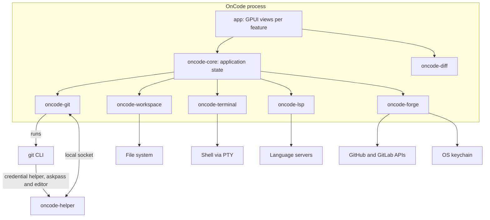
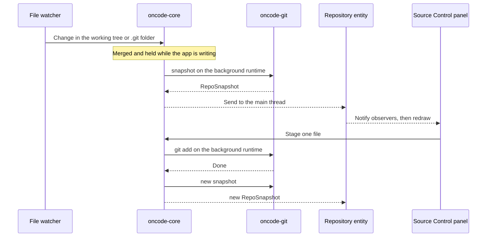
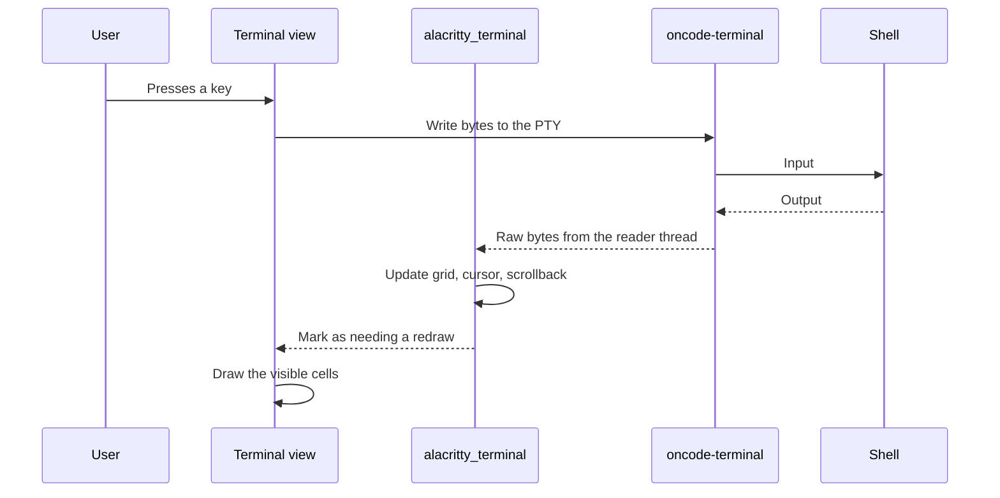
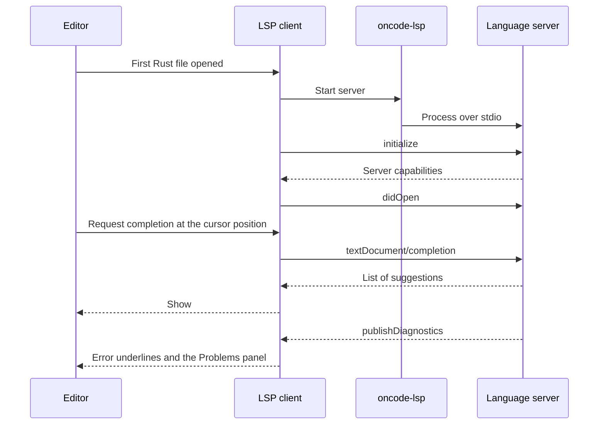

# OnCode Design Document (Native)

| | |
|---|---|
| **Status** | v1.0 — implemented (all features in place); deviations, measurement results, and what is still unverified are recorded in [section 15](#15-implementation-notes) |
| **Date** | November 18, 2026 |
| **Supersedes** | [Design v0.2 (Tauri + React)](archive/DESIGN-v0.2-tauri.md), which was implemented and tested |
| **Scope** | Product and technical design for OnCode as a native application |

OnCode is a desktop application for editing code that is simpler than Visual Studio Code, with **source control (Git) as its main feature**. This document redesigns OnCode as a **native** application: the entire UI is drawn directly on the GPU, with no WebView and no JavaScript.

## Table of Contents

1. [Summary](#1-summary)
2. [Requirements](#2-requirements)
3. [Technology Decisions](#3-technology-decisions)
4. [System Architecture](#4-system-architecture)
5. [UI Design](#5-ui-design)
6. [Git Module](#6-git-module)
7. [Self-Built Components](#7-self-built-components)
8. [Settings and Data Storage](#8-settings-and-data-storage)
9. [Security](#9-security)
10. [Testing Strategy](#10-testing-strategy)
11. [Build and Distribution](#11-build-and-distribution)
12. [Roadmap](#12-roadmap)
13. [Risks and Mitigations](#13-risks-and-mitigations)
14. [Glossary](#14-glossary)
15. [Implementation Notes](#15-implementation-notes)

---

## 1. Summary

### 1.1 Why the redesign

Version 0.2 was built with Tauri: a Rust backend and a UI made of web pages (React + CodeMirror) inside the operating system's WebView. It worked and was tested, but it **felt much heavier than a native editor such as Zed**. The cause is fundamental, not a matter of tuning: as soon as the app opens, a browser engine and its JavaScript engine come along with it, and every line of text, list, and panel is a DOM element.

This design replaces the entire view layer with a native, GPU-drawn UI. The layers underneath, namely the Rust crates for Git, files, the terminal (PTY), language servers, and GitHub/GitLab, are **reused**, because they never depended on Tauri in the first place.

### 1.2 Goals

1. **Lightweight.** Targets to be measured on a release build:

   | Measure | Target |
   |---|---|
   | Window ready to use (cold start) | < 300 ms |
   | Idle memory, one medium-sized project open | < 150 MB |
   | Scrolling and typing | 120 fps on a 120 Hz display, with no perceptible dropped frames |
   | Process count | One application process, plus the child processes that are actually needed (`git`, shell, language server) |

2. **Feature parity with v0.2.** No feature is lost except those explicitly named in [2.3](#23-intentional-differences-from-v02).
3. All v0.2 goals stay: full Git without typing commands, an editor good enough for real work, simplicity, cross-platform (Linux, Windows, macOS).

### 1.3 Non-goals

Unchanged from v0.2: no extension marketplace, debugger, remote development, notebooks, settings sync, AI features, or multi-root workspaces.

### 1.4 Decisions already made

| Topic | Decision |
|---|---|
| UI framework | GPUI with the `gpui-component` component library |
| Tauri version | Removed from the repository; not maintained side by side |
| Scope of the first native release | Full parity with v0.2, in one release |

---

## 2. Requirements

### 2.1 Functional requirements

The list below is the **parity list**: every item already exists in v0.2 and must exist in the first native release. The details are not repeated here; see section 2 of the [v0.2 design](archive/DESIGN-v0.2-tauri.md#2-requirements).

| Area | Items |
|---|---|
| Source control | Status; stage / unstage / discard per file, per hunk, per line; commit (amend, sign-off); side-by-side and unified diff; branches and merge; remote management; fetch / pull / push with a credential dialog (HTTPS and SSH); clone and init; graph with search; commit details and comparison of two commits; stash; tags; cherry-pick; revert; reset; blame; file history; conflict editor; interactive rebase; worktrees; submodules; reflog; Git Output |
| Editor and workspace | Explorer with Git markers; file operations (delete to trash); tabs and splits; syntax highlighting; find/replace; code folding; quick open; command palette; project-wide search and replace; detection of external changes; encoding and line endings preserved; tab restoration |
| Terminal | Integrated terminal in the project folder; multiple terminals; copy/paste; search; clickable links |
| LSP | Completion, hover, signature help, diagnostics and the Problems panel, go to definition, references, rename, format; per-language server configuration |
| GitHub and GitLab | Login (device flow and token), clone from an account, list / details / checkout / create pull requests, CI status |
| Framework | Restricted mode for untrusted folders; settings; `keybindings.json`; welcome screen; multiple windows |

The v0.2 end-to-end tests (34 scenarios in `e2e/`) become the **parity checklist**: every scenario must have an equivalent test in the native version (see [section 10](#10-testing-strategy)).

### 2.2 Non-functional requirements

| Aspect | Target |
|---|---|
| Performance | As in [1.2](#12-goals) |
| Installer size | < 40 MB (tree-sitter grammars for many languages add to the binary size) |
| Git status | Refresh < 300 ms on a repository with 50,000 files |
| Graph | Smooth on a history of 100,000 commits |
| Large files | Files up to 50 MB can be opened; heavy features are turned off above 5 MB |
| Reliability | No action discards work without explicit confirmation |
| Platforms | Linux (x86_64, aarch64; Wayland and X11), Windows 10/11 (x86_64), macOS 12+ |
| Graphics requirements | A GPU with Vulkan (Linux), DirectX 11 (Windows), or Metal (macOS); software rendering as a fallback where the system provides it |
| User prerequisites | Git ≥ 2.40; language servers are installed by the user |
| Interface language | English |

### 2.3 Intentional differences from v0.2

| Item | v0.2 | Native v1.0 | Reason |
|---|---|---|---|
| Editing inside the diff view | The right side of the working-tree diff could be edited | Read-only diff; an "Open File" button opens the file in the editor | The diff component used is read-only; building an editable diff is a large piece of work with little benefit |
| Pull request description | HTML rendered from Markdown, sanitized | Rendered as native rich text | There is no HTML any more, so the whole class of script-injection problems disappears |
| Multi-cursor | Yes | Yes (extra cursors and column selection built into the editor component) | Answered in N0; see [15.2](#152-n0-proof-results) |
| Rename across files (LSP) | Only the currently open files | All affected files | Editing is now done in Rust ([7.5](#75-lsp-client)) |

### 2.4 Still out of scope

"Parity" means parity with what **actually exists** in v0.2. The following do not exist in v0.2 and are not added in the first native release:

- Automatic updates and code signing (they require keys and certificates owned by the project owner).
- Hot exit: unsaved changes are not backed up when the app is closed.
- In the Graph: dragging a branch onto a branch, hash search, date filters.
- Inline review comments and merging pull requests from the app.
- Bisect, `git log -L`, dedicated LFS support, `.editorconfig`, image and Markdown previews.
- Splitting the editor in more than one direction at once.

---

## 3. Technology Decisions

### 3.1 Stack summary

Versions were checked on crates.io and docs.rs on the date of this document.

| Layer | Choice | Version | Notes |
|---|---|---|---|
| UI framework | GPUI | follows `gpui-component` | Apache-2.0. Pre-1.0; see [3.2](#32-gpui-and-gpui-component) |
| UI components | `gpui-component` | 0.10 | Apache-2.0; code editor, diff, dock, tabs, tree, virtual list, command palette, dialogs |
| Syntax highlighting | tree-sitter (via `gpui-component`) | 0.27 | ± 35 grammars available as optional features |
| Terminal emulation | `alacritty_terminal` | 0.26 | The view is built in-house ([7.4](#74-terminal)) |
| PTY | `portable-pty` (via `oncode-terminal`) | 0.9 | Already exists |
| Text diff | `imara-diff` | 0.2 | For change markers in the editor gutter |
| LSP protocol types | `lsp-types` | 0.97 | Same as the one `gpui-component` uses |
| File watching, search, index | `notify`, `grep-*`, `ignore`, `nucleo-matcher` (via `oncode-workspace`) | — | Already exist |
| HTTP and keychain | `reqwest`, `keyring` (via `oncode-forge`) | 0.13 / 4 | Already exist |
| Packaging | `cargo-packager` | 0.11 | deb, AppImage, NSIS, DMG |
| Language | Rust only | ≥ 1.88 | No more TypeScript, Node.js, or pnpm |

### 3.2 GPUI and `gpui-component`

GPUI is the UI framework built for the Zed editor: written in Rust, drawing through the GPU, and designed for text-dense interfaces.

**What to understand before depending on it:**

- GPUI is still pre-1.0 and its own documentation says breaking changes are frequent between versions.
- `gpui-component` 0.10 does not use the `gpui` release on crates.io (0.2.2) but a snapshot named `gpui-pre`. As a result, **the GPUI version we use is determined by `gpui-component`**, and other GPUI libraries outside that ecosystem are not guaranteed to be compatible.
- Both versions are pinned exactly (`=`) in `Cargo.toml`. Version bumps are done deliberately, one at a time, with the whole test suite run.

**What `gpui-component` already provides** (and therefore need not be built):

| Need | Component |
|---|---|
| Code editor | `input::Editor` on top of `EditorState`: UTF-8 rope, tree-sitter highlighting, code folding, search, gutter decorations, read-only mode, indentation |
| LSP hooks | `input::Lsp` with providers for completion, hover, definition, code actions, document colors, and semantic tokens |
| Diff | `diff::Diff`: read-only patch view, virtualized, side-by-side or unified mode, interactive gutter markers, line decorations, annotations |
| Layout | `dock`, `resizable`, `tab`, `TitleBar` |
| Lists and trees | `list` (including virtual list), `tree`, `table` |
| Overlays | `command` (command palette), `menu`, `native_menu`, `dialog`, `notification` |
| Rich text | `text`, for rendering the Markdown of pull request descriptions |
| Theme | `theme` |

### 3.3 Rejected alternatives

| Alternative | Reason rejected |
|---|---|
| Stay on Tauri and optimize (split bundles, limit live tabs) | Reduces the load but does not remove the WebView; it would not match a native app |
| Use Zed's own editor crates (`editor`, `terminal_view`, `project`) | Licensed GPL-3.0, so OnCode would have to be GPL too; moreover those crates are tightly bound to Zed's internal structure |
| Floem (the Lapce framework) | Fewer ready-made components; no equivalent diff, dock, or command palette component |
| Iced | Mature, but its text editor widget is basic: no LSP, code folding, or diff |
| Qt (C++/QML) | Would mean rewriting in C++ and connecting the Rust crates through FFI; the already-tested backend could not be used directly |

### 3.4 Git stays on the `git` CLI

The v0.2 decision is unchanged: all Git operations run through the system `git`, because only the CLI fully supports interactive rebase, worktrees, submodules, hooks, credential helpers, and signing. This layer already exists in `crates/oncode-git` together with its integration tests.

---

## 4. System Architecture

### 4.1 Component overview



The main difference from v0.2: **there is no IPC boundary any more**. Previously the frontend and backend talked through Tauri commands and events with data serialized to JSON; now the views call Rust functions directly, in the same process.

### 4.2 Directory structure

```
oncode/
├─ app/                          GPUI binary
│  └─ src/
│     ├─ main.rs
│     ├─ workbench/              Window, activity bar, sidebar, tabs, bottom panel, status bar
│     ├─ commands.rs             Command and keybinding registry
│     └─ features/
│        ├─ explorer/
│        ├─ editor/              File tabs, buffers, Git markers, blame
│        ├─ search/
│        ├─ scm/                 Source Control panel, diff, conflict editor
│        ├─ graph/               Graph, commit details, rebase dialog, reflog
│        ├─ terminal/
│        ├─ lsp/                 LSP providers for the editor, Problems panel
│        ├─ forge/               Accounts, pull requests
│        └─ settings/
├─ crates/
│  ├─ oncode-core/               NEW: application state without UI
│  ├─ oncode-diff/               NEW: diff chunks between two texts
│  ├─ oncode-git/                Unchanged
│  ├─ oncode-workspace/          Unchanged
│  ├─ oncode-terminal/           Unchanged
│  ├─ oncode-lsp/                Extended: JSON-RPC client
│  ├─ oncode-forge/              Unchanged
│  └─ oncode-helper/             Unchanged
└─ docs/
```

### 4.3 What is reused, moved, and removed

| v0.2 part | Fate | Notes |
|---|---|---|
| `crates/oncode-git`, `-workspace`, `-terminal`, `-forge`, `-helper` | **Reused as is** | Together with their ± 270 unit and integration tests |
| `crates/oncode-lsp` | **Extended** | The process manager and message framing stay; a JSON-RPC client is added ([7.5](#75-lsp-client)) |
| `src-tauri/src/state.rs`, `settings.rs`, `store.rs`, `tokens.rs` | **Moved** to `crates/oncode-core` | Logic for the repository registry, snapshot scheduling, folder trust, and token storage; the dependency on Tauri is removed |
| `src-tauri/src/commands/*` | **Removed** | Only IPC wrappers |
| `src/` (React, ± 17,000 lines) | **Rewritten** as `app/` | Its behavior is the reference; its code cannot be reused |
| Pure frontend logic (`scm/lines.ts`, `scm/conflictState.ts`, `graph/rebasePlan.ts`, `app/keybindings.ts`, search matching) | **Translated to Rust** together with its tests | Same rules, different language |
| `tauri-specta`, `src/ipc/bindings.ts`, CSP, capabilities | **Removed** | There is no IPC boundary or WebView any more |
| `e2e/` (WebDriver) | **Removed**; its scenarios become a checklist | WebDriver only applies to a WebView |

### 4.4 `oncode-core`: application state without UI

`oncode-core` holds all the state that does not depend on the views, so it can be tested without opening a window:

- **Repository registry** and **snapshot scheduling**: consecutive refresh requests are merged; while the app itself is writing, refresh is held back until it finishes (a rule from v0.2).
- **Workspace**: the folder root, trust status, file watcher, file index.
- **Requests to the user**: when `git` asks for credentials or a commit message through `oncode-helper`, `oncode-core` forwards the request to the UI over a channel and waits for the answer.
- **Cancellable operations**, settings, persisted data, and token storage with an in-memory fallback.

`oncode-core` broadcasts changes over channels; the `app` layer forwards them to GPUI entities.

### 4.5 Concurrency model

GPUI distinguishes two executors, and the division of work is strict:

| Where | What is done there |
|---|---|
| **Foreground** (main thread) | All entity updates and drawing. No blocking I/O allowed. |
| **Background** | Running `git`, reading and writing files, search, HTTP requests, output parsing |

The backend crates use `tokio`. Because GPUI has its own executor, `oncode-core` owns a separate `tokio` runtime; the views send work to it and receive the results on the main thread. This pattern was proven in stage N0 before features were built on it.



### 4.6 File buffers

In GPUI, editor state is an entity (`Entity<EditorState>`) and the view is just an element that refers to it. For that reason one file needs only **one** state entity, shared by all tabs and splits that show it. The cross-editor synchronization mechanism of v0.2 is no longer needed.

The buffer registry (in `app/features/editor`) maps paths to entities, counts usage, and keeps the last saved content, encoding, and line endings. The v0.2 rules remain: a clean buffer is reloaded when the file changes on disk; a buffer with changes is marked as conflicting and the user chooses.

---

## 5. UI Design

### 5.1 Layout

The layout is unchanged from v0.2; what changes is how it is drawn.

```
┌────┬──────────────────────┬──────────────────────────────────────────────────────┐
│ ▣  │ SOURCE CONTROL       │ main.rs ×   lib.rs   README.md ●                      │
│ ⌕  │                      ├──────────────────────────────────────────────────────┤
│ ⑂  │  (sidebar content    │                    Editor area                       │
│ ◉  │   follows the active │              (tabs, can be split)                    │
│ ⇄  │   icon)              ├──────────────────────────────────────────────────────┤
│ ▭  │                      │ TERMINAL   PROBLEMS   GIT OUTPUT                     │
│ ⚙  │                      │ $ cargo build                                        │
├────┴──────────────────────┴──────────────────────────────────────────────────────┤
│ ⑂ main  ↓2 ↑1   ✕ 0 ⚠ 3   ▭ Terminal                Ln 42, Col 7  UTF-8  LF  Rust │
└──────────────────────────────────────────────────────────────────────────────────┘
```

| Area | `gpui-component` component | Notes |
|---|---|---|
| Window frame, sidebar, editor area, bottom panel | `dock`, `resizable` | The sidebar and bottom panel can be collapsed |
| Editor tabs and panel tabs | `tab` | Preview tabs, unsaved marker, context menu |
| Explorer, change list, search results, ref list | `tree`, `list` (virtual) | |
| Command palette, quick open, branch picker | `command` | |
| Confirmation, input, and credential dialogs | `dialog` | |
| Context menus | `menu` | |
| Toasts | `notification` | |
| Title bar | `TitleBar` | |

The detailed wireframes for the Source Control panel, Graph, conflict editor, and rebase dialog in [v0.2 design section 5](archive/DESIGN-v0.2-tauri.md#5-uiux-design) **remain valid**.

### 5.2 What was learned from v0.2 and carried into this design

- **Every feature has a visible entry point.** In v0.2 the terminal could at first only be opened with a shortcut; now the "Terminal" button in the status bar and the panel button in the activity bar are part of the design.
- **The Graph must stay readable when narrow.** The author and hash columns are hidden first; the commit subject and ref badges are always visible.
- **Settings can be opened without a folder**, so the Git path can be fixed when Git is not found.

### 5.3 Commands, keybindings, and themes

- The command registry and the keybinding format (`Mod+Shift+P`, `keybindings.json`) are kept. GPUI has its own action and key-context system; our registry is mapped onto it, so users' files from v0.2 still apply.
- Two built-in themes (dark and light) plus follow-the-system, defined through `gpui-component`'s `theme`. Git colors (added, modified, deleted, conflict) and graph lane colors are defined once and used in the editor, lists, and terminal.

---

## 6. Git Module

The Git layer (`crates/oncode-git`) is **unchanged**. A summary of its contract, whose details are in [v0.2 design section 6](archive/DESIGN-v0.2-tauri.md#6-git-module) and in the code and its tests:

| Topic | What applies |
|---|---|
| Runner | Arguments as an array, fixed environment, per-repository write queue, cancellation, progress, logging to Git Output |
| Status | `git status --porcelain=v2 -z`; unfinished operations are detected from the Git directory |
| Partial staging | Line splice with content fingerprints of both sides, written via `hash-object` + `update-index` |
| Authentication | `oncode-helper` as `GIT_ASKPASS` and `SSH_ASKPASS`, and as the last `credential.helper` (`-c`), over a local socket with a one-time token. A logged-in GitHub/GitLab account only answers the credential helper, whose protocol and host arrive as separate fields and must match the account's scheme and host name. Askpass prompts always go to the user, because a user name in the URL can spoof the host in the prompt text |
| Interactive rebase | `oncode-helper` as the todo-list editor and message editor |
| Conflicts | The three versions from the index are re-merged with `git merge-file --diff3` into segments |
| Errors | Classified into codes (`pushRejected`, `noUpstream`, `dirtyWorkTree`, …) that determine the actions offered in the UI |
| Destructive actions | Always with a confirmation that says what will be lost; force push uses `--force-with-lease` |

### 6.1 One change: hunks come from Git

In v0.2, the web editor computed the difference between two texts itself, so the hunks on screen could differ from Git's hunks. In the native version the diff view receives a **patch from `git diff`** ([7.1](#71-diff-view)), so the hunks you see are Git's own hunks.

The staging model is still line splice: the chosen hunk or lines are translated into line ranges on the old and new sides, then applied by the existing `Repo::apply_splice`. The content fingerprint still makes sure the diff used is not stale. All that is added to `oncode-git` is a function to fetch a file's patch as text.

---

## 7. Self-Built Components

This section covers the work that no library provides. It is the core of the native version's work.

### 7.1 Diff view

Built on `gpui-component`'s `diff::Diff`, which shows a patch read-only in side-by-side or unified mode.

| Need | How it is met |
|---|---|
| Source | Text patch from `git diff` for the working tree, staged, a commit, a range, or a stash |
| Per-hunk actions (Stage / Unstage / Discard) | Interactive gutter marker at the start of each hunk |
| Actions on selected lines | The line selection from the diff state is translated into line ranges |
| Navigation between changes | Jump to the next / previous hunk |
| Binary and oversized files | A replacement view with the size of both sides and per-file actions |
| Editing | Not supported inside the diff; the "Open File" button ([2.3](#23-intentional-differences-from-v02)) |

Translating a selection into a line-splice operation is pure logic that is tested on its own, including cases that used to be fragile: files without a trailing newline, new files, and a partial line selection within one hunk.

**To be proven in N0:** whether `Diff`'s gutter markers and line selection are enough for per-hunk and per-line actions. If not, the diff view is built from two read-only `Editor`s with line decorations.

### 7.2 Conflict editor

The v0.2 model is kept: the backend returns segments that are either *already merged* or *conflicting (current, base, incoming)*.

- Three panes: Current (read-only), Result (editable), Incoming (read-only), each an `Editor`.
- The **conflict range model** is translated from `conflictState.ts` to Rust: each conflict has a range in the Result document that shifts as the text changes; choosing a side replaces its content and marks it resolved; a manual edit inside the range also marks it resolved.
- Pane labels use the actual branch or commit names.
- Non-text conflicts (binary, deleted on one side) use a simple view with a per-file choice.

`gpui-component` also has a type for conflicts inside its diff module. N0 checks whether it can replace part of this work.

### 7.3 Commit graph

- The data is unchanged: `oncode-git` streams `GraphRow`s per page, complete with column, color, and list of lines.
- The view: a virtualized uniform list, so only the visible rows are drawn.
- Each row draws its own slice of the graph using GPUI's drawing primitives: straight lines for passing lanes, curves for lanes that merge or branch, circles for commits (a hollow circle for a merge).
- The ref panel on the left and the detail panel on the right use `tree` and `list`.
- Context menus and the rebase dialog use the same actions as v0.2.

### 7.4 Terminal



- `alacritty_terminal` handles emulation: escape sequences, grid, scrollback, selection.
- The view is drawn per cell in a `canvas` (`grid.rs`, `paint.rs`): the background is the full line height, each text run is placed in its column with the glyph width forced to the cell width (glyphs from a fallback font do not shift columns), and ligatures are turned off. Box-drawing lines, blocks, and powerline separators are drawn as shapes (`glyphs.rs`) so they connect between lines whatever the line height is, like `customGlyphs` in xterm.js. The terminal font and line height can be set separately (`terminal.fontFamily`, `terminal.lineHeight`).
- Terminals can be split side by side in the panel and moved to the editor area as tabs; the panel owns all the terminals of that window and kills the ones that are no longer anywhere (`panel.rs`).
- The PTY, size, and flow control use the existing `oncode-terminal`.
- Application keys (palette, panel shortcuts) still reach the app; the rest go to the shell.
- Output search and clickable links, which used to be provided by xterm.js addons, are built in-house on top of the grid.

The `gpui-terminal` crate is not used: it does not yet support scrollback and selection, and it depends on a different GPUI version.

### 7.5 LSP client

In v0.2, LSP logic was handled by a JavaScript library. Now it is written in Rust.



- **Protocol layer** (`oncode-lsp`): request/response correlation, notifications, timeouts, and document synchronization (`didOpen`, `didChange`, `didClose`), with types from `lsp-types`. This layer does not depend on GPUI and is tested against a mock server.
- **Bridge to the editor** (`app/features/lsp`): implements the `Editor`'s provider traits for completion, hover, definition, and code actions. Those providers are held through `Rc`, so the bridge runs on the main thread and forwards requests to the client in the background.
- **Beyond the provider traits:** diagnostics, signature help, find references, rename, and format have no hooks in `Editor`, so the bridge handles them itself (including the signature help popup view). Cross-file rename can now change files that are not open, because editing is done in Rust.
- **Lifecycle** follows v0.2: one server per command per project, started when needed, restarted with a delay if it dies (bounded), and declared "not installed" if its command does not exist.

---

## 8. Settings and Data Storage

The file formats are **unchanged**, so v0.2 users need no migration:

| File | Contents |
|---|---|
| `settings.json` | Nested settings: `editor`, `files`, `workbench`, `git`, `terminal`, `lsp`, `forge` |
| `.oncode/settings.json` | Project-level overrides; applies only in trusted folders |
| `keybindings.json` | `{ "<command id>": "<shortcut>" }`; an empty value removes the shortcut |
| `state.json` | Last project, trusted folders, accounts, per-project session |
| OS keychain | Tokens; an in-memory fallback when the keychain is unavailable |

The `Settings` and `Store` modules and their tests are moved from `src-tauri` to `oncode-core`. The data directory location is now determined by us (previously by Tauri) and must be the same as the v0.2 location so old data can be read.

---

## 9. Security

**Still applies:**

- **Restricted mode.** An untrusted folder gets only the explorer, editor, and search. Git, LSP, and project settings that define commands are disabled.
- **Running processes.** Only `git`, the terminal shell, and the configured language servers; arguments are always arrays; ref names and paths are validated.
- **Secrets.** Tokens live only in the keychain or memory; they never become arguments, enter logs, or are displayed.
- **The `oncode-helper` socket** is restricted to the same user and protected by a one-time token.

**No longer relevant** because there is no WebView: CSP, Tauri capabilities, and HTML sanitization. External content (pull request descriptions, commit messages) is rendered as rich text with no ability to run scripts. Links inside it are still opened only in the system browser, and only for the `http` and `https` schemes.

---

## 10. Testing Strategy

### 10.1 What changes

| v0.2 tests | Count | Fate |
|---|---|---|
| Rust backend tests (unit, integration against real Git, property tests) | ± 320 | **Kept** |
| Application state tests in `src-tauri` | ± 20 | **Moved** to `oncode-core` |
| Frontend tests (Vitest) | 708 | **Gone** along with the React code; the pure logic is translated together with its tests |
| End-to-end tests (WebDriver) | 34 | **Gone**; the scenarios are rebuilt as GPUI view tests |

This is a real cost of the rewrite: for several stages, test coverage of the view layer is lower than in v0.2.

### 10.2 Test levels of the native version

| Level | Target | Tool |
|---|---|---|
| Backend unit and integration | As in v0.2 | `cargo test` |
| Pure UI logic | Translating diff selections into line ranges, the conflict range model, rebase plan validation, keybindings, graph geometry | `cargo test` |
| Application state | `oncode-core`: snapshot scheduling, folder trust, credential requests | `cargo test` |
| LSP client | Against a mock server, and against `typescript-language-server` when installed | `cargo test` |
| Views | User flows with simulated input, headless | `#[gpui::test]` with the GPUI test context |
| Manual | Per-OS checklist: display, IME, HiDPI, installers | Checklist document |

### 10.3 Parity checklist

Every v0.2 end-to-end scenario must have an equivalent view test before release:

| Group | Scenarios |
|---|---|
| Framework | Restricted mode until trusted; welcome screen and settings without a folder; `keybindings.json`; terminal and panel buttons; tab restoration |
| Editor | Open, edit, save, Git markers; reload on external change; blame |
| Search | Respects gitignore and jumps to the match; replace in open and closed files |
| Source control | Stage a hunk then commit; unstage and discard a hunk; stage selected lines; untracked files; move to trash; Git Output |
| Conflicts | Resolve via the conflict editor then continue; abort |
| Graph | History, refs, details; interactive rebase (squash, reword, drop); canceling the message dialog |
| Remote | Publish, fetch, diverged pull, push; switch and create branches; stash |
| Authentication | HTTP with a username and password dialog; wrong password and cancellation; SSH with host confirmation and passphrase |
| LSP | Diagnostics; completion; go to definition across files |
| GitHub/GitLab | Token login; device-flow login; list and details; push using the account token |
| Terminal | Running a command in the project folder |

The local servers used by the v0.2 tests (git smart-HTTP with Basic auth, a private `sshd`, mock GitHub and GitLab) are rewritten as Rust test tooling and reused.

---

## 11. Build and Distribution

### 11.1 Development prerequisites

- Rust (stable). Node.js and pnpm are no longer needed.
- Git ≥ 2.40.
- **Linux:** development libraries for Wayland, X11, xkbcommon, and fontconfig, plus the Vulkan loader. The exact package list was settled in stage N0 and is written in `docs/DEVELOPMENT.md`.
- **Windows:** Microsoft C++ Build Tools.
- **macOS:** Xcode with the Command Line Tools (GPUI uses Metal).

### 11.2 Commands

| Goal | Command |
|---|---|
| Run | `cargo run -p oncode` |
| All tests | `cargo test --workspace` |
| Release build | `cargo build --release -p oncode -p oncode-helper` |
| Installer | `cargo packager --release` |

### 11.3 Release packages

| OS | Format | Notes |
|---|---|---|
| Linux | AppImage, `.deb` | |
| Windows | NSIS installer | No longer depends on WebView2 |
| macOS | `.dmg` | Signed and notarized |

`oncode-helper` is packaged next to the main binary, as in v0.2. Automatic updates and code signing still require keys and certificates owned by the project owner.

---

## 12. Roadmap

The first native release contains all the features. The order below is the **order of work**, not the release order.

| Stage | Contents | Done when |
|---|---|---|
| **N0 Foundation and proof** | Commit and tag the Tauri version (`tauri-v0.2`), then delete `src/`, `src-tauri/`, `e2e/`, and the Node files. Create `app/` and `oncode-core`. Three proofs: (1) `Editor` opens, edits, and saves files, including an answer on multi-cursor; (2) an empty app builds and runs on Windows; (3) view tests run headless in CI. Plus a proof of the `tokio` runtime pattern next to the GPUI executor. | All three proofs answered; if any fails, this design is reviewed before continuing |
| **N1 Editor and workspace** | Window frame, commands and keybindings, explorer, tabs and splits, buffers, quick open, search and replace, settings, welcome screen, session | Usable for editing a real project without data loss |
| **N2 Core Git** | Source Control panel, diff view with per-hunk and per-line actions, commit, branches, fetch / pull / push, credential dialog, Git Output, restricted mode | Full daily workflow without a terminal |
| **N3 Advanced Git** | Graph, commit details, rebase dialog, conflict editor, stash, tags, blame, file history, reflog, worktrees, submodules | All Git scenarios in the checklist pass |
| **N4 Terminal** | Terminal view on top of `alacritty_terminal` | TUI programs run correctly on three OSes |
| **N5 LSP** | JSON-RPC client, bridge to the editor, Problems panel | LSP scenarios pass against a real server |
| **N6 GitHub and GitLab** | Accounts, clone from an account, list / details / checkout / create pull requests | Forge scenarios pass against a mock server |
| **N7 Release** | Installers for three OSes, measurement of the [1.2](#12-goals) targets, manual checklist | Performance targets measured and met, or the gap recorded |

N4, N5, and N6 do not depend on one another.

**Size of the work.** The v0.2 view layer amounts to ± 17,000 lines of TypeScript plus ± 9,000 lines of tests and ± 1,700 lines of end-to-end tests; all of it is rewritten. Thanks to ready-made components, the native version is expected to be no larger than that, but it is still the largest piece of work since the project began. A time estimate is deliberately not given before N0 is finished, because N0 is what shows how much the libraries really provide.

---

## 13. Risks and Mitigations

| Risk | Impact | Mitigation |
|---|---|---|
| GPUI is pre-1.0 and locked to the snapshot chosen by `gpui-component` | A version bump can break a lot of code; other GPUI libraries may not be compatible | Versions pinned exactly; version bumps as separate work; dependence on third-party GPUI libraries kept minimal |
| `Editor` does not support multi-cursor or other needs (IME, large files) | Fewer editor features than v0.2 | Proven in N0; the options: accept the gap and record it, contribute upstream, or fork |
| GPUI is less mature on Windows | Windows-specific display or performance bugs | The N0 proof covers Windows; manual Windows testing at each stage |
| Requires a GPU | Does not run on machines without Vulkan or DirectX 11, virtual machines, or remote sessions | Document the requirement; test with software rendering (e.g. lavapipe on Linux) |
| View test coverage drops during the rewrite | Regressions go uncaught | Parity checklist; pure logic translated together with its tests first; backend tests stay intact |
| The `Diff` component is not flexible enough for per-line actions | The diff work grows | Proven in N0; fallback of two read-only `Editor`s |
| No runnable app until N2 | Nothing usable day to day until then | The Tauri version is tagged before deletion and can be rebuilt from that tag |
| Binary size grows because of the tree-sitter grammars | The installer exceeds the target | Only common-language grammars are enabled; size is measured in N7 |
| `tokio` runtime alongside the GPUI executor | Deadlocks or updates on the wrong thread | One bridging pattern proven in N0 and used in all features |

---

## 14. Glossary

| Term | Meaning |
|---|---|
| **Entity** | A unit of GPUI-owned state that can be observed; views are redrawn when an entity they observe changes |
| **Foreground / background executor** | GPUI's task schedulers on the main thread and on background threads |
| **GPUI** | A Rust UI framework from the creators of Zed that draws through the GPU |
| **tree-sitter grammar** | A language's syntax definition for the tree-sitter parser; the basis for highlighting and code folding |
| **Hunk** | One block of adjacent changes in a diff |
| **Native** | An application that draws its own interface, with no browser engine |
| **Rope** | A text data structure that is efficient for editing large files |
| **Line splice** | OnCode's way of partial staging: replacing a range of lines on one side with a range of lines from the other side |
| **Snapshot (repository)** | A complete picture of the repository's state at one moment |

Git terms and other terms that are unchanged are in the [v0.2 glossary](archive/DESIGN-v0.2-tauri.md#14-glossary).

---

## 15. Implementation Notes

This section records what differs from the design above and what has or has not been proven, so the document stays in line with the code.

### 15.1 Deviations from the design

| Topic | Design | Implementation | Reason |
|---|---|---|---|
| UI dependency | `gpui-component` directly | `gpui-kit` =0.10.0, the official umbrella crate that re-exports GPUI, `gpui-base`, `gpui-component`, and icons | One dependency that pins the whole matching `gpui-pre-*` family |
| UI code structure | Modules `app/src/features/<feature>` | One crate per feature: `crates/oncode-ui` (framework) and `crates/oncode-ui-<feature>`; `app/` contains only `main` | Incremental compilation is much faster, and features can be worked on and tested separately |
| `oncode-diff` | A separate crate on top of `imara-diff` | Not created; text comparison uses `similar` inside `oncode-ui-diff` | `similar` is already a dependency of `gpui-component`; one crate fewer |
| File buffer | One `EditorState` shared by all splits | One `EditorState` per view; `Buffer` forwards every edit to the other states | Editor state holds the cursor and scroll position, so sharing state makes splitting the same file useless |
| Keybindings | Mapped onto GPUI's action system | A global keystroke interceptor (`intercept_keystrokes`) that looks commands up in the registry | Exactly the same behavior as v0.2 (`when`, overrides from `keybindings.json`) without rebuilding the GPUI keymap |
| `SettingsChanged` | — | `oncode-core` broadcasts the user settings once; each window computes its own effective settings | There is no longer a webview per window to send events to |
| Terminal data | — | `oncode-core` sends raw bytes from the PTY; emulation is done in the UI | The emulator (`alacritty_terminal`) needs bytes, not text |

### 15.2 N0 proof results

| Proof | Result |
|---|---|
| Editor opens, edits, saves; multi-cursor | **Proven.** The view test `crates/oncode-ui/tests/editor.rs` opens a file, types through the real input path, and saves to disk. Multi-cursor and column selection are built-in features of the editor component. |
| App builds and runs on Windows | **Partial.** Cross-compiling from Linux to `x86_64-pc-windows-gnu` successfully produced `oncode.exe` and `oncode-helper.exe`, both debug and release (release: `oncode.exe` 53 MB). The DirectX shaders for release are only compiled when the build runs on Windows (fxc.exe). The cross build uses a copy of `gpui-pre-windows` that embeds the shader source and compiles it when the app starts (see `.dev-sysroot/env-win.sh`); a build on Windows itself (CI, `release.yml`) does not need it. The first attempt used debug assertions and failed on Windows: GPUI's debug path reads shaders from the build machine's path, so the window did not open. The first installer also had no icon; now `app/build.rs` embeds `icons/icon.ico`. Window-open failures and panics are logged to `oncode.log` in the data folder (`%APPDATA%\dev.oncode.editor`). The fixed version has not yet been tried on Windows. |
| Headless view tests | **Proven.** `#[gpui_kit::test]` runs without a display server, with the real backend on a tokio thread. |
| `tokio` runtime next to the GPUI executor | **Proven.** The pattern is `oncode_ui::spawn_core`; used by all features. One pitfall: tests must not wait on GPUI timers (test time does not advance on its own). |
| Running without a GPU | The window shows in Xvfb with Mesa lavapipe (software Vulkan). |

### 15.3 Feature status

All feature crates are wired into the app (`app/src/main.rs`) and have headless view tests against the real backend. The whole workspace passes with no failures (`cargo test --workspace`, November 18, 2026, Linux: 825 tests pass, 0 fail). The combined test `app/tests/all_features.rs` runs all features together in one window.

| Feature | Crate | Equivalent v0.2 end-to-end scenarios already tested |
|---|---|---|
| Framework: window, tabs/splits, command palette, quick open, shortcuts, `keybindings.json`, session | `oncode-ui` | welcome screen; `keybindings.json`; tab restoration |
| File editor, save, reload from outside | `oncode-ui` | open/edit/save; external changes |
| Explorer, welcome screen, restricted mode | `oncode-ui-explorer` | restricted mode until trusted; Git markers in the explorer |
| Project search and replace | `oncode-ui-search` | search respects gitignore; replace in closed (disk) and open (via editor) files |
| Diff (stage/unstage/discard per hunk and line), conflict editor, gutter markers, blame | `oncode-ui-diff` | stage one hunk; unstage a hunk and discard a hunk with confirmation; stage selected lines and the unified view; resolve conflicts via the editor; blame |
| Source Control, commit, branches, remotes, stash, Git Output, clone, init | `oncode-ui-scm` | stage via the row button then commit; stage/unstage all; publish then sync with a diverged pull; stash/pop; create a branch; HTTP username/password dialog (including wrong password and cancel); SSH: host confirmation and passphrase, and host rejected; move an untracked file to the trash |
| Graph, commit details, interactive rebase, reflog, stash, worktrees, submodules | `oncode-ui-graph` | history and details; interactive rebase (ordering) |
| Terminal | `oncode-ui-terminal` | the terminal runs a command; shell keys are not hijacked by app shortcuts |
| LSP and Problems | `oncode-lsp`, `oncode-ui-lsp` | diagnostics and Problems; go to definition across files; rename in open and closed files |
| GitHub/GitLab | `oncode-ui-forge` | GitLab token login, MR list and details; GitHub device-flow login; push using the account token |
| Settings | `oncode-ui-settings` | settings persist; settings without a folder |

### 15.4 Different from v0.2 or not yet done

| Item | Notes |
|---|---|
| Blame | Shown for the cursor line in the status bar, not as a per-line annotation in the gutter: the editor component provides no per-line annotations. |
| Diagnostics underlines | Drawn only on files that have a syntax highlighter (a rule of the editor component); the Problems panel and status bar still contain everything. |
| Signature help | Not yet available; the editor component has no hook for it. |
| Terminal | No IME (text input goes through `key_char`), no mouse reporting to TUI programs, search through a dialog. |
| Interactive rebase | Order is changed with up/down buttons, without dragging. |
| Graph | Columns do not hide themselves when narrow. |
| v0.2 end-to-end tests | Every scenario has an equivalent headless view test, including moving an untracked file to the trash (`crates/oncode-ui-scm/tests/trash.rs`). Its test servers (git smart-HTTP with Basic auth, a private `sshd`, mock GitHub/GitLab) were rewritten in Rust. |
| `.deb` package | The package name is `on-code` (derived by the tool from the product name) and the Maintainer field is empty. |

### 15.5 Measurements

Release build, Linux, Xvfb virtual display with software Vulkan (lavapipe), no GPU:

| Measure | Target | Result |
|---|---|---|
| Window shown | < 300 ms | ± 85 ms (± 260 ms on the first run) |
| Idle memory, small project | < 150 MB | RSS ± 230 MB, but the app's private (anonymous) memory is only ± 58 MB. The rest is shared pages belonging to the software renderer: libLLVM 54 MB, driver libraries 30 MB, lavapipe/gallium 16 MB, graphics buffers ± 38 MB. With a real GPU that renderer is not loaded; the final figure needs to be measured there. |
| Binary / package size | installer < 40 MB | binary 67 MB, `.deb` 19 MB, AppImage 19 MB, NSIS installer 11 MB (from Linux, unsigned) |

### 15.6 Never run yet

The app on Windows (only cross-compiled) and macOS; login and API against the real github.com and gitlab.com; a real keychain; real language servers (tests use a mock server); performance with a real GPU; installing the NSIS installer on Windows; opening the DMG on a Mac. The Apple Silicon DMG (`OnCode_0.1.0_aarch64.dmg`, 53 MB, ad-hoc signed, not notarized) was built by cross-compiling from Linux using a third-party macOS SDK, Metal shaders compiled when the app starts, and `rust-lld`; it has never been opened on a Mac. There is no DMG for Intel Macs yet. The AppImage has been built and run in Xvfb without extra libraries; its window shows.
