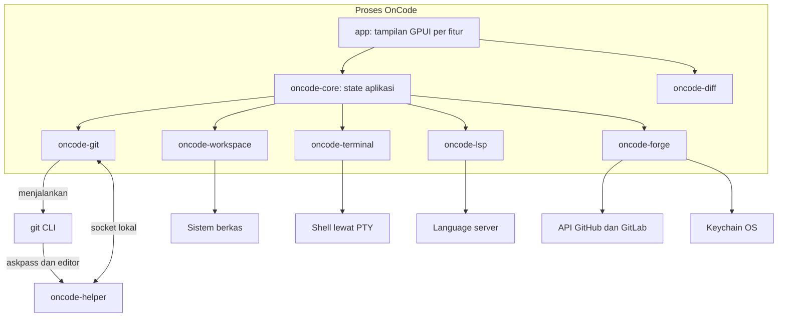
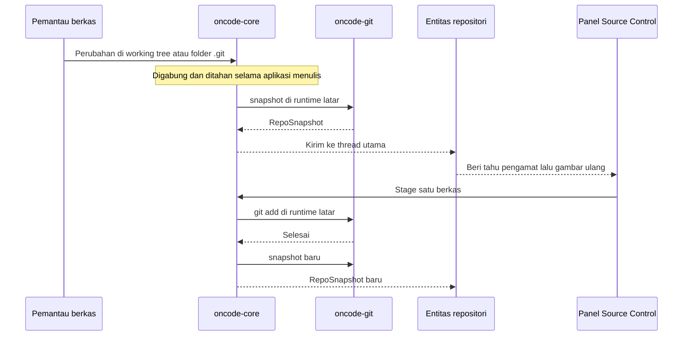
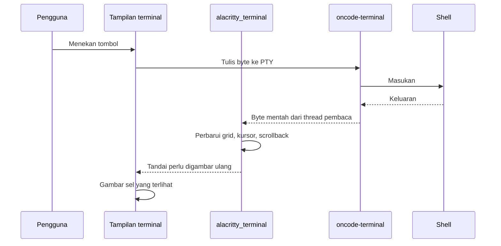
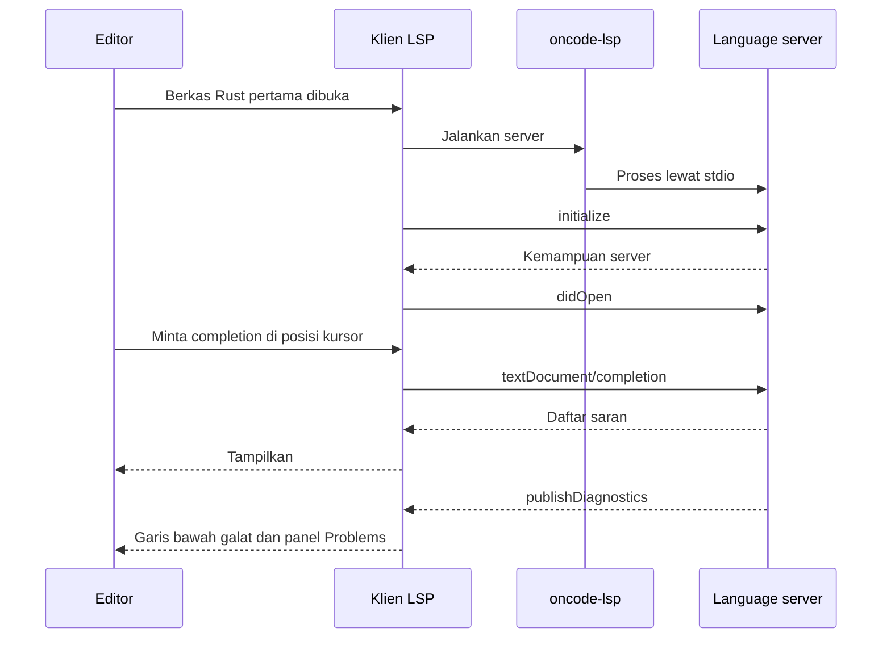

# Dokumen Rancangan OnCode (Native)

| | |
|---|---|
| **Status** | v1.0 — diimplementasikan (semua fitur terpasang); penyimpangan, hasil pengukuran, dan yang belum terverifikasi dicatat di [bagian 15](#15-catatan-implementasi) |
| **Tanggal** | 18 November 2026 |
| **Menggantikan** | [Rancangan v0.2 (Tauri + React)](arsip/RANCANGAN-v0.2-tauri.md), yang sudah diimplementasikan dan teruji |
| **Cakupan** | Rancangan produk dan teknis untuk OnCode sebagai aplikasi native |

OnCode adalah aplikasi desktop untuk menyunting kode yang lebih sederhana daripada Visual Studio Code, dengan **source control (Git) sebagai fitur utama**. Dokumen ini merancang ulang OnCode sebagai aplikasi **native**: seluruh tampilan digambar langsung lewat GPU, tanpa WebView dan tanpa JavaScript.

## Daftar Isi

1. [Ringkasan](#1-ringkasan)
2. [Kebutuhan](#2-kebutuhan)
3. [Keputusan Teknologi](#3-keputusan-teknologi)
4. [Arsitektur Sistem](#4-arsitektur-sistem)
5. [Rancangan UI](#5-rancangan-ui)
6. [Modul Git](#6-modul-git)
7. [Komponen yang Dibangun Sendiri](#7-komponen-yang-dibangun-sendiri)
8. [Pengaturan dan Penyimpanan Data](#8-pengaturan-dan-penyimpanan-data)
9. [Keamanan](#9-keamanan)
10. [Strategi Pengujian](#10-strategi-pengujian)
11. [Build dan Distribusi](#11-build-dan-distribusi)
12. [Roadmap](#12-roadmap)
13. [Risiko dan Mitigasi](#13-risiko-dan-mitigasi)
14. [Glosarium](#14-glosarium)
15. [Catatan Implementasi](#15-catatan-implementasi)

---

## 1. Ringkasan

### 1.1 Mengapa dirancang ulang

Versi 0.2 dibangun dengan Tauri: backend Rust dan tampilan berupa halaman web (React + CodeMirror) di dalam WebView milik sistem operasi. Versi itu berfungsi dan teruji, tetapi **terasa jauh lebih berat daripada editor native seperti Zed**. Penyebabnya mendasar, bukan soal penyetelan: begitu aplikasi dibuka, ikut berjalan sebuah mesin browser beserta mesin JavaScript-nya, dan setiap baris teks, daftar, dan panel adalah elemen DOM.

Rancangan ini mengganti seluruh lapisan tampilan dengan UI native yang digambar GPU. Lapisan di bawahnya, yaitu crate Rust untuk Git, berkas, terminal (PTY), language server, dan GitHub/GitLab, **dipakai ulang**, karena sejak awal tidak bergantung pada Tauri.

### 1.2 Tujuan

1. **Ringan.** Target yang akan diukur pada build rilis:

   | Ukuran | Target |
   |---|---|
   | Jendela siap dipakai (cold start) | < 300 ms |
   | Memori saat diam, satu proyek menengah terbuka | < 150 MB |
   | Gulir dan mengetik | 120 fps pada layar 120 Hz, tanpa frame yang terasa tersendat |
   | Jumlah proses | Satu proses aplikasi, ditambah proses anak yang memang diperlukan (`git`, shell, language server) |

2. **Setara fitur dengan v0.2.** Tidak ada fitur yang hilang kecuali yang disebut tegas di [2.3](#23-perbedaan-yang-disengaja-dari-v02).
3. Semua tujuan v0.2 tetap: Git lengkap tanpa mengetik perintah, editor yang cukup untuk kerja nyata, sederhana, lintas platform (Linux, Windows, macOS).

### 1.3 Non-tujuan

Tidak berubah dari v0.2: tanpa marketplace ekstensi, debugger, remote development, notebook, sinkronisasi pengaturan, fitur AI, dan workspace multi-root.

### 1.4 Keputusan yang sudah diambil

| Topik | Keputusan |
|---|---|
| Kerangka UI | GPUI dengan pustaka komponen `gpui-component` |
| Versi Tauri | Dihapus dari repositori; tidak dipelihara berdampingan |
| Lingkup rilis native pertama | Setara penuh dengan v0.2, dalam satu rilis |

---

## 2. Kebutuhan

### 2.1 Kebutuhan fungsional

Daftar di bawah adalah **daftar kesetaraan**: semua butir sudah ada di v0.2 dan wajib ada di rilis native pertama. Rinciannya tidak diulang di sini; lihat bagian 2 pada [rancangan v0.2](arsip/RANCANGAN-v0.2-tauri.md#2-kebutuhan).

| Area | Butir |
|---|---|
| Source control | Status; stage / unstage / discard per berkas, per hunk, per baris; commit (amend, sign-off); diff berdampingan dan unified; branch dan merge; kelola remote; fetch / pull / push dengan dialog kredensial (HTTPS dan SSH); clone dan init; graph dengan pencarian; detail commit dan perbandingan dua commit; stash; tag; cherry-pick; revert; reset; blame; riwayat berkas; editor konflik; interactive rebase; worktree; submodule; reflog; Git Output |
| Editor dan workspace | Explorer dengan penanda Git; operasi berkas (hapus ke tempat sampah); tab dan split; highlight sintaks; cari/ganti; lipat kode; quick open; command palette; pencarian dan penggantian di seluruh proyek; deteksi perubahan dari luar; encoding dan akhir baris dipertahankan; pemulihan tab |
| Terminal | Terminal terintegrasi di folder proyek; beberapa terminal; salin/tempel; pencarian; tautan bisa diklik |
| LSP | Completion, hover, signature help, diagnostics dan panel Problems, go to definition, references, rename, format; konfigurasi server per bahasa |
| GitHub dan GitLab | Login (device flow dan token), clone dari akun, daftar / detail / checkout / buat pull request, status CI |
| Kerangka | Mode terbatas untuk folder yang belum dipercaya; pengaturan; `keybindings.json`; layar awal; beberapa jendela |

Uji end-to-end v0.2 (34 skenario di `e2e/`) menjadi **daftar periksa kesetaraan**: setiap skenario harus punya padanan uji di versi native (lihat [bagian 10](#10-strategi-pengujian)).

### 2.2 Kebutuhan non-fungsional

| Aspek | Target |
|---|---|
| Kinerja | Seperti [1.2](#12-tujuan) |
| Ukuran installer | < 40 MB (grammar tree-sitter untuk banyak bahasa menambah ukuran binary) |
| Status Git | Refresh < 300 ms pada repositori 50.000 berkas |
| Graph | Lancar pada riwayat 100.000 commit |
| Berkas besar | Hingga 50 MB bisa dibuka; fitur berat dimatikan di atas 5 MB |
| Keandalan | Tidak ada aksi yang menghilangkan pekerjaan tanpa konfirmasi eksplisit |
| Platform | Linux (x86_64, aarch64; Wayland dan X11), Windows 10/11 (x86_64), macOS 12+ |
| Kebutuhan grafis | GPU dengan Vulkan (Linux), DirectX 11 (Windows), atau Metal (macOS); render perangkat lunak sebagai cadangan bila tersedia di sistem |
| Prasyarat pengguna | Git ≥ 2.40; language server dipasang sendiri |
| Bahasa antarmuka | Inggris |

### 2.3 Perbedaan yang disengaja dari v0.2

| Hal | v0.2 | Native v1.0 | Alasan |
|---|---|---|---|
| Menyunting di dalam tampilan diff | Sisi kanan diff working tree bisa disunting | Diff baca-saja; tombol "Open File" membuka berkas di editor | Komponen diff yang dipakai bersifat baca-saja; membuat diff yang bisa disunting adalah pekerjaan besar dengan manfaat kecil |
| Deskripsi pull request | HTML hasil Markdown, disanitasi | Dirender sebagai teks kaya native | Tidak ada lagi HTML, sehingga seluruh kelas masalah injeksi skrip hilang |
| Multi-kursor | Ada | Ada (kursor tambahan dan seleksi kolom bawaan komponen editor) | Terjawab di N0; lihat [15.2](#152-hasil-pembuktian-n0) |
| Rename lintas berkas (LSP) | Hanya berkas yang sedang terbuka | Semua berkas yang terdampak | Penyuntingan kini dilakukan di Rust ([7.5](#75-klien-lsp)) |

### 2.4 Yang tetap di luar lingkup

"Setara" berarti setara dengan yang **benar-benar ada** di v0.2. Hal berikut belum ada di v0.2 dan tidak ditambahkan di rilis native pertama:

- Pembaruan otomatis dan penandatanganan kode (memerlukan kunci dan sertifikat milik pemilik proyek).
- Hot exit: perubahan yang belum disimpan tidak dicadangkan saat aplikasi ditutup.
- Di Graph: menyeret branch ke branch, pencarian hash, filter tanggal.
- Komentar review inline dan merge pull request dari aplikasi.
- Bisect, `git log -L`, dukungan LFS khusus, `.editorconfig`, pratinjau gambar dan Markdown.
- Split editor ke lebih dari satu arah sekaligus.

---

## 3. Keputusan Teknologi

### 3.1 Ringkasan stack

Versi diperiksa di crates.io dan docs.rs pada tanggal dokumen ini.

| Lapisan | Pilihan | Versi | Catatan |
|---|---|---|---|
| Kerangka UI | GPUI | mengikuti `gpui-component` | Apache-2.0. Pra-1.0; lihat [3.2](#32-gpui-dan-gpui-component) |
| Komponen UI | `gpui-component` | 0.10 | Apache-2.0; editor kode, diff, dock, tab, tree, daftar virtual, command palette, dialog |
| Highlight sintaks | tree-sitter (lewat `gpui-component`) | 0.27 | ± 35 grammar tersedia sebagai fitur opsional |
| Emulasi terminal | `alacritty_terminal` | 0.26 | Tampilannya dibuat sendiri ([7.4](#74-terminal)) |
| PTY | `portable-pty` (lewat `oncode-terminal`) | 0.9 | Sudah ada |
| Diff teks | `imara-diff` | 0.2 | Untuk penanda perubahan di gutter editor |
| Tipe protokol LSP | `lsp-types` | 0.97 | Sama dengan yang dipakai `gpui-component` |
| Pemantau berkas, pencarian, indeks | `notify`, `grep-*`, `ignore`, `nucleo-matcher` (lewat `oncode-workspace`) | — | Sudah ada |
| HTTP dan keychain | `reqwest`, `keyring` (lewat `oncode-forge`) | 0.13 / 4 | Sudah ada |
| Pengemasan | `cargo-packager` | 0.11 | deb, AppImage, NSIS, DMG |
| Bahasa | Rust saja | ≥ 1.88 | Tidak ada lagi TypeScript, Node.js, atau pnpm |

### 3.2 GPUI dan `gpui-component`

GPUI adalah kerangka UI yang dibuat untuk editor Zed: ditulis dalam Rust, menggambar lewat GPU, dan dirancang untuk antarmuka padat teks.

**Yang perlu dipahami sebelum bergantung padanya:**

- GPUI masih pra-1.0 dan dokumentasinya sendiri menyatakan perubahan yang merusak kompatibilitas sering terjadi antarversi.
- `gpui-component` 0.10 tidak memakai rilis `gpui` di crates.io (0.2.2), melainkan snapshot bernama `gpui-pre`. Akibatnya **versi GPUI yang kita pakai ditentukan oleh `gpui-component`**, dan pustaka GPUI lain di luar ekosistem itu belum tentu cocok.
- Versi keduanya dikunci persis (`=`) di `Cargo.toml`. Kenaikan versi dilakukan sengaja, satu per satu, dengan seluruh uji dijalankan.

**Yang sudah disediakan `gpui-component`** (dan karena itu tidak perlu dibuat):

| Kebutuhan | Komponen |
|---|---|
| Editor kode | `input::Editor` di atas `EditorState`: rope UTF-8, highlight tree-sitter, lipat kode, pencarian, dekorasi gutter, mode baca-saja, indentasi |
| Kait LSP | `input::Lsp` dengan penyedia completion, hover, definition, code action, warna dokumen, dan semantic token |
| Diff | `diff::Diff`: tampilan patch baca-saja, tervirtualisasi, mode berdampingan atau unified, penanda gutter interaktif, dekorasi baris, anotasi |
| Tata letak | `dock`, `resizable`, `tab`, `TitleBar` |
| Daftar dan pohon | `list` (termasuk daftar virtual), `tree`, `table` |
| Lapisan atas | `command` (command palette), `menu`, `native_menu`, `dialog`, `notification` |
| Teks kaya | `text`, untuk merender Markdown deskripsi pull request |
| Tema | `theme` |

### 3.3 Alternatif yang ditolak

| Alternatif | Alasan ditolak |
|---|---|
| Tetap di Tauri dan mengoptimalkan (memecah bundel, membatasi tab hidup) | Mengurangi beban, tetapi tidak menghilangkan WebView; tidak akan menyamai aplikasi native |
| Memakai crate editor milik Zed (`editor`, `terminal_view`, `project`) | Berlisensi GPL-3.0, sehingga OnCode harus ikut GPL; selain itu crate-crate tersebut terikat erat pada struktur internal Zed |
| Floem (kerangka Lapce) | Lebih sedikit komponen siap pakai; tidak ada komponen diff, dock, atau command palette yang setara |
| Iced | Matang, tetapi widget editor teksnya dasar: tanpa LSP, lipat kode, atau diff |
| Qt (C++/QML) | Berarti menulis ulang dalam C++ dan menghubungkan crate Rust lewat FFI; backend yang sudah teruji tidak bisa dipakai langsung |

### 3.4 Git tetap lewat `git` CLI

Keputusan v0.2 tidak berubah: semua operasi Git dijalankan lewat `git` milik sistem, karena hanya CLI yang mendukung penuh interactive rebase, worktree, submodule, hooks, credential helper, dan signing. Lapisan ini sudah ada di `crates/oncode-git` beserta uji integrasinya.

---

## 4. Arsitektur Sistem

### 4.1 Gambaran komponen



Perbedaan utama dari v0.2: **tidak ada lagi batas IPC**. Dulu frontend dan backend berbicara lewat command dan event Tauri dengan data yang diserialisasi ke JSON; sekarang tampilan memanggil fungsi Rust secara langsung, di proses yang sama.

### 4.2 Struktur direktori

```
oncode/
├─ app/                          Binary GPUI
│  └─ src/
│     ├─ main.rs
│     ├─ workbench/              Jendela, activity bar, sidebar, tab, panel bawah, status bar
│     ├─ commands.rs             Registry command dan keybinding
│     └─ features/
│        ├─ explorer/
│        ├─ editor/              Tab berkas, buffer, penanda Git, blame
│        ├─ search/
│        ├─ scm/                 Panel Source Control, diff, editor konflik
│        ├─ graph/               Graph, detail commit, dialog rebase, reflog
│        ├─ terminal/
│        ├─ lsp/                 Penyedia LSP untuk editor, panel Problems
│        ├─ forge/               Akun, pull request
│        └─ settings/
├─ crates/
│  ├─ oncode-core/               BARU: state aplikasi tanpa UI
│  ├─ oncode-diff/               BARU: chunk diff antara dua teks
│  ├─ oncode-git/                Tetap
│  ├─ oncode-workspace/          Tetap
│  ├─ oncode-terminal/           Tetap
│  ├─ oncode-lsp/                Diperluas: klien JSON-RPC
│  ├─ oncode-forge/              Tetap
│  └─ oncode-helper/             Tetap
└─ docs/
```

### 4.3 Yang dipakai ulang, dipindahkan, dan dihapus

| Bagian v0.2 | Nasib | Keterangan |
|---|---|---|
| `crates/oncode-git`, `-workspace`, `-terminal`, `-forge`, `-helper` | **Dipakai ulang apa adanya** | Beserta ± 270 uji unit dan integrasinya |
| `crates/oncode-lsp` | **Diperluas** | Pengelola proses dan pembingkai pesan tetap; ditambah klien JSON-RPC ([7.5](#75-klien-lsp)) |
| `src-tauri/src/state.rs`, `settings.rs`, `store.rs`, `tokens.rs` | **Dipindahkan** ke `crates/oncode-core` | Logika registry repositori, penjadwalan snapshot, kepercayaan folder, penyimpanan token; ketergantungan pada Tauri dilepas |
| `src-tauri/src/commands/*` | **Dihapus** | Hanya pembungkus IPC |
| `src/` (React, ± 17.000 baris) | **Ditulis ulang** sebagai `app/` | Perilakunya menjadi acuan; kodenya tidak bisa dipakai |
| Logika murni di frontend (`scm/lines.ts`, `scm/conflictState.ts`, `graph/rebasePlan.ts`, `app/keybindings.ts`, pencocokan pencarian) | **Diterjemahkan ke Rust** beserta ujinya | Aturan yang sama, bahasa berbeda |
| `tauri-specta`, `src/ipc/bindings.ts`, CSP, capability | **Dihapus** | Tidak ada lagi batas IPC maupun WebView |
| `e2e/` (WebDriver) | **Dihapus**; skenarionya menjadi daftar periksa | WebDriver hanya berlaku untuk WebView |

### 4.4 `oncode-core`: state aplikasi tanpa UI

`oncode-core` memuat semua state yang tidak bergantung pada tampilan, sehingga bisa diuji tanpa membuka jendela:

- **Registry repositori** dan **penjadwalan snapshot**: permintaan refresh beruntun digabung; selama aplikasi sendiri menulis, refresh ditahan sampai selesai (aturan dari v0.2).
- **Workspace**: akar folder, status kepercayaan, pemantau berkas, indeks berkas.
- **Permintaan ke pengguna**: saat `git` meminta kredensial atau pesan commit lewat `oncode-helper`, `oncode-core` meneruskannya ke UI lewat sebuah kanal dan menunggu jawabannya.
- **Operasi yang bisa dibatalkan**, pengaturan, data tersimpan, dan penyimpanan token dengan cadangan memori.

`oncode-core` menyiarkan perubahan lewat kanal; lapisan `app` meneruskannya ke entitas GPUI.

### 4.5 Model konkurensi

GPUI membedakan dua eksekutor, dan pembagian kerjanya tegas:

| Tempat | Yang dikerjakan |
|---|---|
| **Foreground** (thread utama) | Semua pembaruan entitas dan penggambaran. Tidak boleh ada I/O yang menunggu. |
| **Background** | Menjalankan `git`, membaca dan menulis berkas, pencarian, permintaan HTTP, parsing keluaran |

Crate backend memakai `tokio`. Karena GPUI punya eksekutornya sendiri, `oncode-core` memiliki satu runtime `tokio` tersendiri; tampilan mengirim pekerjaan ke sana dan menerima hasilnya di thread utama. Pola ini dibuktikan di tahap N0 sebelum fitur dibangun di atasnya.



### 4.6 Buffer berkas

Di GPUI, state editor adalah entitas (`Entity<EditorState>`) dan tampilan hanyalah elemen yang merujuknya. Karena itu satu berkas cukup punya **satu** entitas state yang dipakai bersama oleh semua tab dan split yang menampilkannya. Mekanisme sinkronisasi antar-editor di v0.2 tidak diperlukan lagi.

Registry buffer (di `app/features/editor`) memetakan path ke entitas, menghitung pemakaian, dan menyimpan isi tersimpan terakhir, encoding, dan akhir baris. Aturan v0.2 tetap: buffer bersih dimuat ulang saat berkas berubah di disk; buffer berisi perubahan ditandai konflik dan pengguna memilih.

---

## 5. Rancangan UI

### 5.1 Tata letak

Tata letak tidak berubah dari v0.2; yang berubah adalah cara menggambarnya.

```
┌────┬──────────────────────┬──────────────────────────────────────────────────────┐
│ ▣  │ SOURCE CONTROL       │ main.rs ×   lib.rs   README.md ●                      │
│ ⌕  │                      ├──────────────────────────────────────────────────────┤
│ ⑂  │  (isi sidebar sesuai │                    Area editor                       │
│ ◉  │   ikon yang aktif)   │              (tab, bisa di-split)                    │
│ ⇄  │                      ├──────────────────────────────────────────────────────┤
│ ▭  │                      │ TERMINAL   PROBLEMS   GIT OUTPUT                     │
│ ⚙  │                      │ $ cargo build                                        │
├────┴──────────────────────┴──────────────────────────────────────────────────────┤
│ ⑂ main  ↓2 ↑1   ✕ 0 ⚠ 3   ▭ Terminal                Ln 42, Col 7  UTF-8  LF  Rust │
└──────────────────────────────────────────────────────────────────────────────────┘
```

| Area | Komponen `gpui-component` | Catatan |
|---|---|---|
| Kerangka jendela, sidebar, area editor, panel bawah | `dock`, `resizable` | Sidebar dan panel bawah bisa diciutkan |
| Tab editor dan tab panel | `tab` | Tab pratinjau, penanda belum-disimpan, menu konteks |
| Explorer, daftar perubahan, hasil pencarian, daftar ref | `tree`, `list` (virtual) | |
| Command palette, quick open, pemilih branch | `command` | |
| Dialog konfirmasi, masukan, kredensial | `dialog` | |
| Menu konteks | `menu` | |
| Toast | `notification` | |
| Bilah judul | `TitleBar` | |

Wireframe rinci untuk panel Source Control, Graph, editor konflik, dan dialog rebase di [rancangan v0.2 bagian 5](arsip/RANCANGAN-v0.2-tauri.md#5-rancangan-uiux) **tetap berlaku**.

### 5.2 Hal yang dipelajari dari v0.2 dan dibawa ke rancangan ini

- **Setiap fitur punya pintu masuk yang terlihat.** Terminal di v0.2 awalnya hanya bisa dibuka lewat pintasan; sekarang tombol "Terminal" di status bar dan tombol panel di activity bar adalah bagian dari rancangan.
- **Graph harus tetap terbaca saat sempit.** Kolom penulis dan hash disembunyikan lebih dulu; subjek commit dan lencana ref selalu terlihat.
- **Pengaturan bisa dibuka tanpa folder**, agar path Git bisa diperbaiki saat Git tidak ditemukan.

### 5.3 Command, keybinding, dan tema

- Registry command dan format keybinding (`Mod+Shift+P`, `keybindings.json`) dipertahankan. GPUI punya sistem aksi dan konteks tombolnya sendiri; registry kita dipetakan ke sana, sehingga berkas pengguna dari v0.2 tetap berlaku.
- Dua tema bawaan (gelap dan terang) plus mengikuti sistem, didefinisikan lewat `theme` milik `gpui-component`. Warna Git (ditambah, diubah, dihapus, konflik) dan warna jalur graph didefinisikan sekali dan dipakai di editor, daftar, dan terminal.

---

## 6. Modul Git

Lapisan Git (`crates/oncode-git`) **tidak berubah**. Ringkasan kontraknya, yang rinciannya ada di [rancangan v0.2 bagian 6](arsip/RANCANGAN-v0.2-tauri.md#6-modul-git) dan di kode beserta ujinya:

| Topik | Yang berlaku |
|---|---|
| Runner | Argumen berupa array, lingkungan tetap, antrean tulis per repositori, pembatalan, progres, pencatatan ke Git Output |
| Status | `git status --porcelain=v2 -z`; operasi yang belum selesai dideteksi dari direktori Git |
| Staging parsial | Sambung-potong baris dengan sidik isi kedua sisi, ditulis lewat `hash-object` + `update-index` |
| Autentikasi | `oncode-helper` sebagai `GIT_ASKPASS` dan `SSH_ASKPASS`, socket lokal dengan token sekali pakai |
| Interactive rebase | `oncode-helper` sebagai editor urutan dan editor pesan |
| Konflik | Tiga versi dari index digabung ulang dengan `git merge-file --diff3` menjadi segmen |
| Galat | Diklasifikasi menjadi kode (`pushRejected`, `noUpstream`, `dirtyWorkTree`, …) yang menentukan tawaran aksi di UI |
| Aksi destruktif | Selalu dengan konfirmasi yang menyebut apa yang hilang; force push memakai `--force-with-lease` |

### 6.1 Satu perubahan: hunk berasal dari Git

Di v0.2, editor web menghitung sendiri perbedaan dua teks, sehingga hunk di layar bisa berbeda dari hunk versi Git. Di versi native, tampilan diff menerima **patch dari `git diff`** ([7.1](#71-tampilan-diff)), sehingga hunk yang terlihat adalah hunk milik Git.

Model staging tetap sambung-potong baris: hunk atau baris yang dipilih diterjemahkan menjadi rentang baris sisi lama dan sisi baru, lalu diterapkan oleh `Repo::apply_splice` yang sudah ada. Sidik isi tetap memastikan diff yang dipakai belum usang. Yang ditambahkan ke `oncode-git` hanya fungsi untuk mengambil patch sebuah berkas dalam bentuk teks.

---

## 7. Komponen yang Dibangun Sendiri

Bagian ini memuat pekerjaan yang tidak disediakan pustaka. Inilah inti pekerjaan versi native.

### 7.1 Tampilan diff

Dibangun di atas `diff::Diff` milik `gpui-component`, yang menampilkan patch secara baca-saja dalam mode berdampingan atau unified.

| Kebutuhan | Cara memenuhinya |
|---|---|
| Sumber | Patch teks dari `git diff` untuk working tree, staged, commit, rentang, atau stash |
| Aksi per hunk (Stage / Unstage / Discard) | Penanda gutter interaktif di awal tiap hunk |
| Aksi pada baris terpilih | Pilihan baris dari state diff diterjemahkan menjadi rentang baris |
| Navigasi antarperubahan | Lompat ke hunk berikut / sebelumnya |
| Berkas biner dan terlalu besar | Tampilan pengganti dengan ukuran kedua sisi dan aksi per berkas |
| Menyunting | Tidak didukung di dalam diff; tombol "Open File" ([2.3](#23-perbedaan-yang-disengaja-dari-v02)) |

Penerjemahan pilihan menjadi operasi sambung-potong adalah logika murni yang diuji tersendiri, termasuk kasus yang dulu rawan: berkas tanpa newline di akhir, berkas baru, dan pilihan sebagian baris dalam satu hunk.

**Yang perlu dibuktikan di N0:** apakah penanda gutter dan pilihan baris milik `Diff` cukup untuk aksi per hunk dan per baris. Bila tidak, tampilan diff dibangun dari dua `Editor` baca-saja dengan dekorasi baris.

### 7.2 Editor konflik

Model dari v0.2 dipertahankan: backend mengembalikan segmen *sudah tergabung* atau *konflik (current, base, incoming)*.

- Tiga panel: Current (baca-saja), Result (bisa disunting), Incoming (baca-saja), masing-masing sebuah `Editor`.
- **Model rentang konflik** diterjemahkan dari `conflictState.ts` ke Rust: tiap konflik punya rentang di dokumen Result yang ikut bergeser saat teks berubah; memilih sisi mengganti isinya dan menandainya selesai; suntingan manual di dalam rentang juga menandainya selesai.
- Label panel memakai nama branch atau commit yang sebenarnya.
- Konflik non-teks (biner, dihapus di satu sisi) memakai tampilan sederhana dengan pilihan per berkas.

`gpui-component` juga punya tipe untuk konflik di dalam modul diff-nya. Di N0 diperiksa apakah itu bisa menggantikan sebagian pekerjaan ini.

### 7.3 Graph commit

- Data tidak berubah: `oncode-git` mengalirkan `GraphRow` per halaman, lengkap dengan kolom, warna, dan daftar garis.
- Tampilan: daftar seragam tervirtualisasi, sehingga hanya baris yang terlihat yang digambar.
- Tiap baris menggambar potongan graph-nya sendiri dengan primitif gambar GPUI: garis lurus untuk jalur yang lewat, kurva untuk jalur yang menyatu atau bercabang, lingkaran untuk commit (lingkaran kosong untuk merge).
- Panel ref di kiri dan panel detail di kanan memakai `tree` dan `list`.
- Menu konteks dan dialog rebase memakai aksi yang sama dengan v0.2.

### 7.4 Terminal



- `alacritty_terminal` menangani emulasi: urutan escape, grid, scrollback, seleksi.
- Tampilannya digambar per sel di sebuah `canvas` (`grid.rs`, `paint.rs`): latar setinggi baris penuh, tiap potongan teks diletakkan di kolomnya dengan lebar huruf dipaksa selebar sel (huruf dari font cadangan tidak menggeser kolom), dan ligatur dimatikan. Garis kotak, blok, dan pemisah powerline digambar sebagai bentuk (`glyphs.rs`) agar menyambung antar baris berapa pun tinggi barisnya, seperti `customGlyphs` di xterm.js. Font dan tinggi baris terminal bisa diatur sendiri (`terminal.fontFamily`, `terminal.lineHeight`).
- Terminal bisa dibelah berdampingan di panel dan dipindah ke area editor sebagai tab; panel memiliki semua terminal jendela itu dan mematikan yang tidak lagi ada di mana pun (`panel.rs`).
- PTY, ukuran, dan kendali aliran memakai `oncode-terminal` yang sudah ada.
- Tombol aplikasi (palet, pintasan panel) tetap sampai ke aplikasi; sisanya ke shell.
- Pencarian di keluaran dan tautan yang bisa diklik, yang dulu disediakan addon xterm.js, dibuat sendiri di atas grid.

Crate `gpui-terminal` tidak dipakai: belum mendukung scrollback dan seleksi, dan bergantung pada versi GPUI yang berbeda.

### 7.5 Klien LSP

Di v0.2 logika LSP ditangani pustaka JavaScript. Sekarang ditulis dalam Rust.



- **Lapisan protokol** (`oncode-lsp`): korelasi permintaan dan jawaban, notifikasi, batas waktu, dan sinkronisasi dokumen (`didOpen`, `didChange`, `didClose`), dengan tipe dari `lsp-types`. Lapisan ini tidak bergantung pada GPUI dan diuji dengan server tiruan.
- **Jembatan ke editor** (`app/features/lsp`): mengimplementasikan trait penyedia milik `Editor` untuk completion, hover, definition, dan code action. Penyedia itu dipegang lewat `Rc`, jadi jembatan berjalan di thread utama dan meneruskan permintaan ke klien di latar.
- **Di luar trait penyedia:** diagnostics, signature help, find references, rename, dan format tidak punya kait di `Editor`, jadi ditangani jembatan sendiri (termasuk tampilan popup signature help). Rename lintas berkas kini bisa mengubah berkas yang tidak sedang terbuka, karena penyuntingan dilakukan di Rust.
- **Siklus hidup** mengikuti v0.2: satu server per perintah per proyek, dimulai saat diperlukan, dimulai ulang dengan jeda bila mati (dibatasi), dan dinyatakan "belum terpasang" bila perintahnya tidak ada.

---

## 8. Pengaturan dan Penyimpanan Data

Format berkas **tidak berubah**, sehingga pengguna v0.2 tidak perlu migrasi:

| Berkas | Isi |
|---|---|
| `settings.json` | Pengaturan bersarang: `editor`, `files`, `workbench`, `git`, `terminal`, `lsp`, `forge` |
| `.oncode/settings.json` | Penimpaan tingkat proyek; hanya berlaku pada folder yang dipercaya |
| `keybindings.json` | `{ "<id command>": "<pintasan>" }`; daftar kosong menghapus pintasan |
| `state.json` | Proyek terakhir, folder yang dipercaya, akun, sesi per proyek |
| Keychain OS | Token; cadangan di memori bila keychain tidak tersedia |

Modul `Settings` dan `Store` beserta ujinya dipindahkan dari `src-tauri` ke `oncode-core`. Lokasi direktori data ditentukan sendiri (dulu oleh Tauri) dan harus sama dengan lokasi v0.2 agar data lama terbaca.

---

## 9. Keamanan

**Tetap berlaku:**

- **Mode terbatas.** Folder yang belum dipercaya hanya mendapat explorer, editor, dan pencarian. Git, LSP, dan pengaturan proyek yang menentukan perintah dinonaktifkan.
- **Menjalankan proses.** Hanya `git`, shell terminal, dan language server yang dikonfigurasi; argumen selalu array; nama ref dan path divalidasi.
- **Rahasia.** Token hanya di keychain atau memori; tidak pernah menjadi argumen, masuk log, atau ditampilkan.
- **Socket `oncode-helper`** dibatasi untuk pengguna yang sama dan dilindungi token sekali pakai.

**Tidak lagi relevan** karena tidak ada WebView: CSP, capability Tauri, dan sanitasi HTML. Konten dari luar (deskripsi pull request, pesan commit) dirender sebagai teks kaya tanpa kemampuan menjalankan skrip. Tautan di dalamnya tetap hanya dibuka di browser sistem, dan hanya untuk skema `http` dan `https`.

---

## 10. Strategi Pengujian

### 10.1 Yang berubah

| Uji v0.2 | Jumlah | Nasib |
|---|---|---|
| Uji backend Rust (unit, integrasi terhadap Git sungguhan, property test) | ± 320 | **Tetap** |
| Uji state aplikasi di `src-tauri` | ± 20 | **Dipindahkan** ke `oncode-core` |
| Uji frontend (Vitest) | 708 | **Hilang** bersama kode React; logika murninya diterjemahkan beserta ujinya |
| Uji end-to-end (WebDriver) | 34 | **Hilang**; skenarionya dibangun ulang sebagai uji tampilan GPUI |

Ini harga yang nyata dari penulisan ulang: selama beberapa tahap, cakupan uji lapisan tampilan lebih rendah daripada v0.2.

### 10.2 Tingkat uji versi native

| Tingkat | Sasaran | Alat |
|---|---|---|
| Unit dan integrasi backend | Seperti v0.2 | `cargo test` |
| Logika murni UI | Penerjemahan pilihan diff ke rentang baris, model rentang konflik, validasi rencana rebase, keybinding, geometri graph | `cargo test` |
| State aplikasi | `oncode-core`: penjadwalan snapshot, kepercayaan folder, permintaan kredensial | `cargo test` |
| Klien LSP | Terhadap server tiruan, dan terhadap `typescript-language-server` bila terpasang | `cargo test` |
| Tampilan | Alur pengguna dengan masukan yang disimulasikan, tanpa layar | `#[gpui::test]` dengan konteks uji GPUI |
| Manual | Daftar periksa per OS: tampilan, IME, HiDPI, installer | Dokumen daftar periksa |

### 10.3 Daftar periksa kesetaraan

Setiap skenario end-to-end v0.2 harus punya padanan uji tampilan sebelum rilis:

| Kelompok | Skenario |
|---|---|
| Kerangka | Mode terbatas sampai dipercaya; layar awal dan pengaturan tanpa folder; `keybindings.json`; tombol terminal dan panel; pemulihan tab |
| Editor | Buka, sunting, simpan, penanda Git; muat ulang saat berubah dari luar; blame |
| Pencarian | Menghormati gitignore dan lompat ke kecocokan; ganti di berkas terbuka dan tertutup |
| Source control | Stage hunk lalu commit; unstage dan discard hunk; stage baris terpilih; untracked; buang ke tempat sampah; Git Output |
| Konflik | Selesaikan lewat editor konflik lalu lanjutkan; abort |
| Graph | Riwayat, ref, detail; interactive rebase (squash, reword, drop); pembatalan dialog pesan |
| Remote | Publish, fetch, pull bercabang, push; ganti dan buat branch; stash |
| Autentikasi | HTTP dengan dialog username dan password; password salah dan pembatalan; SSH dengan konfirmasi host dan passphrase |
| LSP | Diagnostics; completion; go to definition lintas berkas |
| GitHub/GitLab | Login token; login device flow; daftar dan detail; push memakai token akun |
| Terminal | Menjalankan perintah di folder proyek |

Server lokal yang dipakai uji v0.2 (git smart-HTTP dengan Basic auth, `sshd` pribadi, GitHub dan GitLab tiruan) ditulis ulang sebagai perkakas uji Rust dan dipakai lagi.

---

## 11. Build dan Distribusi

### 11.1 Prasyarat pengembangan

- Rust (stable). Node.js dan pnpm tidak diperlukan lagi.
- Git ≥ 2.40.
- **Linux:** pustaka pengembangan untuk Wayland, X11, xkbcommon, dan fontconfig, serta loader Vulkan. Daftar paket persisnya ditetapkan di tahap N0 dan ditulis di `docs/PENGEMBANGAN.md`.
- **Windows:** Microsoft C++ Build Tools.
- **macOS:** Xcode beserta Command Line Tools (GPUI memakai Metal).

### 11.2 Perintah

| Tujuan | Perintah |
|---|---|
| Menjalankan | `cargo run -p oncode` |
| Semua uji | `cargo test --workspace` |
| Build rilis | `cargo build --release -p oncode -p oncode-helper` |
| Installer | `cargo packager --release` |

### 11.3 Paket rilis

| OS | Format | Catatan |
|---|---|---|
| Linux | AppImage, `.deb` | |
| Windows | Installer NSIS | Tidak lagi bergantung pada WebView2 |
| macOS | `.dmg` | Ditandatangani dan dinotarisasi |

`oncode-helper` dikemas di samping binary utama, seperti di v0.2. Pembaruan otomatis dan penandatanganan kode tetap memerlukan kunci dan sertifikat milik pemilik proyek.

---

## 12. Roadmap

Rilis native pertama memuat semua fitur. Urutan di bawah adalah **urutan pengerjaan**, bukan urutan rilis.

| Tahap | Isi | Selesai bila |
|---|---|---|
| **N0 Fondasi dan pembuktian** | Commit dan tag versi Tauri (`tauri-v0.2`), lalu hapus `src/`, `src-tauri/`, `e2e/`, dan berkas Node. Buat `app/` dan `oncode-core`. Tiga pembuktian: (1) `Editor` membuka, menyunting, dan menyimpan berkas, termasuk jawaban soal multi-kursor; (2) aplikasi kosong terbangun dan berjalan di Windows; (3) uji tampilan berjalan tanpa layar di CI. Ditambah pembuktian pola runtime `tokio` di samping eksekutor GPUI. | Ketiga pembuktian terjawab; bila salah satunya gagal, rancangan ini ditinjau ulang sebelum lanjut |
| **N1 Editor dan workspace** | Kerangka jendela, command dan keybinding, explorer, tab dan split, buffer, quick open, pencarian dan penggantian, pengaturan, layar awal, sesi | Bisa dipakai menyunting proyek nyata tanpa kehilangan data |
| **N2 Git inti** | Panel Source Control, tampilan diff dengan aksi per hunk dan per baris, commit, branch, fetch / pull / push, dialog kredensial, Git Output, mode terbatas | Alur harian lengkap tanpa terminal |
| **N3 Git lanjut** | Graph, detail commit, dialog rebase, editor konflik, stash, tag, blame, riwayat berkas, reflog, worktree, submodule | Semua skenario Git di daftar periksa lolos |
| **N4 Terminal** | Tampilan terminal di atas `alacritty_terminal` | Program TUI berjalan benar di tiga OS |
| **N5 LSP** | Klien JSON-RPC, jembatan ke editor, panel Problems | Skenario LSP lolos terhadap server sungguhan |
| **N6 GitHub dan GitLab** | Akun, clone dari akun, daftar / detail / checkout / buat pull request | Skenario forge lolos terhadap server tiruan |
| **N7 Rilis** | Installer tiga OS, pengukuran target [1.2](#12-tujuan), daftar periksa manual | Target kinerja terukur dan tercapai, atau selisihnya dicatat |

N4, N5, dan N6 tidak saling bergantung.

**Ukuran pekerjaan.** Lapisan tampilan v0.2 berjumlah ± 17.000 baris TypeScript ditambah ± 9.000 baris uji dan ± 1.700 baris uji end-to-end; semuanya ditulis ulang. Berkat komponen siap pakai, versi native diperkirakan tidak lebih besar dari itu, tetapi ini tetap pekerjaan terbesar sejak proyek dimulai. Perkiraan waktu sengaja tidak diberikan sebelum N0 selesai, karena N0-lah yang menunjukkan seberapa banyak yang benar-benar disediakan pustaka.

---

## 13. Risiko dan Mitigasi

| Risiko | Dampak | Mitigasi |
|---|---|---|
| GPUI pra-1.0 dan terkunci pada snapshot yang dipilih `gpui-component` | Kenaikan versi bisa merusak banyak kode; pustaka GPUI lain belum tentu cocok | Versi dikunci persis; kenaikan versi sebagai pekerjaan tersendiri; ketergantungan pada pustaka GPUI pihak ketiga dijaga minimal |
| `Editor` tidak mendukung multi-kursor atau kebutuhan lain (IME, berkas besar) | Fitur editor v0.2 berkurang | Dibuktikan di N0; pilihannya: menerima kekurangan dan mencatatnya, menyumbang ke hulu, atau membuat fork |
| GPUI di Windows kurang matang | Bug tampilan atau kinerja khusus Windows | Pembuktian N0 mencakup Windows; uji manual Windows di tiap tahap |
| Membutuhkan GPU | Tidak jalan di mesin tanpa Vulkan atau DirectX 11, mesin virtual, atau sesi jarak jauh | Mendokumentasikan kebutuhan; menguji dengan render perangkat lunak (mis. lavapipe di Linux) |
| Cakupan uji tampilan turun selama penulisan ulang | Regresi tidak tertangkap | Daftar periksa kesetaraan; logika murni diterjemahkan beserta ujinya lebih dulu; uji backend tetap utuh |
| Komponen `Diff` tidak cukup lentur untuk aksi per baris | Pekerjaan diff membesar | Dibuktikan di N0; cadangan dua `Editor` baca-saja |
| Tidak ada aplikasi yang bisa dijalankan sampai N2 | Tidak ada yang bisa dipakai sehari-hari selama itu | Versi Tauri diberi tag sebelum dihapus dan bisa dibangun kembali dari tag itu |
| Ukuran binary membesar karena grammar tree-sitter | Installer melebihi target | Hanya grammar bahasa umum yang diaktifkan; ukurannya diukur di N7 |
| Runtime `tokio` berdampingan dengan eksekutor GPUI | Kebuntuan atau pembaruan di thread yang salah | Satu pola jembatan yang dibuktikan di N0 dan dipakai di semua fitur |

---

## 14. Glosarium

| Istilah | Arti |
|---|---|
| **Entitas** | Unit state milik GPUI yang bisa diamati; tampilan digambar ulang saat entitas yang diamatinya berubah |
| **Eksekutor foreground / background** | Penjadwal tugas GPUI di thread utama dan di thread latar |
| **GPUI** | Kerangka UI Rust buatan pengembang Zed yang menggambar lewat GPU |
| **Grammar tree-sitter** | Definisi sintaks sebuah bahasa untuk parser tree-sitter; dasar highlight dan lipat kode |
| **Hunk** | Satu blok perubahan yang berdekatan dalam sebuah diff |
| **Native** | Aplikasi yang menggambar antarmukanya sendiri, tanpa mesin browser |
| **Rope** | Struktur data teks yang efisien untuk penyuntingan berkas besar |
| **Sambung-potong baris** | Cara staging parsial OnCode: mengganti rentang baris satu sisi dengan rentang baris sisi lain |
| **Snapshot (repositori)** | Gambaran utuh keadaan repositori pada satu saat |

Istilah Git dan istilah lain yang tidak berubah ada di [glosarium v0.2](arsip/RANCANGAN-v0.2-tauri.md#14-glosarium).

---

## 15. Catatan Implementasi

Bagian ini mencatat apa yang berbeda dari rancangan di atas dan apa yang sudah atau belum terbukti, agar dokumen tetap sesuai dengan kode.

### 15.1 Penyimpangan dari rancangan

| Topik | Rancangan | Implementasi | Alasan |
|---|---|---|---|
| Dependensi UI | `gpui-component` langsung | `gpui-kit` =0.10.0, crate payung resmi yang mengekspor ulang GPUI, `gpui-base`, `gpui-component`, dan ikon | Satu dependensi yang mengunci seluruh keluarga `gpui-pre-*` yang cocok |
| Struktur kode UI | Modul `app/src/features/<fitur>` | Satu crate per fitur: `crates/oncode-ui` (kerangka) dan `crates/oncode-ui-<fitur>`; `app/` hanya berisi `main` | Kompilasi bertahap jauh lebih cepat, dan fitur bisa dikerjakan serta diuji terpisah |
| `oncode-diff` | Crate tersendiri di atas `imara-diff` | Tidak dibuat; perbandingan teks memakai `similar` di dalam `oncode-ui-diff` | `similar` sudah menjadi dependensi `gpui-component`; satu crate lebih sedikit |
| Buffer berkas | Satu `EditorState` dipakai bersama semua split | Satu `EditorState` per tampilan; `Buffer` meneruskan setiap suntingan ke state lain | State editor memuat kursor dan gulir, jadi berbagi state membuat split berkas yang sama tidak berguna |
| Keybinding | Dipetakan ke sistem aksi GPUI | Penyadap tombol global (`intercept_keystrokes`) yang mencari command di registry | Perilakunya sama persis dengan v0.2 (`when`, penimpaan dari `keybindings.json`) tanpa menyusun ulang keymap GPUI |
| `SettingsChanged` | — | `oncode-core` menyiarkan pengaturan pengguna sekali; tiap jendela menghitung pengaturan efektifnya sendiri | Tidak ada lagi webview per jendela yang dikirimi event |
| Data terminal | — | `oncode-core` mengirim byte mentah dari PTY; emulasi dilakukan di UI | Emulator (`alacritty_terminal`) butuh byte, bukan teks |

### 15.2 Hasil pembuktian N0

| Pembuktian | Hasil |
|---|---|
| Editor membuka, menyunting, menyimpan; multi-kursor | **Terbukti.** Uji tampilan `crates/oncode-ui/tests/editor.rs` membuka berkas, mengetik lewat jalur masukan sungguhan, dan menyimpan ke disk. Multi-kursor dan seleksi kolom adalah fitur bawaan komponen editor. |
| Aplikasi terbangun dan berjalan di Windows | **Sebagian.** Kompilasi silang dari Linux ke `x86_64-pc-windows-gnu` berhasil menghasilkan `oncode.exe` dan `oncode-helper.exe`, baik debug maupun rilis (rilis: `oncode.exe` 53 MB). Shader DirectX untuk rilis hanya dikompilasi bila build berjalan di Windows (fxc.exe). Build silang memakai salinan `gpui-pre-windows` yang menanam sumber shader dan mengompilasinya saat aplikasi mulai (lihat `.dev-sysroot/env-win.sh`); build di Windows sendiri (CI, `release.yml`) tidak memerlukannya. Percobaan pertama memakai debug-assertions dan gagal di Windows: jalur debug GPUI membaca shader dari path mesin build, sehingga jendela tidak terbuka. Installer pertama juga belum punya ikon; kini `app/build.rs` menyematkan `icons/icon.ico`. Kegagalan membuka jendela dan panic dicatat ke `oncode.log` di folder data (`%APPDATA%\dev.oncode.editor`). Versi perbaikan belum dicoba di Windows. |
| Uji tampilan tanpa layar | **Terbukti.** `#[gpui_kit::test]` berjalan tanpa server tampilan, dengan backend sungguhan di thread tokio. |
| Runtime `tokio` di samping eksekutor GPUI | **Terbukti.** Polanya `oncode_ui::spawn_core`; dipakai semua fitur. Satu jebakan: uji tidak boleh menunggu pewaktu GPUI (waktu uji tidak berjalan sendiri). |
| Menjalankan tanpa GPU | Jendela tampil di Xvfb dengan Mesa lavapipe (Vulkan perangkat lunak). |

### 15.3 Keadaan fitur

Semua crate fitur terpasang di aplikasi (`app/src/main.rs`) dan punya uji tampilan tanpa layar terhadap backend sungguhan. Seluruh workspace lolos tanpa kegagalan (`cargo test --workspace`, 18 November 2026, Linux: 825 uji lolos, 0 gagal). Uji gabungan `app/tests/all_features.rs` menjalankan semua fitur bersamaan dalam satu jendela.

| Fitur | Crate | Padanan skenario end-to-end v0.2 yang sudah diuji |
|---|---|---|
| Kerangka: jendela, tab/split, command palette, quick open, pintasan, `keybindings.json`, sesi | `oncode-ui` | layar awal; `keybindings.json`; pemulihan tab |
| Editor berkas, simpan, muat ulang dari luar | `oncode-ui` | buka/sunting/simpan; perubahan dari luar |
| Explorer, layar awal, mode terbatas | `oncode-ui-explorer` | mode terbatas sampai dipercaya; penanda Git di explorer |
| Pencarian dan penggantian proyek | `oncode-ui-search` | pencarian menghormati gitignore; penggantian di berkas tertutup (disk) dan terbuka (lewat editor) |
| Diff (stage/unstage/discard per hunk dan baris), editor konflik, penanda gutter, blame | `oncode-ui-diff` | stage satu hunk; unstage hunk dan discard hunk dengan konfirmasi; stage baris terpilih dan tampilan unified; selesaikan konflik lewat editor; blame |
| Source Control, commit, branch, remote, stash, Git Output, clone, init | `oncode-ui-scm` | stage lewat tombol baris lalu commit; stage/unstage semua; publish lalu sync dengan pull bercabang; stash/pop; buat branch; dialog username/password HTTP (juga password salah dan batal); SSH: konfirmasi host dan passphrase, juga host ditolak; buang berkas untracked ke tempat sampah |
| Graph, detail commit, interactive rebase, reflog, stash, worktree, submodule | `oncode-ui-graph` | riwayat dan detail; interactive rebase (urutan) |
| Terminal | `oncode-ui-terminal` | terminal menjalankan perintah; tombol shell tidak direbut pintasan aplikasi |
| LSP dan Problems | `oncode-lsp`, `oncode-ui-lsp` | diagnostics dan Problems; go to definition lintas berkas; rename berkas terbuka dan tertutup |
| GitHub/GitLab | `oncode-ui-forge` | login token GitLab, daftar dan detail MR; login device flow GitHub; push memakai token akun |
| Pengaturan | `oncode-ui-settings` | pengaturan tersimpan; pengaturan tanpa folder |

### 15.4 Berbeda dari v0.2 atau belum dikerjakan

| Hal | Keterangan |
|---|---|
| Blame | Ditampilkan untuk baris kursor di status bar, bukan sebagai anotasi per baris di gutter: komponen editor tidak menyediakan anotasi per baris. |
| Garis bawah diagnostics | Hanya tergambar pada berkas yang punya highlighter sintaks (aturan komponen editor); panel Problems dan status bar tetap memuat semuanya. |
| Signature help | Belum ada; komponen editor tidak punya kaitnya. |
| Terminal | Tanpa IME (masukan teks lewat `key_char`), tanpa laporan tetikus ke program TUI, pencarian lewat dialog. |
| Interactive rebase | Urutan diubah dengan tombol naik/turun, tanpa seret. |
| Graph | Kolom tidak menyembunyikan diri saat sempit. |
| Uji end-to-end v0.2 | Semua skenario sudah punya padanan berupa uji tampilan tanpa layar, termasuk buang berkas untracked ke tempat sampah (`crates/oncode-ui-scm/tests/trash.rs`). Server ujinya (git smart-HTTP dengan Basic auth, `sshd` pribadi, GitHub/GitLab tiruan) ditulis ulang dalam Rust. |
| Paket `.deb` | Nama paketnya `on-code` (diturunkan perkakas dari nama produk) dan kolom Maintainer kosong. |

### 15.5 Pengukuran

Build rilis, Linux, layar virtual Xvfb dengan Vulkan perangkat lunak (lavapipe), tanpa GPU:

| Ukuran | Target | Hasil |
|---|---|---|
| Jendela tampil | < 300 ms | ± 85 ms (± 260 ms pada jalan pertama) |
| Memori saat diam, proyek kecil | < 150 MB | RSS ± 230 MB, tetapi memori pribadi aplikasi (anonim) hanya ± 58 MB. Sisanya halaman bersama milik renderer perangkat lunak: libLLVM 54 MB, pustaka driver 30 MB, lavapipe/gallium 16 MB, buffer grafis ± 38 MB. Dengan GPU sungguhan renderer itu tidak dimuat; angka akhirnya perlu diukur di sana. |
| Ukuran binary / paket | installer < 40 MB | binary 67 MB, `.deb` 19 MB, AppImage 19 MB, installer NSIS 11 MB (dari Linux, tanpa tanda tangan) |

### 15.6 Belum pernah dijalankan

Aplikasi di Windows (hanya dikompilasi silang) dan macOS; login dan API terhadap github.com dan gitlab.com sungguhan; keychain sungguhan; language server sungguhan (uji memakai server tiruan); kinerja dengan GPU sungguhan; memasang installer NSIS di Windows; membuka DMG di Mac. DMG Apple Silicon (`OnCode_0.1.0_aarch64.dmg`, 53 MB, tanda tangan ad-hoc, tanpa notarisasi) dibuat dengan kompilasi silang dari Linux memakai macOS SDK pihak ketiga, shader Metal yang dikompilasi saat aplikasi mulai, dan `rust-lld`; belum pernah dibuka di Mac. Belum ada DMG untuk Mac Intel. AppImage sudah dibuat dan dijalankan di Xvfb tanpa pustaka tambahan; jendelanya tampil.
