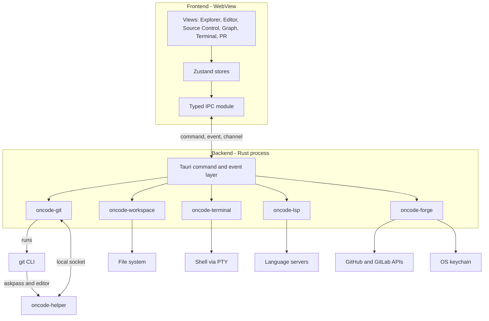
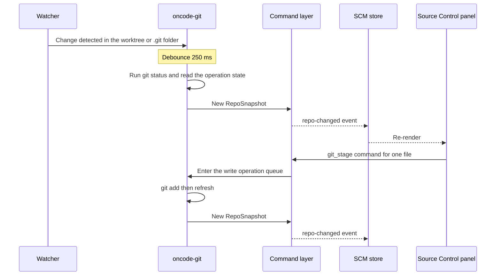
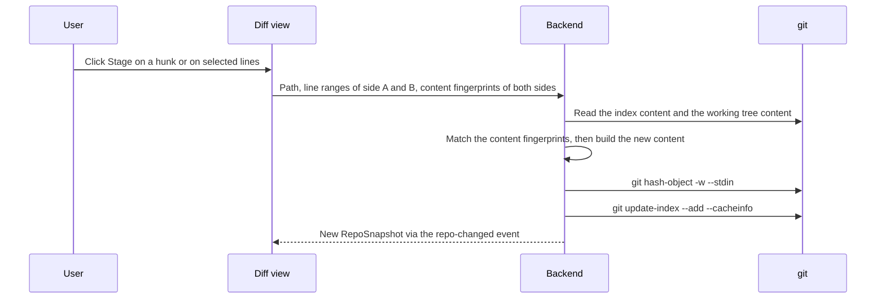
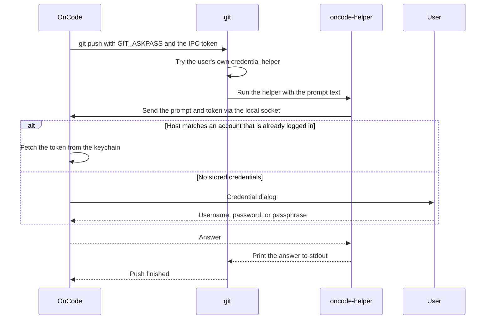
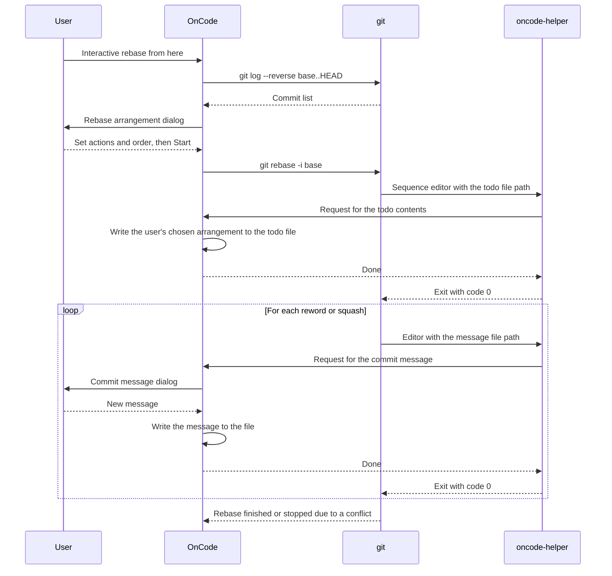
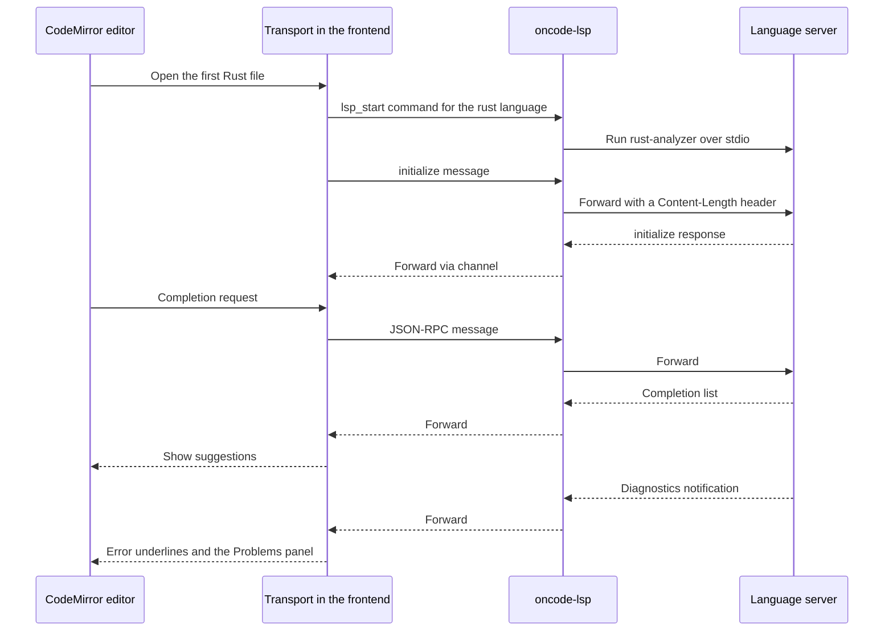

# OnCode Design Document (v0.2, Tauri)

> **Archived.** This document describes the Tauri + React version and has been superseded by the [native version design](../DESIGN.md). Its contents are still referenced as a record of behavior that has been implemented and tested.

| | |
|---|---|
| **Status** | v0.2 — implemented; deviations from the original design are recorded in [section 15](#15-implementation-notes) |
| **Date** | November 17, 2026 |
| **Scope** | Product and technical design for version 1.0 |

OnCode is a desktop code editor that is simpler than Visual Studio Code, with **source control (Git) as its main feature**. This document serves as the implementation reference: what is built, with what technology, how each part works, and in what order the work is done.

## Table of Contents

1. [Summary](#1-summary)
2. [Requirements](#2-requirements)
3. [Technology Decisions](#3-technology-decisions)
4. [System Architecture](#4-system-architecture)
5. [UI/UX Design](#5-uiux-design)
6. [Git Module](#6-git-module)
7. [Other Modules](#7-other-modules)
8. [Settings and Data Storage](#8-settings-and-data-storage)
9. [Security](#9-security)
10. [Testing Strategy](#10-testing-strategy)
11. [Build and Distribution](#11-build-and-distribution)
12. [Roadmap](#12-roadmap)
13. [Risks and Mitigations](#13-risks-and-mitigations)
14. [Glossary](#14-glossary)
15. [Implementation Notes](#15-implementation-notes)

---

## 1. Summary

### 1.1 Background

VS Code is very complete, but that completeness comes with complexity: thousands of settings, an extension system, and limited built-in Git features, so many people still open a separate Git client (GitKraken, Fork, Sourcetree) to view the graph, perform an interactive rebase, or resolve conflicts.

OnCode combines those two things in one lightweight application: **a code editor that is sufficient** and **a complete Git client**.

### 1.2 Goals

1. All day-to-day Git work, up to the advanced level, can be done without leaving the app and without typing commands.
2. An editor that is comfortable for real work: syntax highlighting, tabs, search, terminal, and code intelligence via LSP.
3. Lightweight: small installer, fast to open, memory-efficient.
4. Runs on Linux, Windows, and macOS with the same behavior.
5. Simple: few settings, sensible defaults, no extension system.

### 1.3 Non-goals

The following are **intentionally not built** to keep the app simple:

- Marketplace or extension API
- Debugger
- Remote development (SSH, container, WSL)
- Notebook
- Settings sync across devices
- AI features
- Multi-root workspace (one window opens one folder)

### 1.4 Target users

Developers who work with Git every day and want a single lightweight tool for editing code and managing repositories at the same time, without having to memorize advanced Git commands.

---

## 2. Requirements

Priorities: **P0** required for the MVP, **P1** required for v1.0, **P2** after v1.0.

### 2.1 Functional requirements

#### Source control (main feature)

| ID | Requirement | Priority |
|---|---|---|
| G-01 | View change status: staged, unstaged, untracked, conflicts | P0 |
| G-02 | Stage, unstage, and discard per file, per hunk, and per line | P0 |
| G-03 | Commit with amend, sign-off, GPG sign, and skip-hook options | P0 |
| G-04 | Side-by-side and unified diff, with navigation between changes | P0 |
| G-05 | Branch: create, switch, rename, delete, set upstream, merge | P0 |
| G-06 | Remote: fetch, pull, push, manage remotes, ahead/behind indicator | P0 |
| G-07 | HTTPS and SSH authentication via an in-app dialog | P0 |
| G-08 | Clone and init repositories | P0 |
| G-09 | Commit history graph with search and filter | P0 |
| G-10 | Commit details: metadata, file list, diff for each file | P0 |
| G-11 | Stash: save (including a subset of files), apply, pop, delete, view contents | P0 |
| G-12 | Tag: create (annotated/lightweight), delete, push | P0 |
| G-13 | Cherry-pick, revert, reset (soft/mixed/hard) | P0 |
| G-14 | Blame in the editor gutter and per-file history | P0 |
| G-15 | 3-way merge conflict editor | P0 |
| G-16 | Interactive rebase with a visual interface | P0 |
| G-17 | Worktree: list, add, remove, open in a new window | P0 |
| G-18 | Submodule: status, init, update, sync | P0 |
| G-19 | Reflog as a recovery path | P0 |
| G-20 | Bisect, per-line-range history (`log -L`), dedicated Git LFS support | P2 |

#### Editor and workspace

| ID | Requirement | Priority |
|---|---|---|
| E-01 | Open folder; tree-shaped explorer with Git status markers | P0 |
| E-02 | File operations: create, rename, move, delete (to the trash) | P0 |
| E-03 | Tabbed editor, can be split in two directions | P0 |
| E-04 | Syntax highlighting for common languages, loaded on demand | P0 |
| E-05 | Find/replace within a file, multi-cursor, code folding, bracket matching | P0 |
| E-06 | Quick open file (fuzzy) and command palette | P0 |
| E-07 | Text search across the whole project, with regex and glob filters | P0 |
| E-08 | Replace text across the whole project with preview | P1 |
| E-09 | Detect file changes made outside the app | P0 |
| E-10 | Detect encoding and line endings; both are preserved on save | P0 |
| E-11 | Restore session: open tabs and panel layout | P1 |
| E-12 | `.editorconfig` support; image and Markdown preview | P2 |

#### Terminal

| ID | Requirement | Priority |
|---|---|---|
| T-01 | Integrated terminal in the bottom panel, initial directory = project folder | P1 |
| T-02 | Multiple terminals at once, rename, close | P1 |
| T-03 | Copy/paste, search within output, clickable links | P1 |

#### Code intelligence (LSP)

| ID | Requirement | Priority |
|---|---|---|
| L-01 | Autocomplete, hover, signature help | P1 |
| L-02 | Diagnostics in the editor and the Problems panel | P1 |
| L-03 | Go to definition, find references, rename symbol, format document | P1 |
| L-04 | Per-language language server configuration via settings | P1 |

#### GitHub and GitLab integration

| ID | Requirement | Priority |
|---|---|---|
| F-01 | Log in to GitHub and GitLab accounts (including self-hosted instances) | P1 |
| F-02 | Clone from the list of repositories owned by the account | P1 |
| F-03 | List and details of pull requests / merge requests along with CI status | P1 |
| F-04 | Check out a PR/MR to a local branch | P1 |
| F-05 | Create a PR/MR from the active branch | P1 |
| F-06 | Inline review comments and merging a PR from within the app | P2 |

### 2.2 Non-functional requirements

| Aspect | Target |
|---|---|
| Startup time | Window shown and usable in < 1 second (cold start, SSD) |
| Installer size | < 20 MB |
| Memory | < 300 MB with one medium-sized project open, excluding language servers |
| Git status | Refresh < 300 ms on a repository with 50,000 files |
| Graph | Scrolling stays smooth (60 fps) on a history of 100,000 commits |
| Large files | Files up to 50 MB can be opened; above 5 MB highlighting is turned off |
| Reliability | No action loses work without explicit confirmation |
| Platform | Linux (x86_64, aarch64), Windows 10/11 (x86_64), macOS 12+ (Intel and Apple Silicon) |
| User prerequisites | Git ≥ 2.40 installed; language servers are installed by the user |
| Interface language | English in v1.0; UI text is centralized so it is easy to translate |

---

## 3. Technology Decisions

### 3.1 Stack summary

The versions below are the latest releases checked on npm and crates.io on the date of this document.

| Layer | Choice | Version | Notes |
|---|---|---|---|
| Desktop shell | Tauri | 2.x | Tauri 3 is still alpha, not used |
| Backend language | Rust | 1.99 | |
| Async runtime | `tokio` | 1.x | |
| Frontend language | TypeScript | 7.x | |
| UI framework | React | 19.x | |
| Bundler | Vite | 8.x | |
| State | Zustand | 5.x | |
| Panel layout | `react-resizable-panels` | 4.x | |
| List virtualization | `@tanstack/react-virtual` | 3.x | File tree, commit list |
| Editor | CodeMirror (`@codemirror/view`) | 6.x | |
| Diff and merge | `@codemirror/merge` | 6.x | |
| LSP client | `@codemirror/lsp-client` | 6.x | |
| Syntax highlighting | `@codemirror/language-data` | 6.x | Languages are loaded lazily |
| Terminal (UI) | `@xterm/xterm` + fit, webgl, search, web-links addons | 6.x | |
| Terminal (PTY) | `portable-pty` | 0.9 | ConPTY on Windows |
| File watcher | `notify` | latest stable release | 9.0 is still RC |
| Text search | `grep-searcher`, `grep-regex`, `ignore` | 0.1 / 0.1 / 0.4 | Core ripgrep libraries |
| Fuzzy matcher | `nucleo` | 0.5 | |
| HTTP | `reqwest` | 0.13 | For the GitHub/GitLab APIs |
| Secret storage | `keyring` | 4.x | Each OS's built-in keychain |
| Git helper IPC | `tokio` (Unix socket, named pipe) | 1.x | No additional library |
| Trash | `trash` | 5.x | |
| Encoding | `encoding_rs`, `chardetng` | 0.8 / 1.0 | |
| Typed IPC bindings | `tauri-specta` + `specta` | 2.0.0-rc (pinned) | See [3.5](#35-typed-ipc-tauri-specta) |
| Markdown rendering | `markdown-it` + `dompurify` | 15.x / 3.x | PR/MR descriptions |
| Package manager | pnpm | 12.x | |

### 3.2 Tauri, not Electron

| | Tauri 2 | Electron |
|---|---|---|
| Installer size | ± 10–15 MB | ± 100–150 MB |
| Base memory | Low (the OS's own WebView) | High (its own bundled Chromium) |
| Backend | Rust: fast for parsing Git output and for search | Node.js |
| Rendering engine | Differs per OS (WebKitGTK, WebView2, WKWebView) | Same on all OSes |

**Decision: Tauri.** The goal of "simpler and lighter" is best served by Tauri, and heavy work (parsing, search, graph layout) is well suited to Rust. The price paid is the difference in rendering engines across OSes; the mitigation is in [section 13](#13-risks-and-mitigations).

### 3.3 CodeMirror 6, not Monaco

- CodeMirror is modular and small; languages are loaded on demand. Monaco is large and hard to split up.
- CodeMirror is designed to be recomposed: the blame gutter, buttons inside hunks, and conflict decorations are built as ordinary extensions.
- `@codemirror/merge` provides side-by-side and unified diff views; `@codemirror/lsp-client` provides the official LSP client.
- Downside: there is no built-in three-pane merge editor, so it has to be assembled in-house (see [6.9](#69-conflict-resolution)).

### 3.4 Git CLI, not libgit2 or gitoxide

This is the most decisive decision for an app whose main feature is source control.

| Criteria | `git` CLI | libgit2 (`git2`) | gitoxide (`gix`) |
|---|---|---|---|
| Interactive rebase | Yes | No | No |
| Complete worktree and submodule support | Yes | Partial | Partial |
| Hooks | Yes | Not automatic | No |
| User's credential helper and SSH configuration | Yes | Must be recreated | Partial |
| GPG/SSH signing, LFS, filters | Yes | No | Partial |
| Same result as the user's terminal | Yes | Not necessarily | Not necessarily |
| No external process | No | Yes | Yes |

**Decision: all Git operations are run through the system's `git`**, the approach also used by VS Code, GitHub Desktop, and Fork. The consequences:

- Git must be installed. The app checks `git --version` at startup; if it is missing or older than 2.40, installation guidance is shown and Git features are disabled.
- There is a cost to spawning a process for every command (a few milliseconds on Linux/macOS, more expensive on Windows). This is addressed by combining commands, debouncing, and snapshot caching.
- Output must be parsed. Only machine-readable formats are used (`--porcelain`, `-z`, `--format` with custom separators), never human-readable output.

If a read path later proves slow, `gix` can be added for that path alone without changing the design.

### 3.5 Typed IPC (`tauri-specta`)

`tauri-specta` generates TypeScript functions from Rust commands so that command names, arguments, and return types are checked at compile time. The package is still at RC status, therefore:

- its version is pinned exactly in `Cargo.toml`;
- all IPC calls in the frontend go through a single module (`src/ipc/`), so that if `tauri-specta` has to be dropped, the replacement only needs to be a hand-written `invoke` wrapper in that module.

---

## 4. System Architecture

### 4.1 Component overview



Division principles:

- **The frontend only displays and accepts input.** The frontend does not run processes, does not read the disk, and does not call network APIs directly.
- **The backend is the source of truth** for repository state, files, processes, and tokens.
- **Logic lives in ordinary crates**, not inside `src-tauri`, so it can be tested without running Tauri.

### 4.2 Directory structure

```
oncode/
├─ docs/
│  └─ DESIGN.md
├─ src/                          Frontend (React + TypeScript)
│  ├─ app/                       Shell: layout, command registry, keybindings, theme
│  ├─ ipc/                       Bindings generated by tauri-specta + thin wrappers
│  ├─ components/                Shared UI components (tree, list, dialog, menu)
│  └─ features/
│     ├─ explorer/
│     ├─ editor/                 CodeMirror, tabs, split, extensions (blame, conflict)
│     ├─ search/
│     ├─ scm/                    Source Control panel, diff, commit box
│     ├─ graph/                  Graph, commit details, rebase dialog
│     ├─ terminal/
│     ├─ lsp/                    LSP transport, Problems panel
│     ├─ forge/                  Login, repo list, PR/MR
│     └─ settings/
├─ src-tauri/                    Tauri shell
│  ├─ src/
│  │  ├─ main.rs
│  │  ├─ commands/               One file per domain: git.rs, fs.rs, search.rs, ...
│  │  ├─ state.rs                AppState: repo registry, terminals, LSP, settings
│  │  └─ events.rs
│  ├─ capabilities/
│  └─ tauri.conf.json
├─ crates/
│  ├─ oncode-git/                Runner, parser, model, graph layout, patch builder
│  ├─ oncode-workspace/          Files, watcher, search, file index
│  ├─ oncode-terminal/           PTY manager
│  ├─ oncode-lsp/                Language server process manager
│  ├─ oncode-forge/              GitHub and GitLab clients, OAuth
│  └─ oncode-helper/             Helper binary: askpass and editor for git
├─ Cargo.toml                    Cargo workspace
└─ package.json
```

### 4.3 Process model

| Process | Count | Role |
|---|---|---|
| Main process (Rust) | 1 | Handles all windows, state, and child processes |
| WebView | 1 per window | One window = one project folder |
| `git` | Short-lived, per command | Run and awaited by `oncode-git` |
| `oncode-helper` | Short-lived | Run by `git` when it needs credentials or an editor |
| Shell | 1 per terminal | Behind the PTY |
| Language server | 1 per language per project | Started when the first file of that language is opened |

The app runs as a single instance: opening a second folder creates a new window in the same process.

### 4.4 IPC contract

Three Tauri mechanisms are used according to the nature of the data:

| Mechanism | Direction | Used for | Example |
|---|---|---|---|
| **Command** | UI → backend, single reply | Actions and queries | `git_stage`, `fs_read_file`, `forge_list_prs` |
| **Event** | Backend → UI, broadcast | State change notifications | `repo-changed`, `fs-changed`, `credential-request` |
| **Channel** | Backend → UI, ordered stream owned by a single call | Incremental or continuous data | Search results, commit log pages, clone progress, terminal output, LSP messages |

Rules:

1. Command names follow the pattern `<domain>_<action>` with the domains `git`, `fs`, `search`, `term`, `lsp`, `forge`, `settings`, `app`.
2. Every Git command accepts a `repoId` (the canonical path of the worktree root).
3. All commands return `Result<T, AppError>`:

   ```rust
   struct AppError {
       code: ErrorCode,        // enum: used by the UI to choose the message and follow-up actions
       message: String,        // concise, for display
       detail: Option<String>, // e.g. git's stderr as-is
   }
   ```

4. Long operations (clone, fetch, push, search) accept an `operationId` and can be cancelled via `app_cancel(operationId)`.
5. File contents and terminal output are sent as raw bytes (not JSON) to avoid serialization cost.

### 4.5 Repository state flow

Git state is not kept as a copy that is mutated in the frontend. The backend broadcasts a **snapshot** whenever something changes, and the UI only redraws.



While the app itself is running a write operation, signals from the watcher are held and a single refresh is performed after the operation finishes, to avoid back-to-back refreshes.

---

## 5. UI/UX Design

### 5.1 Main layout

```
┌────┬──────────────────────┬──────────────────────────────────────────────────────┐
│    │ SOURCE CONTROL       │ main.rs ×   lib.rs   README.md ●                      │
│ ▣  │                      ├──────────────────────────────────────────────────────┤
│ ⌕  │  (content follows    │                                                      │
│ ⑂  │   the active icon)   │                    Editor area                       │
│ ◉  │                      │              (tabs, can be split)                    │
│ ⇄  │                      │                                                      │
│    │                      ├──────────────────────────────────────────────────────┤
│    │                      │ TERMINAL   PROBLEMS   GIT OUTPUT                     │
│ ⚙  │                      │ $ cargo build                                        │
├────┴──────────────────────┴──────────────────────────────────────────────────────┤
│ ⑂ feature/login  ↓2 ↑1   ⟳        ✕ 0  ⚠ 3              Ln 42, Col 7  UTF-8  LF  Rust │
└──────────────────────────────────────────────────────────────────────────────────┘
```

| Area | Contents |
|---|---|
| Activity bar (left) | Explorer ▣, Search ⌕, Source Control ⑂, Graph ◉, Pull Requests ⇄, Settings ⚙. The Source Control icon shows the number of changes. |
| Sidebar | Contents follow the active icon; width is adjustable; can be hidden |
| Editor area | File tabs, diff tabs, Graph tab, conflict editor tab; can be split |
| Bottom panel | Terminal, Problems (diagnostics), Git Output (log of the git commands run by the app) |
| Status bar | Active branch (click to switch), ahead/behind (click to sync), problem count, cursor position, encoding, line endings, language |

When a folder that is a Git repository is opened, the first sidebar shown is **Source Control**, not Explorer. This choice can be changed in settings.

**Git Output** always records the `git` commands that are run, along with their output. Users can see exactly what the app does, and learn the commands if they wish.

### 5.2 Source Control panel

```
┌ SOURCE CONTROL ──────────────── ⟳  ⋯ ┐
│ ┌──────────────────────────────────┐ │
│ │ Commit message (Ctrl+Enter)      │ │
│ │                                  │ │
│ └──────────────────────────────────┘ │
│ [ ✓ Commit            ▾ ]  ☐ Amend   │
│                                      │
│ ⚠ MERGE IN PROGRESS                  │
│   [Continue]  [Abort]                │
│                                      │
│ ▾ Conflicts (1)                      │
│     config.toml              C       │
│ ▾ Staged (2)                    −    │
│     src/auth.rs              M   −   │
│     src/login.rs             A   −   │
│ ▾ Changes (3)                ↶  +    │
│     src/main.rs              M  ↶ +  │
│     README.md                M  ↶ +  │
│     notes.txt                U  ↶ +  │
│                                      │
│ ▸ Stash (2)                          │
│ ▸ Worktree (1)                       │
│ ▸ Submodule (1)                      │
└──────────────────────────────────────┘
```

- Clicking a file opens a diff tab. The `+` button stages, `−` unstages, and `↶` discards.
- The Commit button has a menu: Commit, Commit & Push, Commit & Sync.
- The operation banner appears only while a merge, rebase, cherry-pick, or revert is unfinished.
- The file list can be shown as a flat list or as a tree.
- If there is more than one repository inside the folder (submodules or nested repos), each repository appears as its own section.

### 5.3 Diff view

- Two modes: side-by-side (default) and unified. Switch using the button in the tab bar.
- Each hunk has buttons in the gutter: **Stage hunk**, **Discard hunk** (or **Unstage hunk** on a staged diff).
- Selecting several lines and then pressing **Stage selected lines** stages only those lines.
- The right side of a worktree diff can be edited directly; saving updates the diff.
- Navigation: `Alt+↓` / `Alt+↑` to the next/previous change.
- Binary files show the old and new sizes; images are shown side by side.

### 5.4 Graph view

Opened as a tab in the editor area so that it gets plenty of width.

```
┌ References ───────┬ Graph ─────────────────────────────────────────┬ Commit details ─────────┐
│ ⌕ filter...       │ ⌕ search message, author, hash... [All branches ▾]│ a1b2c3d                 │
│ ▾ Local           │                                                │ Add login validation    │
│   ● main          │ ●   Add login validation  [feature/login]  Ana │ Ana <ana@example.com>    │
│     feature/login │ │ ● Fix README typo        [main] [origin/main] │ Nov 17, 2026 10:24      │
│ ▾ Remote          │ ●─┘ Merge branch 'hotfix'                   Budi │ Parent: 9f8e7d6         │
│   ▾ origin        │ │ ● Hotfix expired token                   Budi │                         │
│     main          │ ●─┘ Refactor auth module                     Ana │ Changed files (3)       │
│ ▾ Tag             │ ●   Release v1.2.0           [v1.2.0]       Budi │  M src/auth.rs          │
│   v1.2.0          │ │                                              │  M src/login.rs         │
│ ▾ Stash           │ │                                              │  A tests/login_test.rs  │
│   stash@{0}       │ ⋮                                              │                         │
└───────────────────┴────────────────────────────────────────────────┴─────────────────────────┘
```

- The topmost row is the uncommitted changes, if any.
- **Right-click a commit:** Checkout, Create branch here, Create tag here, Cherry-pick, Revert, Reset to here (soft/mixed/hard), Interactive rebase from here, Copy hash.
- **Right-click a branch:** Checkout, Merge into current, Rebase current onto, Rename, Delete, Push, Set upstream, Compare with current.
- **Drag a branch onto another branch:** offers Merge or Rebase.
- Clicking a file in the details panel opens that commit's diff.
- Selecting two commits shows a comparison between them.

### 5.5 Conflict editor

```
┌ config.toml — Conflict 1 of 3 ───────────────────────────  ↑ ↓   [Mark as resolved] ┐
├ Current (main) ───────────┬ Result ─────────────────────┬ Incoming (feature/login) ─┤
│ timeout = 30              │ timeout = 30                 │ timeout = 30              │
│▌retries = 3        [Use ▸]│▌retries = ???                │[◂ Use]        retries = 5▐│
│ log = "info"              │ log = "info"                 │ log = "info"              │
│                           │        [Use both]            │                           │
└───────────────────────────┴──────────────────────────────┴───────────────────────────┘
```

- The left and right panels are read-only; the middle panel (Result) can be edited freely.
- Panel labels use the actual branch or commit names, not "ours/theirs", because their meanings are reversed during a rebase.
- Non-conflicting changes have already been merged automatically in the Result panel.
- **Mark as resolved** becomes active once no conflicts remain; this action saves the file and stages it.
- A compact mode is also available in the regular editor: conflict markers are highlighted and given Accept Current / Accept Incoming / Accept Both buttons.

### 5.6 Interactive rebase dialog

```
┌ Interactive rebase: 4 commits on top of 9f8e7d6 ──────────────────────────┐
│  ≡  [pick   ▾]  a1b2c3d  Add login validation                             │
│  ≡  [squash ▾]  b2c3d4e  wip                                              │
│  ≡  [reword ▾]  c3d4e5f  fix test                                         │
│  ≡  [drop   ▾]  d4e5f6a  debug print                                      │
│                                                                           │
│  Drag ≡ to reorder. The top commit is applied first.                      │
│                                              [Cancel]   [Start rebase]    │
└───────────────────────────────────────────────────────────────────────────┘
```

Available actions: `pick`, `reword`, `edit`, `squash`, `fixup`, `drop`. The dialog rejects invalid arrangements (for example `squash` on the first row).

### 5.7 Default keyboard shortcuts

On macOS, `Ctrl` is replaced by `Cmd`. All shortcuts can be changed.

| Shortcut | Action |
|---|---|
| `Ctrl+P` | Quick open file |
| `Ctrl+Shift+P` | Command palette |
| `Ctrl+Shift+E` / `F` / `G` | Explorer / Search / Source Control |
| `Ctrl+Shift+H` | Open Graph |
| `Ctrl+B` | Show/hide sidebar |
| `` Ctrl+` `` | Show/hide terminal |
| `Ctrl+S` | Save |
| `Ctrl+W` | Close tab |
| `Ctrl+\` | Split editor |
| `Ctrl+Enter` (in the commit box) | Commit |
| `Alt+↓` / `Alt+↑` | Next / previous change |
| `F12` / `Shift+F12` | Go to definition / Find references |
| `F2` | Rename symbol |
| `Shift+Alt+F` | Format document |

### 5.8 UX principles

1. **Safe by default.** Actions that can lose work always ask for a confirmation that states what will be lost.
2. **Transparent.** Every Git command that is run is recorded in Git Output.
3. **Actionable errors.** Error messages come with a button for the next action (example: push rejected → *Pull then push again* button).
4. **Everything via keyboard.** Every action is registered in the command palette.

---

## 6. Git Module

The `oncode-git` crate does not depend on Tauri. It receives requests, runs `git`, parses the output, and returns data structures.

### 6.1 Runner

A single central function runs all Git commands:

- **Arguments are always an array**, never passed through a shell. Paths are placed after `--`; ref names from the user are validated and preceded by `--end-of-options` so that they are not read as options.
- **Fixed options:** `--no-pager -c color.ui=false -c core.quotepath=false`.
- **Fixed environment:**

  | Variable | Value | Purpose |
  |---|---|---|
  | `LC_ALL`, `LANG` | `en_US.UTF-8` | Stable error messages for classification |
  | `GIT_PAGER` | `cat` | Prevents the pager |
  | `GIT_TERMINAL_PROMPT` | `0` | Git does not wait for input on a terminal that does not exist |
  | `GIT_OPTIONAL_LOCKS` | `0` (for read operations) | Read operations do not lock the index |
  | `GIT_ASKPASS`, `SSH_ASKPASS` | `oncode-helper` path | Credential requests go to the app |
  | `SSH_ASKPASS_REQUIRE` | `force` | SSH uses askpass even without a terminal |
  | `GIT_EDITOR`, `GIT_SEQUENCE_EDITOR` | `oncode-helper` with a subcommand | Editing of the commit message and the rebase list goes to the app |
  | `ONCODE_IPC_ENDPOINT`, `ONCODE_IPC_TOKEN` | socket address and one-time token | Used by `oncode-helper` to contact the app |

- **Per-repository queue.** Write operations run one at a time. Read operations may run concurrently.
- **Cancellation and timeouts.** Read operations are given a timeout; network operations can be cancelled by the user (the process is stopped).
- **Progress.** `clone`, `fetch`, `pull`, and `push` run with `--progress`; progress lines on stderr are parsed into percentages.
- **Logging.** The command, duration, exit code, and stderr are sent to the Git Output panel. Secrets are never in arguments, so they are not recorded.

### 6.2 Data model

```rust
struct RepoSnapshot {
    repo_id: RepoId,
    head: Head,
    upstream: Option<Upstream>,        // name, ahead, behind
    operation: Option<Operation>,      // unfinished operation
    staged: Vec<FileChange>,
    unstaged: Vec<FileChange>,
    untracked: Vec<String>,
    conflicted: Vec<ConflictEntry>,
    stash_count: u32,
}

enum Head {
    Branch(String),
    Detached(Oid),
    Unborn(String),                    // new repo with no commits
}

struct FileChange {
    path: String,
    orig_path: Option<String>,         // for rename/copy
    kind: ChangeKind,                  // Added, Modified, Deleted, Renamed, Copied, TypeChanged
    submodule: Option<SubmoduleState>,
}

struct ConflictEntry {
    path: String,
    kind: ConflictKind,                // BothModified, BothAdded, DeletedByUs, DeletedByThem, ...
}

enum Operation {
    Merge { incoming: String },
    Rebase { interactive: bool, step: u32, total: u32, onto: Oid, head_name: String },
    CherryPick { commit: Oid },
    Revert { commit: Oid },
}

struct Commit {
    oid: Oid,
    parents: Vec<Oid>,
    author: Signature,                 // name, email, time
    committer: Signature,
    subject: String,
    refs: Vec<RefLabel>,               // branches, tags, HEAD pointing at this commit
}

struct GraphRow {
    commit: Commit,
    column: u16,                       // lane where the commit dot is drawn
    color: u8,
    edges: Vec<Edge>,                  // lines in this row: from column, to column, color
}

struct Hunk {
    old_start: u32, old_lines: u32,
    new_start: u32, new_lines: u32,
    header: String,
    lines: Vec<DiffLine>,              // kind (context/add/delete), text, old and new line numbers
}
```

### 6.3 Mapping features to Git commands

| Feature | Main command |
|---|---|
| Find the repository | `git rev-parse --show-toplevel --git-dir --git-common-dir` |
| Status | `git status --porcelain=v2 -z --branch --show-stash --untracked-files=all` |
| Diff worktree / staged | `git diff --no-ext-diff -- <path>` / `git diff --cached ...` |
| File contents at a given revision | `git show <rev>:<path>`, `git show :<path>` (index) |
| Stage / unstage a file | `git add -- <path>` / `git restore --staged -- <path>` |
| Stage / unstage a hunk or lines | `git hash-object -w --stdin` then `git update-index --add --cacheinfo` (see [6.5](#65-per-hunk-and-per-line-staging)) |
| Discard a tracked file | `git restore -- <path>` |
| Discard a hunk or lines | The new content is written directly to the file in the working tree |
| Discard an untracked file | Moved to the OS trash (not `git clean`) |
| Commit | `git commit -F - [--amend] [--signoff] [-S] [--no-verify]` |
| Undo the last commit | `git reset --soft HEAD~1` |
| List refs | `git for-each-ref --format=...` (including `%(upstream:track)`) |
| Branch | `git switch`, `git switch -c`, `git branch -m`, `git branch -d`, `git branch --set-upstream-to` |
| Merge | `git merge [--no-ff \| --ff-only \| --squash] <ref>` |
| Rebase | `git rebase <upstream>`, `git rebase -i <base>`, `--continue`, `--skip`, `--abort` |
| Fetch / pull / push | `git fetch --prune --progress`, `git pull --progress`, `git push --progress [-u] [--force-with-lease]` |
| Remote | `git remote -v`, `add`, `remove`, `rename`, `set-url` |
| Clone / init | `git clone --progress [--recurse-submodules]`, `git init` |
| Log and graph | `git log -z --topo-order --format=<custom format> [--all]` |
| Commit details | `git show --format=<...> --raw -z <oid>`, `git diff <a> <b> -- <path>` |
| File history | `git log --follow -z --format=<...> -- <path>` |
| Blame | `git blame --incremental [--contents -] -- <path>` |
| Stash | `git stash list -z --format=...`, `push [-u] [--staged] [-m] [-- <path>]`, `apply`, `pop`, `drop`, `show -p` |
| Tag | `git tag [-a -m] <name> <rev>`, `git tag -d`, `git push <remote> <tag>`, `git push <remote> --delete <tag>` |
| Cherry-pick / revert | `git cherry-pick [-x] <oid...>`, `git revert [-m 1] <oid>`, each with `--continue`, `--skip`, `--abort` |
| Reset | `git reset --soft \| --mixed \| --hard <rev>` |
| List conflicts | `git ls-files -u -z` |
| The three versions of a conflicted file | `git show :1:<path>` (base), `:2:` (current), `:3:` (incoming) |
| Re-merge for the conflict editor | `git merge-file -p --diff3 <current> <base> <incoming>` |
| Take one whole side | `git checkout --ours \| --theirs -- <path>` |
| Mark as resolved | `git add -- <path>` |
| Worktree | `git worktree list --porcelain -z`, `add`, `remove`, `prune` |
| Submodule | `git submodule status --recursive`, `update --init --recursive`, `sync`, `add` |
| Reflog | `git reflog --format=<...>` |
| Configuration | `git config --get`, `git config --list -z` |

### 6.4 Status and watching

- A single `git status --porcelain=v2 -z --branch --show-stash` call yields the branch, upstream, ahead/behind, stash count, and all file entries. The parser handles four kinds of entries: ordinary (`1`), rename/copy (`2`), unmerged (`u`), and untracked (`?`).
- **Unfinished operations** are detected from the contents of the Git directory: `MERGE_HEAD`, `rebase-merge/` or `rebase-apply/`, `CHERRY_PICK_HEAD`, `REVERT_HEAD`. For a rebase, the current step and the total are read from `rebase-merge/msgnum` and `rebase-merge/end`.
- The **watcher** watches the worktree (respecting `.gitignore`) and key files in the Git directory: `HEAD`, `index`, `refs/`, `packed-refs`, as well as the operation markers above. The location of the Git directory is taken from `git rev-parse`, because in worktrees and submodules `.git` is a pointer file, not a folder.
- Changes are debounced by 250 ms. Changes in the worktree trigger a status refresh; changes in `refs/` also trigger a refresh of the branch list and the graph.
- If the OS watcher limit is exceeded (inotify on Linux), the app shows a warning and falls back to refreshing when the window gains focus and after a file is saved.

### 6.5 Per-hunk and per-line staging

`git add -p` is interactive, so it is not used. The app also **does not build patches for `git apply`**: the diff view is computed by the editor, and the hunks computed by the editor are not always the same as Git's hunks (especially on repeated lines), so a patch based on line numbers could hit a different change from the one the user sees.

Instead, **line splicing** is used:



- Each operation takes the form "replace lines `A[a_from..a_to)` with lines `B[b_from..b_to)`". For stage, A is the index and B is the working tree; for unstage, A is HEAD and B is the index; for discard, the result is written to the file in the working tree.
- The line model is the same as the editor's document model (`"a\nb\n"` is three lines, the last one empty), so files without a trailing newline are handled without special cases.
- The **content fingerprints** of both sides are sent back along with the request. If the file has changed since the diff was displayed, the operation is rejected and the diff is reloaded.
- The working tree side is first passed through Git's *clean* filter (`git hash-object -w -- <path>`), so line-ending conversion and other filters still apply.
- The file mode (e.g. executable) is preserved from the index.
- **Partial line selection** within a single hunk follows Git's patch order: old lines are kept and the selected new lines are inserted after them.
- **Binary files and renames** can only be staged per file.

This part is tested with property tests against real Git repositories (see [section 10](#10-testing-strategy)).

### 6.6 History graph

**Data retrieval.** `git log -z --topo-order` with a format containing the hash, parent hashes, author, time, refs, and subject, separated by control characters. The process is left running and its output is read 500 commits at a time; the next page is read when the user scrolls near the end. Because the pipe holds the process back when it is not being read, there is no cost for commits that are never viewed. The process is stopped when the Graph tab is closed or the filter changes.

**Lane assignment.** Computed in Rust, incrementally, following the data stream:

1. Keep a list of active lanes; each lane records the hash of the commit it is waiting for.
2. For each commit, find the lanes waiting for its hash. The first matching lane becomes the commit's column; other lanes that are also waiting for it merge into that column.
3. If no lane is waiting (the tip of a branch), use the first empty lane.
4. The first parent inherits the commit's lane. Other parents use a lane that is already waiting for them, or a new empty lane.
5. Per-row result: the dot's column, its color, and a list of lines (straight, merging, branching).

**Rendering.** The list is virtualized; each row draws its own slice of the graph with a small SVG. Only visible rows are in the DOM.

**Search and filter.** Message, author, and date range filters are passed on to `git log` (`--grep`, `--author`, `--since`, `--until`); hash search uses `git rev-parse`. The branch filter determines the starting refs (`--all`, the active branch only, or the user's selection).

### 6.7 Authentication



- A credential helper already configured by the user (for example Git Credential Manager or libsecret) still runs first, because Git calls it before askpass.
- The helper recognizes the prompt type from its text: username, password, SSH key passphrase, and SSH host fingerprint confirmation. Each type gets a suitable dialog.
- For hosts that match a GitHub/GitLab account already logged in within the app, the token from the keychain is used automatically without a dialog.
- The dialog offers the option to save the credentials to the OS keychain.
- The local socket (Unix socket on Linux/macOS, named pipe on Windows) is accessible only to the same user, and every `git` invocation uses a random one-time token.
- Cancelling the dialog makes the helper exit with an error code, so Git stops cleanly.

### 6.8 Interactive rebase



- If the rebase stops (a conflict or an `edit` action), `git` exits and the app recognizes the state from the `rebase-merge/` directory. The banner shows progress ("step 3 of 7") with **Continue**, **Skip**, and **Abort** buttons.
- The remaining arrangement can be changed midway through `git rebase --edit-todo`, using the same sequence editor mechanism.
- Rebasing from the first commit uses `--root`.
- Before starting, the app warns if the commits to be rewritten already exist on the remote, because a force push will be required afterward.
- The same editor mechanism is used whenever Git asks for a message (for example `rebase --continue` after a conflict on a squash). For ordinary commits, the message is sent via `git commit -F -` so no editor is needed.

### 6.9 Conflict resolution

1. Conflicted files are obtained from the `u` entries in the status; their kind (both modified, both added, deleted on one side) determines the interface.
2. For text content conflicts, the app takes the three versions from the index (`:1:` base, `:2:` current, `:3:` incoming) and then runs `git merge-file -p --diff3`. The result is parsed into a sequence of segments: *already merged* or *conflict (current, base, incoming)*. This approach does not depend on the conflict marker style in the user's configuration.
3. The three-panel editor ([5.5](#55-conflict-editor)) is assembled from three CodeMirror instances with scrolling synchronized per segment, and decorations that mark the conflict segments.
4. Each conflict is resolved with *Use current*, *Use incoming*, *Use both*, or by editing manually.
5. **Mark as resolved** writes the contents of the Result panel to the file and then runs `git add`.
6. Non-text conflicts:
   - **Deleted on one side:** choice of *Keep file* or *Delete file*.
   - **Binary:** choice of using one side in its entirety (`git checkout --ours` / `--theirs`).
7. After all conflicts are resolved, the operation banner enables **Continue** (`git merge --continue`, `git rebase --continue`, and so on).

### 6.10 Blame and file history

- Blame uses the `git blame --incremental` format; the result is displayed after the command finishes.
- If the buffer has unsaved changes, its contents are sent via `--contents -` so that line numbers still match; lines that are not yet committed are marked separately.
- The gutter shows the author and relative date; hovering shows the full commit message and a link to the commit in the Graph.
- Blame can be turned on per editor; a compact mode is also available that shows the annotation only on the cursor line.
- File history uses `git log --follow` and is displayed as a list of commits; selecting an entry shows the file's diff at that commit.

### 6.11 Stash, tag, worktree, submodule, reflog

- **Stash.** Creating a stash offers a message, an option to include untracked files, and a choice of specific files only. Each stash can be viewed as a diff, applied, popped, deleted, or turned into a branch.
- **Tag.** Created from the commit context menu; the dialog offers annotated (with a message) or lightweight, plus an option to push right away.
- **Worktree.** The worktree list appears in the Source Control panel. Adding a worktree asks for a branch and a location; opening a worktree creates a new window. A branch currently in use by another worktree is marked in the branch list.
- **Submodule.** Each submodule appears as a nested repository with its status (not initialized, commit differs from the recorded one, has local changes). Actions: init, update, sync, open as a repository.
- **Reflog.** Shown as a list of HEAD movements. Each entry offers *Create branch here* and *Reset to here*; this is the recovery path after a mistaken reset or rebase.

### 6.12 Error classification and destructive actions

Git's stderr and exit code are mapped to error codes so that the UI can offer next steps:

| Code | Trigger | UI offer |
|---|---|---|
| `GitNotFound` | `git` is missing or too old | Installation guidance |
| `AuthFailed` | Credentials rejected | Try again, log in to an account |
| `PushRejected` | The remote has new commits | Pull then push; force with lease |
| `NoUpstream` | The branch has no upstream yet | Publish branch |
| `DirtyWorkTree` | Local changes would be overwritten | Stash and continue; cancel |
| `Conflict` | Merge/rebase/cherry-pick/stash pop has conflicts | Open the conflict editor |
| `IndexLocked` | An `index.lock` exists | Try again; delete the lock if there is no other git process |
| `HookFailed` | A hook exited with an error | Show the hook output; commit without hooks |
| `Unknown` | Anything else | Show stderr as-is |

Destructive actions and their safeguards:

| Action | Safeguard |
|---|---|
| Discard changes | The confirmation states the number of files; untracked files go to the OS trash |
| Reset `--hard` | The confirmation states the number of changed files and mentions the reflog |
| Delete an unmerged branch | A second confirmation that states the number of commits that exist only on that branch |
| Force push | Always `--force-with-lease`; the confirmation names the remote branch |
| Drop stash | Confirmation |
| Remove a worktree containing changes | The confirmation states the changes that will be lost |
| Checkout with conflicting local changes | Offers an automatic stash instead of overwriting |

---

## 7. Other Modules

### 7.1 Workspace and explorer

- One window opens one folder. The list of recent projects appears on the start screen.
- The file tree is loaded per folder when opened (lazily) and is virtualized.
- Each file and folder is given a color and a Git status letter (M, A, U, D, C); files ignored by `.gitignore` are dimmed.
- File operations (create, rename, move, delete) are performed by the backend. Delete always goes to the OS trash.
- The watcher broadcasts `fs-changed` so that the tree and open tabs follow changes made from outside.

### 7.2 Editor

- **Buffer.** A file has one CodeMirror document, shared by all tabs and splits that display it.
- **Opening files.** The backend detects binary (a NUL byte at the start of the file), encoding (BOM, then `chardetng`), and line endings. Text is sent as UTF-8; the original encoding and line endings are reused when saving.
- **Large files.** Above 5 MB: highlighting, code folding, and LSP are turned off. Above 50 MB: confirmation first, and the file is opened read-only.
- **External changes.** If the buffer is clean, the content is reloaded. If the buffer has changes, the user chooses: use the disk version, keep the editor version, or compare.
- **Saving.** Written to a temporary file and then renamed (atomic), so the file is not corrupted if the app stops midway through writing.
- **Custom extensions:** Git change gutter (add/modify/delete lines against HEAD), blame gutter, conflict decorations and buttons, hunk action buttons on diffs.
- **Languages.** `@codemirror/language-data` maps file names to language packages and loads them when needed.

### 7.3 Search

- **Quick open.** The backend keeps an index of file paths (respecting `.gitignore`) that is updated by the watcher. Fuzzy matching uses `nucleo`; the top results are sent on every keystroke.
- **Text search.** Parallel traversal with `ignore`, matching with `grep-searcher` and `grep-regex`. Options: regex, case-sensitive, whole word, include/exclude globs.
- Results are streamed through a channel in per-file groups and displayed as a virtualized tree. A new query cancels the previous search.
- **Replace across the whole project (P1).** Shows a preview per match. Files that are currently open are changed through their editor so that undo still works; other files are written by the backend.

### 7.4 Terminal

- The backend creates a PTY with `portable-pty` and runs the user's default shell (`$SHELL` on Linux/macOS, PowerShell on Windows; can be changed in settings) in the project folder.
- PTY output is read on a dedicated thread, merged within a window of a few milliseconds, and then sent as raw bytes through a channel. Input and resize events are sent via commands.
- If the UI falls behind (very heavy output), PTY reading is paused until xterm.js finishes processing the queue.
- Rendering uses the WebGL addon; if WebGL is unavailable in the WebView, it automatically falls back to the default renderer.
- The terminal is closed together with its window; the shell process is stopped cleanly.

### 7.5 LSP



- **Division of roles.** The backend only manages processes and frames messages; it does not understand the contents of the protocol. All LSP logic is handled by `@codemirror/lsp-client` through a transport object connected to Tauri commands and channels.
- **Default server list** (can be changed or extended via settings):

  | Language | Command |
  |---|---|
  | Rust | `rust-analyzer` |
  | TypeScript / JavaScript | `typescript-language-server --stdio` |
  | Python | `pyright-langserver --stdio` |
  | Go | `gopls` |
  | C / C++ | `clangd` |

- Servers are **not bundled**. If the command is not found in PATH, the status bar shows a short hint on how to install it; the editor keeps working without LSP.
- **Lifecycle.** A server is started when the first file of its language is opened, stopped when the window is closed, and restarted automatically if it dies (limited to five times within three minutes).
- The **Problems panel** collects diagnostics from all files, grouped per file.

### 7.6 GitHub and GitLab integration

**Abstraction.** A single trait for all providers:

```rust
#[async_trait]
trait ForgeProvider {
    async fn current_user(&self) -> Result<User>;
    async fn list_repos(&self, query: &str, page: u32) -> Result<Page<RemoteRepo>>;
    async fn list_pull_requests(&self, repo: &RepoRef, filter: PrFilter) -> Result<Page<PullRequest>>;
    async fn get_pull_request(&self, repo: &RepoRef, number: u64) -> Result<PullRequestDetail>;
    async fn list_checks(&self, repo: &RepoRef, sha: &str) -> Result<Vec<Check>>;
    async fn create_pull_request(&self, repo: &RepoRef, input: NewPullRequest) -> Result<PullRequest>;
}
```

Implementations: `GitHubProvider` (github.com and GitHub Enterprise Server) and `GitLabProvider` (gitlab.com and self-hosted).

**Login.**

| Provider | Method | Notes |
|---|---|---|
| GitHub | OAuth Device Flow | The app shows a code and the user enters it in the browser; no client secret is needed |
| GitLab | OAuth Device Flow, or Personal Access Token | PAT as a fallback for self-hosted instances that do not yet support device flow; GitLab tokens expire, so refresh tokens are handled automatically |

Tokens are stored only in the OS keychain via `keyring`, never in the settings file. If the keychain is unavailable or does not respond within a few seconds (e.g. Linux without a Secret Service), the token is kept in memory for that session only and the user is told that they will need to log in again after the app is closed.

**Connecting a local repository to a provider.** The remote URL (both HTTPS and SSH forms) is parsed into host, owner, and repository name; the host is matched against the accounts that are already logged in.

**Features.**

- **Clone from an account:** a dialog with a searchable repository list, then `git clone`.
- **PR/MR list:** in the Pull Requests sidebar, with filters (open, mine, awaiting my review), CI status, and a draft label.
- **PR/MR details:** description (Markdown rendered and then sanitized), reviewers, CI check status, commit list, and changed files. The diff is displayed with the same diff viewer after the PR ref is fetched (`refs/pull/<n>/head` on GitHub, `refs/merge-requests/<n>/head` on GitLab).
- **Check out a PR/MR:** fetch that ref into a local branch and then switch to it.
- **Create a PR/MR:** from the active branch; the title and description are filled in from the commit message, the target branch can be chosen, and there is a draft option; the branch is pushed first if it does not yet exist on the remote.
- **Open in browser** for things that are not yet supported (inline comments, merge).

---

## 8. Settings and Data Storage

### 8.1 Settings

Settings are stored as JSON and are intentionally few. There are two levels; the project level overrides the user level.

| Level | Location |
|---|---|
| User | `settings.json` in the app's configuration directory (e.g. `~/.config/<app-id>/` on Linux) |
| Project | `.oncode/settings.json` at the project root |

Example:

```json
{
  "editor": { "fontSize": 14, "tabSize": 4, "wordWrap": false, "inlineBlame": false },
  "files": { "autoSave": "off" },
  "workbench": { "theme": "system", "startupView": "scm" },
  "git": { "path": null, "autoFetchMinutes": 5, "pullStrategy": "ffOnly", "confirmForcePush": true },
  "terminal": { "shell": null },
  "lsp": { "enabled": true, "servers": { "rust": { "command": "rust-analyzer", "args": [] } } },
  "forge": { "githubClientId": null, "gitlabClientId": null }
}
```

Keys that are not written use their default values.

- A form-based settings page is available; the JSON file can still be edited directly.
- Project-level settings that determine commands to run (`lsp.servers`, `terminal.shell`, `git.path`) only apply to trusted folders (see [9.3](#93-folder-trust)).

### 8.2 Keybindings and themes

- Default keybindings are defined in code; user overrides are stored in `keybindings.json` (`{ "<command id>": "Mod+K" }`, an empty list removes the shortcut) and take effect as soon as the file is saved.
- Two built-in themes (dark and light) plus a follow-the-system option. Colors are defined as CSS variables; the CodeMirror and xterm.js themes are derived from the same variables so that they stay consistent.

### 8.3 Data stored by the app

| Data | Location |
|---|---|
| Settings and keybindings | The app's configuration directory |
| Recent projects, window size and position | The app's data directory (`state.json`) |
| Per-project session: open tabs, layout, folder trust status | The app's data directory, one file per project |
| GitHub/GitLab tokens and saved Git credentials | OS keychain |
| App logs | The app's log directory, rotated |

The app writes nothing to the project folder except `.oncode/settings.json` if the user creates it, and it sends no telemetry.

---

## 9. Security

### 9.1 Frontend and backend boundary

- **Minimal Tauri capabilities.** The WebView may only call the app's own commands. There is no direct access to the shell, file system, or HTTP from the frontend.
- **Strict CSP** (`default-src 'self'`); no remote scripts or content are loaded.
- **Untrusted content** (PR/MR descriptions, commit messages, file names) is rendered as text, or, for Markdown, sanitized with DOMPurify. External links are opened in the system browser.

### 9.2 Running processes

- The programs that can be run are limited to `git`, the shell for the terminal, and the configured language servers.
- Arguments are always an array; no shell command strings are assembled.
- Ref names, paths, and URLs from the user or from the repository are validated and separated with `--end-of-options` or `--` so that they cannot be injected as options.

### 9.3 Folder trust

Opening an unknown repository is risky: Git's local configuration (`core.fsmonitor`, `core.sshCommand`, filters, hooks) and language servers can run code from the contents of the repository.

- When a folder is opened for the first time, the app asks: **"Trust the authors of the files in this folder?"**
- **Not trusted (restricted mode):** only the explorer, editor, and search are active. Git features, LSP, and project-level settings that determine commands are disabled. A banner offers a button to trust the folder.
- **Trusted:** all features are active. The decision is remembered per folder.
- Folders cloned from within the app and folders created via `git init` in the app are considered trusted right away.

### 9.4 Secrets

- Tokens and passwords exist only in the OS keychain and in process memory.
- Secrets are never made command arguments, are not written to logs, and are not sent to the frontend except when the user types them into a dialog themselves.
- The socket for `oncode-helper` is restricted to the same user and protected by a one-time token per invocation.

### 9.5 Updates

Automatic updates only accept packages signed with the release key; the signature is verified before installation.

---

## 10. Testing Strategy

| Level | Target | Tool |
|---|---|---|
| Unit (Rust) | Parsers for porcelain v2 status, log, blame, diff, worktree; error classification; remote URL parser | `cargo test` |
| Snapshot (Rust) | Graph layout for various history shapes (linear, merge, octopus, many roots) | `insta` |
| Property (Rust) | Partial staging: for random selections of changes, the index and working tree contents must equal the independently computed result | `proptest` |
| Integration (Rust) | Each Git operation is run against a temporary repository created by a scenario script | `cargo test` + `tempfile` + real `git` |
| Unit and component (UI) | Stores, command registry, keybindings, list and dialog components | Vitest + Testing Library |
| End-to-end | Main flow: open folder → edit file → stage hunk → commit → view in graph; conflict flow; rebase flow; remote; editor; terminal; LSP | `tauri-driver` with a small WebDriver client (`e2e/driver.mjs`) |
| Manual | Per-OS release checklist: HTTPS/SSH authentication, terminal, LSP, installer, updates | Checklist document |

**Repository scenarios for integration tests:** an empty repository (unborn branch), detached HEAD, rename, binary file, file without a trailing newline, file names with spaces and non-ASCII characters, each kind of conflict, a rebase stopped midway, submodule, worktree, shallow clone, and a large generated history.

**CI matrix:** Linux, Windows, macOS; Git integration tests are run against the minimum supported version (2.40) and the latest version.

**Limitation:** `tauri-driver` does not support macOS, so automated E2E only runs on Linux and Windows; macOS is covered by unit tests, integration tests, and the manual checklist.

**Performance tests:** benchmarks against real large repositories for the targets in [2.2](#22-non-functional-requirements), run before every release.

---

## 11. Build and Distribution

### 11.1 Development prerequisites

- Rust (stable) and Node.js with pnpm.
- Git ≥ 2.40.
- **Linux (Debian/Ubuntu):** system packages for Tauri, which were not yet installed on the development machine at the time this document was written:

  ```bash
  sudo apt install libwebkit2gtk-4.1-dev build-essential curl wget file \
    libxdo-dev libssl-dev libayatana-appindicator3-dev librsvg2-dev
  ```

- **Windows:** Microsoft C++ Build Tools and the WebView2 Runtime.
- **macOS:** Xcode Command Line Tools.

### 11.2 Commands

| Purpose | Command |
|---|---|
| Run in development mode | `pnpm tauri dev` |
| Backend tests | `cargo test --workspace` |
| Frontend tests | `pnpm test` |
| Release build and installer | `pnpm tauri build` |

### 11.3 Release packages

| OS | Format | Notes |
|---|---|---|
| Linux | AppImage, `.deb`, `.rpm` | Depends on WebKitGTK 4.1 |
| Windows | NSIS installer | Includes the WebView2 bootstrapper |
| macOS | Universal `.dmg` (Intel + Apple Silicon) | Signed and notarized |

- `oncode-helper` is bundled as a companion binary (sidecar) inside the app package.
- Git is **not** bundled in v1.0. If this proves to be an installation obstacle on Windows, bundling a portable Git will be considered after v1.0.

### 11.4 Releases and updates

- CI builds all three platforms from release tags and uploads the installers.
- Automatic updates (the Tauri updater plugin with a signed release manifest) are **not yet installed**: they require a signing key and a manifest URL owned by the project owner (the steps are in `docs/DEVELOPMENT.md`).
- **Code signing:** a Windows certificate and an Apple Developer ID are required before a public release; without them, users will see security warnings from the OS.

---

## 12. Roadmap

The order follows priority: Git first, advanced editor features after. Durations are rough estimates for one full-time developer and should be reviewed again after M0.

| Stage | Contents | Done when | Estimate |
|---|---|---|---|
| **M0 Foundation** | Tauri + React scaffold, Cargo workspace, typed IPC, panel layout, command palette, settings, theme, basic CI | The app opens on three OSes; one example command runs end to end with types | 1–2 weeks |
| **M1 Core editor** | Explorer, file operations, tabs and split, CodeMirror, save, encoding detection, quick open, project search, watcher | Can be used to edit a real project for a full day without data loss | 2–3 weeks |
| **M2 Core Git** | Runner, status, Source Control panel, diff, per-file/hunk/line staging, commit, branch, fetch/pull/push, askpass, clone/init, Git Output, folder trust | The daily flow (edit → partially stage → commit → push) is complete without a terminal | 3–4 weeks |
| **M3 Advanced Git** | Graph, commit details, history search, stash, tag, cherry-pick, revert, reset, blame, file history, change gutter | The graph is smooth at 100,000 commits; all commit context menu actions work | 3–4 weeks |
| **M4 Expert Git** | 3-way conflict editor, interactive rebase, worktree, submodule, reflog, operation banner | A merge conflict and a 5-commit rebase with squash and reword are fully completed through the UI | 4–6 weeks |
| **M5 Terminal** | PTY, xterm.js, multiple terminals, search, links | TUI programs (e.g. `vim`, `htop`) run correctly on three OSes | 1–2 weeks |
| **M6 LSP** | Server manager, transport, completion, hover, diagnostics, definition, references, rename, format, Problems panel | The five languages in the default list work | 2–3 weeks |
| **M7 Forge** | GitHub/GitLab login, keychain, clone from account, list/details/checkout/create PR/MR | The flow of creating a PR and checking out someone else's PR works on both providers | 2–3 weeks |
| **M8 Release** | Installers, signing, automatic updates, benchmarks, cross-platform checklist, user documentation | v1.0 is installed and updates itself on three OSes | 2 weeks |

- **MVP = M0 through M4:** a basic editor with a full Git client. At this point the app can already be used as a replacement for a separate Git client.
- **v1.0 = M0 through M8.** Total estimate 5–7 months for one developer.
- M5, M6, and M7 do not depend on one another, so they can be done in parallel if there is more than one person.

---

## 13. Risks and Mitigations

| Risk | Impact | Mitigation |
|---|---|---|
| WebView behavior differs across OSes (WebKitGTK is the most problematic: performance, WebGL, fonts) | Display bugs specific to one platform | Test on three OSes from M0; avoid the newest CSS/JS features; the terminal renderer has a fallback path |
| M4 scope is large (the conflict editor and rebase are assembled in-house) | Schedule slips | The compact conflict mode in the regular editor is done first as a safety net; the three panels follow |
| Partial staging produces wrong content | Wrong staging; user trust is lost | Property tests; the content fingerprints of both sides are checked before applying; abort if they do not match |
| Cost of spawning `git` processes on Windows | Feels slow | Combine queries, debounce, cache snapshots; `gix` for read paths if needed |
| Git output format changes between versions | Parser fails | Use only porcelain formats; CI tests the minimum and latest versions |
| `tauri-specta` is still RC | API changes | Version pinned; IPC calls centralized in one module so it is easy to replace |
| PTY on Windows (ConPTY) behaves differently | Terminal problems on Windows | Windows-specific manual testing in M5; use `portable-pty`, which already handles ConPTY |
| inotify limit on Linux on large repositories | Changes not detected | Warning plus refresh on focus and on save; instructions for raising the limit |
| OAuth login requires registering applications with GitHub and GitLab | M7 blocked | Register the OAuth apps at the start of M7; PAT is available as an alternative |
| Code signing needs a paid certificate | Security warnings during installation | Budget before M8; the initial Linux release is not affected |
| Very large repositories (monorepos) | Slow status and graph | Performance targets are tested with benchmarks; recommend `core.untrackedCache` and `core.fsmonitor` |

---

## 14. Glossary

| Term | Meaning |
|---|---|
| **Askpass** | A program called by Git or SSH to ask for credentials when there is no terminal |
| **Channel** | A Tauri mechanism for streaming ordered data from the backend to the frontend |
| **Forge** | A Git hosting service such as GitHub and GitLab |
| **Hunk** | A single block of adjacent changes within a diff |
| **Index (staging area)** | Where Git records the changes that will go into the next commit |
| **Lane** | A vertical track on the graph where one line of history is drawn |
| **LSP** | Language Server Protocol; the protocol between the editor and programs that provide code intelligence |
| **Porcelain** | A stable Git output format intended to be read by programs |
| **PTY** | Pseudo-terminal; the intermediary between a terminal application and the shell |
| **Reflog** | A local record of every movement of HEAD and branches |
| **Sidecar** | An additional binary bundled with a Tauri app |
| **Snapshot** | A complete picture of the repository state at a single moment, sent from the backend to the UI |
| **Upstream** | The remote branch tracked by a local branch |
| **Worktree** | An additional working directory linked to the same repository |

---

## 15. Implementation Notes

This section records what differs from the original design and what has not yet been done, so that the document stays consistent with the code.

### 15.1 Deviations from the original design

| Topic | Original design | Implementation | Reason |
|---|---|---|---|
| Partial staging | Build a patch and then `git apply --cached` | Line splicing and then `update-index` ([6.5](#65-per-hunk-and-per-line-staging)) | The result does not depend on the diff algorithm; the hunk that is seen is the same as the one that is applied |
| `oncode-helper` IPC | The `interprocess` crate | `tokio`'s Unix socket and named pipe; the helper uses the standard library | Fewer dependencies |
| Blame | Displayed incrementally | Displayed after `git blame` finishes | Simpler; very large files feel slower |
| Graph | The `git log` process is read 500 commits at a time | 300 commits at a time; a reload fetches at most 3,000 rows | Adjustment made during implementation |
| Shape of `settings.json` | Flat keys (`"editor.fontSize"`) | Nested objects (`"editor": { "fontSize": … }`) | The same types are used by the backend and the frontend |
| E2E tests | WebdriverIO | A small WebDriver client with no dependencies | Sufficient for the need, without a large dependency |
| UI text | Centralized so it is easy to translate | Written directly in the components (English) | No translation need yet; must be centralized before adding languages |
| Screen without a folder | Not detailed | Start screen; tabs such as Settings can still be opened without a folder | So that the Git path can be fixed when Git is not found |

### 15.2 Not yet done

| Item | Notes |
|---|---|
| Automatic updates and code signing | Require a key and certificates owned by the project owner |
| Hot exit | Sessions restore file tabs, but unsaved changes are not backed up |
| Dragging a branch onto a branch in the Graph, hash search, date filter | The context menu provides merge and rebase; message and author filters are available |
| Cross-file rename via LSP | Only files that are currently open are changed; other files are listed in a warning |
| Inline review comments and PR merge | P2 from the start; an open-in-browser button is available |
| Bisect, `git log -L`, dedicated LFS support, `.editorconfig`, image/Markdown preview | P2 from the start |
| More than one split direction at the same time | Editor groups are laid out side by side in one direction; the direction can be switched |

### 15.3 What has and has not been verified

- **Verified on Linux** through automated tests: backend unit and integration tests against real Git, frontend tests, and end-to-end tests against the real app (source control, conflicts, interactive rebase, local remote, editor, search and replace, terminal, settings, LSP with `typescript-language-server`). The same end-to-end suite also passes on the production-mode binary (embedded frontend, strict CSP).
- **Partially checked:** Windows- and macOS-specific code in the `oncode-git`, `oncode-helper`, `oncode-terminal`, `oncode-lsp`, and `oncode-workspace` crates passes cross-target `cargo check` (`x86_64-pc-windows-gnu`, `aarch64-apple-darwin`); the whole application was also successfully cross-compiled to Windows (`x86_64-pc-windows-gnu`) and packaged into an NSIS installer from Linux, but that installer has never been run. For macOS, `oncode-forge` and the Tauri shell could not be checked because they require the target platform's own tooling. The GitLab flow (login with a token, merge request list and details, CI status, description sanitization) and the GitHub flow (device flow login, pull request list, push using the account token) pass end-to-end tests against mock servers on the local machine. HTTP authentication (username and password) and SSH (host fingerprint confirmation, key passphrase) via the app's dialogs pass end-to-end tests against a local git smart-HTTP server and a local `sshd`.
- **Never run:** the app on Windows and macOS; login and API calls against the real github.com and gitlab.com; token storage in a real keychain (the test environment has no keychain service, so what was tested is the in-memory fallback path); the AppImage, rpm, Windows, and macOS installers; startup time and memory usage have not been measured. The release `.deb` package has been built (7.3 MB) and the end-to-end suite passes on its release binary, but the package itself has not been installed on a clean system.
- **Initial measurements** (debug build, virtual display with software rendering, November 17, 2026): on a 100,000-commit history, the first Graph row appears in ± 0.6 seconds and each subsequent page in 70–250 ms with ± 50 rows in the DOM; scrolling yields ± 46 frames per second. On a 50,000-file repository, a file change appears in the Source Control panel in ± 0.5 seconds (including the 250 ms debounce); `git status` itself takes ± 40 ms. These numbers need to be re-measured on a release build on real hardware.

