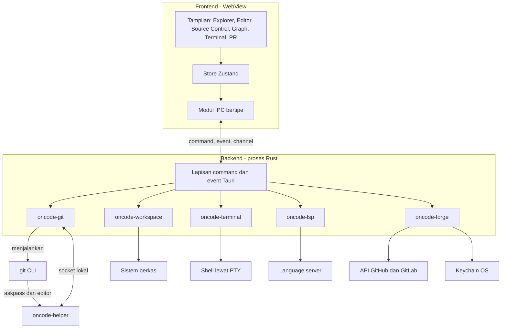
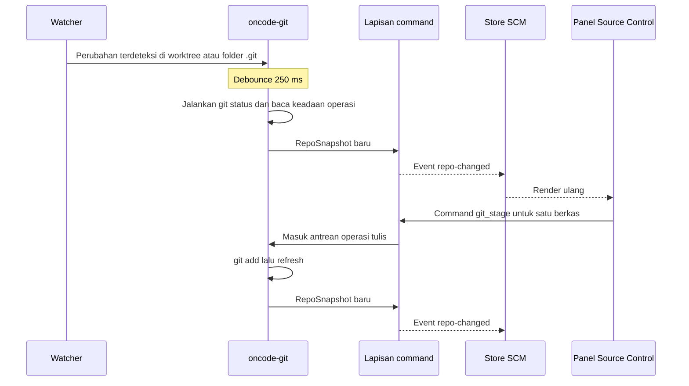
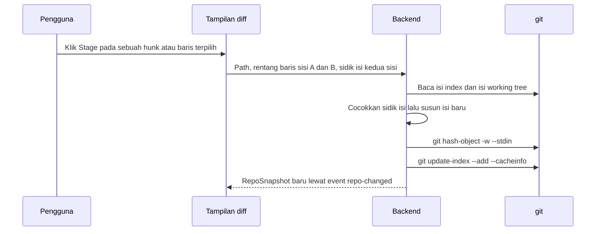
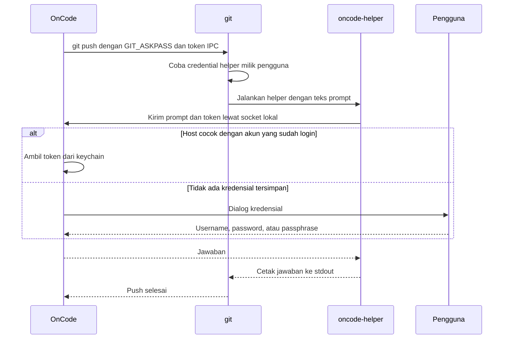
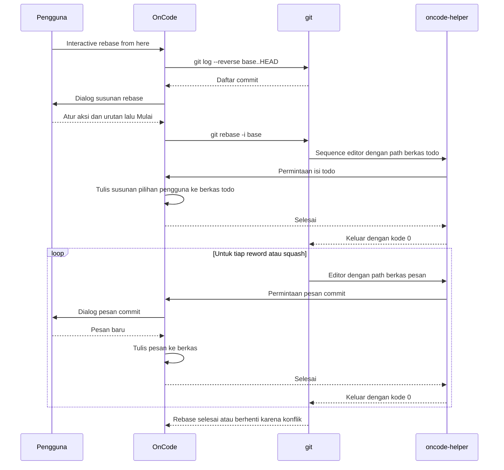
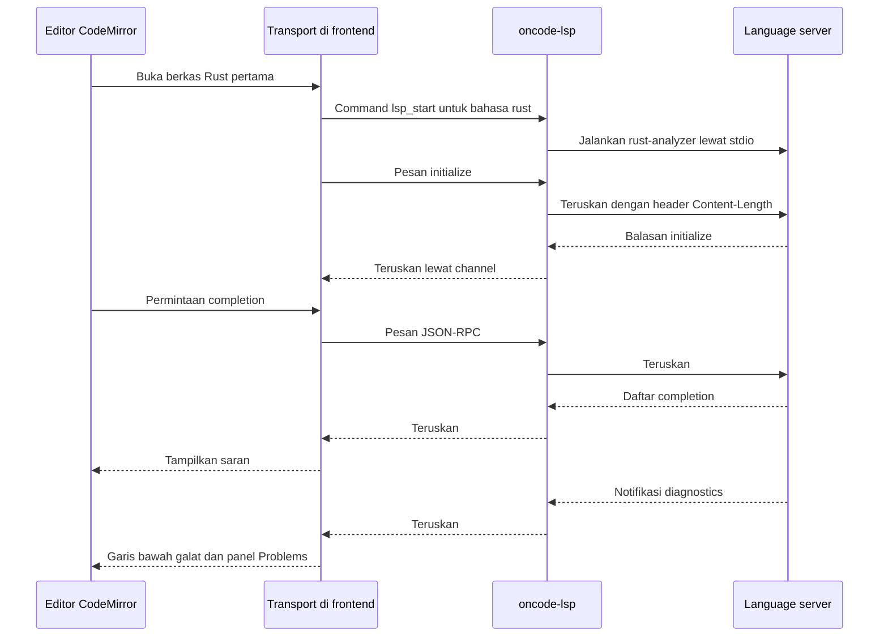

# Dokumen Rancangan OnCode (v0.2, Tauri)

> **Arsip.** Dokumen ini menggambarkan versi Tauri + React dan sudah digantikan oleh [rancangan versi native](../RANCANGAN.md). Isinya tetap dirujuk sebagai catatan perilaku yang sudah diimplementasikan dan teruji.

| | |
|---|---|
| **Status** | v0.2 — sudah diimplementasikan; penyimpangan dari rancangan awal dicatat di [bagian 15](#15-catatan-implementasi) |
| **Tanggal** | 17 November 2026 |
| **Cakupan** | Rancangan produk dan teknis untuk versi 1.0 |

OnCode adalah aplikasi desktop untuk menyunting kode yang lebih sederhana daripada Visual Studio Code, dengan **source control (Git) sebagai fitur utama**. Dokumen ini menjadi acuan implementasi: apa yang dibuat, dengan teknologi apa, bagaimana tiap bagian bekerja, dan dalam urutan apa dikerjakan.

## Daftar Isi

1. [Ringkasan](#1-ringkasan)
2. [Kebutuhan](#2-kebutuhan)
3. [Keputusan Teknologi](#3-keputusan-teknologi)
4. [Arsitektur Sistem](#4-arsitektur-sistem)
5. [Rancangan UI/UX](#5-rancangan-uiux)
6. [Modul Git](#6-modul-git)
7. [Modul Lain](#7-modul-lain)
8. [Pengaturan dan Penyimpanan Data](#8-pengaturan-dan-penyimpanan-data)
9. [Keamanan](#9-keamanan)
10. [Strategi Pengujian](#10-strategi-pengujian)
11. [Build dan Distribusi](#11-build-dan-distribusi)
12. [Roadmap](#12-roadmap)
13. [Risiko dan Mitigasi](#13-risiko-dan-mitigasi)
14. [Glosarium](#14-glosarium)
15. [Catatan Implementasi](#15-catatan-implementasi)

---

## 1. Ringkasan

### 1.1 Latar belakang

VS Code sangat lengkap, tetapi kelengkapan itu datang bersama kerumitan: ribuan pengaturan, sistem ekstensi, dan fitur Git bawaan yang terbatas sehingga banyak orang masih membuka Git client terpisah (GitKraken, Fork, Sourcetree) untuk melihat graph, melakukan rebase interaktif, atau menyelesaikan konflik.

OnCode menggabungkan dua hal itu dalam satu aplikasi ringan: **editor kode yang cukup** dan **Git client yang lengkap**.

### 1.2 Tujuan

1. Seluruh pekerjaan Git sehari-hari sampai tingkat lanjut bisa dilakukan tanpa meninggalkan aplikasi dan tanpa mengetik perintah.
2. Editor yang nyaman untuk pekerjaan nyata: highlight sintaks, tab, pencarian, terminal, dan kecerdasan kode lewat LSP.
3. Ringan: installer kecil, cepat dibuka, hemat memori.
4. Berjalan di Linux, Windows, dan macOS dengan perilaku yang sama.
5. Sederhana: sedikit pengaturan, nilai bawaan yang masuk akal, tanpa sistem ekstensi.

### 1.3 Non-tujuan

Hal berikut **sengaja tidak dibuat** agar aplikasi tetap sederhana:

- Marketplace atau API ekstensi
- Debugger
- Remote development (SSH, container, WSL)
- Notebook
- Sinkronisasi pengaturan antarperangkat
- Fitur AI
- Workspace multi-root (satu jendela membuka satu folder)

### 1.4 Target pengguna

Developer yang bekerja dengan Git setiap hari dan menginginkan satu alat ringan untuk menyunting kode sekaligus mengelola repositori, tanpa harus menghafal perintah Git tingkat lanjut.

---

## 2. Kebutuhan

Prioritas: **P0** wajib untuk MVP, **P1** wajib untuk v1.0, **P2** setelah v1.0.

### 2.1 Kebutuhan fungsional

#### Source control (fitur utama)

| ID | Kebutuhan | Prioritas |
|---|---|---|
| G-01 | Melihat status perubahan: staged, unstaged, untracked, konflik | P0 |
| G-02 | Stage, unstage, dan discard per berkas, per hunk, dan per baris | P0 |
| G-03 | Commit dengan opsi amend, sign-off, GPG sign, dan lewati hook | P0 |
| G-04 | Diff side-by-side dan unified, dengan navigasi antarperubahan | P0 |
| G-05 | Branch: buat, pindah, ganti nama, hapus, atur upstream, merge | P0 |
| G-06 | Remote: fetch, pull, push, kelola remote, indikator ahead/behind | P0 |
| G-07 | Autentikasi HTTPS dan SSH lewat dialog di dalam aplikasi | P0 |
| G-08 | Clone dan init repositori | P0 |
| G-09 | Graph riwayat commit dengan pencarian dan filter | P0 |
| G-10 | Detail commit: metadata, daftar berkas, diff tiap berkas | P0 |
| G-11 | Stash: simpan (termasuk sebagian berkas), terapkan, pop, hapus, lihat isi | P0 |
| G-12 | Tag: buat (annotated/lightweight), hapus, push | P0 |
| G-13 | Cherry-pick, revert, reset (soft/mixed/hard) | P0 |
| G-14 | Blame di gutter editor dan riwayat per berkas | P0 |
| G-15 | Editor konflik merge 3-way | P0 |
| G-16 | Interactive rebase dengan antarmuka visual | P0 |
| G-17 | Worktree: daftar, tambah, hapus, buka di jendela baru | P0 |
| G-18 | Submodule: status, init, update, sync | P0 |
| G-19 | Reflog sebagai jalan pemulihan | P0 |
| G-20 | Bisect, riwayat per rentang baris (`log -L`), dukungan Git LFS khusus | P2 |

#### Editor dan workspace

| ID | Kebutuhan | Prioritas |
|---|---|---|
| E-01 | Buka folder; explorer berbentuk pohon dengan penanda status Git | P0 |
| E-02 | Operasi berkas: buat, ganti nama, pindah, hapus (ke tempat sampah) | P0 |
| E-03 | Editor bertab, bisa di-split dua arah | P0 |
| E-04 | Highlight sintaks untuk bahasa umum, dimuat saat dibutuhkan | P0 |
| E-05 | Cari/ganti dalam berkas, multi-kursor, lipat kode, bracket matching | P0 |
| E-06 | Quick open berkas (fuzzy) dan command palette | P0 |
| E-07 | Pencarian teks di seluruh proyek, dengan regex dan filter glob | P0 |
| E-08 | Ganti teks di seluruh proyek dengan pratinjau | P1 |
| E-09 | Deteksi perubahan berkas dari luar aplikasi | P0 |
| E-10 | Deteksi encoding dan akhir baris; keduanya dipertahankan saat menyimpan | P0 |
| E-11 | Pulihkan sesi: tab terbuka dan tata letak panel | P1 |
| E-12 | Dukungan `.editorconfig`; pratinjau gambar dan Markdown | P2 |

#### Terminal

| ID | Kebutuhan | Prioritas |
|---|---|---|
| T-01 | Terminal terintegrasi di panel bawah, direktori awal = folder proyek | P1 |
| T-02 | Beberapa terminal sekaligus, ganti nama, tutup | P1 |
| T-03 | Salin/tempel, pencarian dalam keluaran, tautan bisa diklik | P1 |

#### Kecerdasan kode (LSP)

| ID | Kebutuhan | Prioritas |
|---|---|---|
| L-01 | Autocomplete, hover, signature help | P1 |
| L-02 | Diagnostics di editor dan panel Problems | P1 |
| L-03 | Go to definition, find references, rename symbol, format dokumen | P1 |
| L-04 | Konfigurasi language server per bahasa lewat pengaturan | P1 |

#### Integrasi GitHub dan GitLab

| ID | Kebutuhan | Prioritas |
|---|---|---|
| F-01 | Login akun GitHub dan GitLab (termasuk instance self-hosted) | P1 |
| F-02 | Clone dari daftar repositori milik akun | P1 |
| F-03 | Daftar dan detail pull request / merge request beserta status CI | P1 |
| F-04 | Checkout PR/MR ke branch lokal | P1 |
| F-05 | Membuat PR/MR dari branch aktif | P1 |
| F-06 | Komentar review inline dan merge PR dari aplikasi | P2 |

### 2.2 Kebutuhan non-fungsional

| Aspek | Target |
|---|---|
| Waktu buka | Jendela tampil dan bisa dipakai < 1 detik (cold start, SSD) |
| Ukuran installer | < 20 MB |
| Memori | < 300 MB dengan satu proyek menengah terbuka, di luar language server |
| Status Git | Refresh < 300 ms pada repositori 50.000 berkas |
| Graph | Gulir tetap lancar (60 fps) pada riwayat 100.000 commit |
| Berkas besar | Berkas hingga 50 MB bisa dibuka; di atas 5 MB highlight dimatikan |
| Keandalan | Tidak ada aksi yang menghilangkan pekerjaan tanpa konfirmasi eksplisit |
| Platform | Linux (x86_64, aarch64), Windows 10/11 (x86_64), macOS 12+ (Intel dan Apple Silicon) |
| Prasyarat pengguna | Git ≥ 2.40 terpasang; language server dipasang sendiri oleh pengguna |
| Bahasa antarmuka | Inggris pada v1.0; teks UI dipusatkan agar mudah diterjemahkan |

---

## 3. Keputusan Teknologi

### 3.1 Ringkasan stack

Versi di bawah adalah rilis terkini yang diperiksa di npm dan crates.io pada tanggal dokumen ini.

| Lapisan | Pilihan | Versi | Catatan |
|---|---|---|---|
| Shell desktop | Tauri | 2.x | Tauri 3 masih alpha, tidak dipakai |
| Bahasa backend | Rust | 1.99 | |
| Runtime async | `tokio` | 1.x | |
| Bahasa frontend | TypeScript | 7.x | |
| Kerangka UI | React | 19.x | |
| Bundler | Vite | 8.x | |
| State | Zustand | 5.x | |
| Tata letak panel | `react-resizable-panels` | 4.x | |
| Virtualisasi daftar | `@tanstack/react-virtual` | 3.x | Pohon berkas, daftar commit |
| Editor | CodeMirror (`@codemirror/view`) | 6.x | |
| Diff dan merge | `@codemirror/merge` | 6.x | |
| Klien LSP | `@codemirror/lsp-client` | 6.x | |
| Highlight sintaks | `@codemirror/language-data` | 6.x | Bahasa dimuat secara lazy |
| Terminal (UI) | `@xterm/xterm` + addon fit, webgl, search, web-links | 6.x | |
| Terminal (PTY) | `portable-pty` | 0.9 | ConPTY di Windows |
| Pemantau berkas | `notify` | rilis stabil terakhir | 9.0 masih RC |
| Pencarian teks | `grep-searcher`, `grep-regex`, `ignore` | 0.1 / 0.1 / 0.4 | Pustaka inti ripgrep |
| Fuzzy matcher | `nucleo` | 0.5 | |
| HTTP | `reqwest` | 0.13 | Untuk API GitHub/GitLab |
| Penyimpanan rahasia | `keyring` | 4.x | Keychain bawaan tiap OS |
| IPC pembantu Git | `tokio` (Unix socket, named pipe) | 1.x | Tanpa pustaka tambahan |
| Tempat sampah | `trash` | 5.x | |
| Encoding | `encoding_rs`, `chardetng` | 0.8 / 1.0 | |
| Binding IPC bertipe | `tauri-specta` + `specta` | 2.0.0-rc (dikunci) | Lihat [3.5](#35-ipc-bertipe-tauri-specta) |
| Render Markdown | `markdown-it` + `dompurify` | 15.x / 3.x | Deskripsi PR/MR |
| Manajer paket | pnpm | 12.x | |

### 3.2 Tauri, bukan Electron

| | Tauri 2 | Electron |
|---|---|---|
| Ukuran installer | ± 10–15 MB | ± 100–150 MB |
| Memori dasar | Rendah (WebView milik OS) | Tinggi (Chromium sendiri) |
| Backend | Rust: cepat untuk parsing keluaran Git dan pencarian | Node.js |
| Mesin render | Berbeda per OS (WebKitGTK, WebView2, WKWebView) | Sama di semua OS |

**Keputusan: Tauri.** Tujuan "lebih simpel dan ringan" paling terbantu oleh Tauri, dan pekerjaan berat (parsing, pencarian, layout graph) cocok dikerjakan di Rust. Harga yang dibayar adalah perbedaan mesin render antar-OS; mitigasinya ada di [bagian 13](#13-risiko-dan-mitigasi).

### 3.3 CodeMirror 6, bukan Monaco

- CodeMirror modular dan kecil; bahasa dimuat saat dibutuhkan. Monaco besar dan sulit dipecah.
- CodeMirror dirancang untuk disusun ulang: gutter blame, tombol di dalam hunk, dan dekorasi konflik dibuat sebagai ekstensi biasa.
- `@codemirror/merge` menyediakan tampilan diff dua sisi dan unified; `@codemirror/lsp-client` menyediakan klien LSP resmi.
- Kekurangan: tidak ada editor merge tiga panel bawaan, jadi harus dirakit sendiri (lihat [6.9](#69-resolusi-konflik)).

### 3.4 Git CLI, bukan libgit2 atau gitoxide

Ini keputusan paling menentukan untuk aplikasi yang fitur utamanya source control.

| Kriteria | `git` CLI | libgit2 (`git2`) | gitoxide (`gix`) |
|---|---|---|---|
| Interactive rebase | Ya | Tidak | Tidak |
| Worktree dan submodule lengkap | Ya | Sebagian | Sebagian |
| Hooks | Ya | Tidak otomatis | Tidak |
| Credential helper dan konfigurasi SSH pengguna | Ya | Harus dibuat ulang | Sebagian |
| GPG/SSH signing, LFS, filter | Ya | Tidak | Sebagian |
| Hasil sama dengan terminal pengguna | Ya | Belum tentu | Belum tentu |
| Tanpa proses eksternal | Tidak | Ya | Ya |

**Keputusan: semua operasi Git dijalankan lewat `git` milik sistem**, cara yang juga dipakai VS Code, GitHub Desktop, dan Fork. Konsekuensinya:

- Git harus terpasang. Aplikasi memeriksa `git --version` saat mulai; bila tidak ada atau lebih lama dari 2.40, ditampilkan panduan pemasangan dan fitur Git dinonaktifkan.
- Ada biaya membuat proses untuk setiap perintah (beberapa milidetik di Linux/macOS, lebih mahal di Windows). Diatasi dengan menggabungkan perintah, debounce, dan cache snapshot.
- Keluaran harus di-parse. Hanya format mesin yang dipakai (`--porcelain`, `-z`, `--format` dengan pemisah khusus), tidak pernah keluaran untuk manusia.

Bila kelak ada jalur baca yang terbukti lambat, `gix` bisa ditambahkan khusus untuk jalur itu tanpa mengubah rancangan.

### 3.5 IPC bertipe (`tauri-specta`)

`tauri-specta` menghasilkan fungsi TypeScript dari command Rust sehingga nama command, argumen, dan tipe balikan diperiksa saat kompilasi. Paket ini masih berstatus RC, maka:

- versinya dikunci persis di `Cargo.toml`;
- seluruh pemanggilan IPC di frontend melewati satu modul (`src/ipc/`), sehingga bila `tauri-specta` harus dilepas, penggantinya cukup wrapper `invoke` yang ditulis tangan di modul itu.

---

## 4. Arsitektur Sistem

### 4.1 Gambaran komponen



Prinsip pembagian:

- **Frontend hanya menampilkan dan menerima masukan.** Frontend tidak menjalankan proses, tidak membaca disk, dan tidak memanggil API jaringan secara langsung.
- **Backend adalah sumber kebenaran** untuk keadaan repositori, berkas, proses, dan token.
- **Logika berada di crate biasa**, bukan di dalam `src-tauri`, supaya bisa diuji tanpa menjalankan Tauri.

### 4.2 Struktur direktori

```
oncode/
├─ docs/
│  └─ RANCANGAN.md
├─ src/                          Frontend (React + TypeScript)
│  ├─ app/                       Kerangka: layout, command registry, keybinding, tema
│  ├─ ipc/                       Binding hasil tauri-specta + pembungkus tipis
│  ├─ components/                Komponen UI umum (tree, list, dialog, menu)
│  └─ features/
│     ├─ explorer/
│     ├─ editor/                 CodeMirror, tab, split, ekstensi (blame, konflik)
│     ├─ search/
│     ├─ scm/                    Panel Source Control, diff, commit box
│     ├─ graph/                  Graph, detail commit, dialog rebase
│     ├─ terminal/
│     ├─ lsp/                    Transport LSP, panel Problems
│     ├─ forge/                  Login, daftar repo, PR/MR
│     └─ settings/
├─ src-tauri/                    Shell Tauri
│  ├─ src/
│  │  ├─ main.rs
│  │  ├─ commands/               Satu berkas per domain: git.rs, fs.rs, search.rs, ...
│  │  ├─ state.rs                AppState: registry repo, terminal, LSP, pengaturan
│  │  └─ events.rs
│  ├─ capabilities/
│  └─ tauri.conf.json
├─ crates/
│  ├─ oncode-git/                Runner, parser, model, layout graph, patch builder
│  ├─ oncode-workspace/          Berkas, watcher, pencarian, indeks berkas
│  ├─ oncode-terminal/           Pengelola PTY
│  ├─ oncode-lsp/                Pengelola proses language server
│  ├─ oncode-forge/              Klien GitHub dan GitLab, OAuth
│  └─ oncode-helper/             Binary pembantu: askpass dan editor untuk git
├─ Cargo.toml                    Workspace Cargo
└─ package.json
```

### 4.3 Model proses

| Proses | Jumlah | Peran |
|---|---|---|
| Proses utama (Rust) | 1 | Menangani semua jendela, state, dan proses anak |
| WebView | 1 per jendela | Satu jendela = satu folder proyek |
| `git` | Berumur pendek, per perintah | Dijalankan dan ditunggu oleh `oncode-git` |
| `oncode-helper` | Berumur pendek | Dijalankan oleh `git` saat butuh kredensial atau editor |
| Shell | 1 per terminal | Di balik PTY |
| Language server | 1 per bahasa per proyek | Dimulai saat berkas bahasa itu pertama dibuka |

Aplikasi berjalan sebagai instance tunggal: membuka folder kedua akan membuat jendela baru di proses yang sama.

### 4.4 Kontrak IPC

Tiga mekanisme Tauri dipakai sesuai sifat datanya:

| Mekanisme | Arah | Dipakai untuk | Contoh |
|---|---|---|---|
| **Command** | UI → backend, satu balasan | Aksi dan kueri | `git_stage`, `fs_read_file`, `forge_list_prs` |
| **Event** | Backend → UI, siaran | Pemberitahuan perubahan keadaan | `repo-changed`, `fs-changed`, `credential-request` |
| **Channel** | Backend → UI, aliran berurutan milik satu pemanggilan | Data bertahap atau berkelanjutan | Hasil pencarian, halaman log commit, progres clone, keluaran terminal, pesan LSP |

Aturan:

1. Nama command berpola `<domain>_<aksi>` dengan domain `git`, `fs`, `search`, `term`, `lsp`, `forge`, `settings`, `app`.
2. Setiap command Git menerima `repoId` (path kanonis akar worktree).
3. Semua command mengembalikan `Result<T, AppError>`:

   ```rust
   struct AppError {
       code: ErrorCode,        // enum: dipakai UI untuk memilih pesan dan aksi lanjutan
       message: String,        // ringkas, untuk ditampilkan
       detail: Option<String>, // mis. stderr git apa adanya
   }
   ```

4. Operasi panjang (clone, fetch, push, pencarian) menerima `operationId` dan bisa dibatalkan lewat `app_cancel(operationId)`.
5. Isi berkas dan keluaran terminal dikirim sebagai byte mentah (bukan JSON) untuk menghindari biaya serialisasi.

### 4.5 Aliran keadaan repositori

Keadaan Git tidak disimpan sebagai salinan yang diubah-ubah di frontend. Backend menyiarkan **snapshot** setiap kali ada perubahan, dan UI hanya menggambar ulang.



Selama aplikasi sendiri sedang menjalankan operasi tulis, sinyal dari watcher ditahan dan satu refresh dilakukan setelah operasi selesai, agar tidak terjadi refresh beruntun.

---

## 5. Rancangan UI/UX

### 5.1 Tata letak utama

```
┌────┬──────────────────────┬──────────────────────────────────────────────────────┐
│    │ SOURCE CONTROL       │ main.rs ×   lib.rs   README.md ●                      │
│ ▣  │                      ├──────────────────────────────────────────────────────┤
│ ⌕  │  (isi sidebar sesuai │                                                      │
│ ⑂  │   ikon yang aktif)   │                    Area editor                       │
│ ◉  │                      │              (tab, bisa di-split)                    │
│ ⇄  │                      │                                                      │
│    │                      ├──────────────────────────────────────────────────────┤
│    │                      │ TERMINAL   PROBLEMS   GIT OUTPUT                     │
│ ⚙  │                      │ $ cargo build                                        │
├────┴──────────────────────┴──────────────────────────────────────────────────────┤
│ ⑂ feature/login  ↓2 ↑1   ⟳        ✕ 0  ⚠ 3              Ln 42, Col 7  UTF-8  LF  Rust │
└──────────────────────────────────────────────────────────────────────────────────┘
```

| Area | Isi |
|---|---|
| Activity bar (kiri) | Explorer ▣, Search ⌕, Source Control ⑂, Graph ◉, Pull Requests ⇄, Settings ⚙. Ikon Source Control menampilkan jumlah perubahan. |
| Sidebar | Isi mengikuti ikon aktif; lebar bisa diubah; bisa disembunyikan |
| Area editor | Tab berkas, tab diff, tab Graph, tab editor konflik; bisa di-split |
| Panel bawah | Terminal, Problems (diagnostics), Git Output (log perintah git yang dijalankan aplikasi) |
| Status bar | Branch aktif (klik untuk berpindah), ahead/behind (klik untuk sync), jumlah masalah, posisi kursor, encoding, akhir baris, bahasa |

Saat membuka folder yang merupakan repositori Git, sidebar yang tampil pertama adalah **Source Control**, bukan Explorer. Pilihan ini bisa diubah di pengaturan.

**Git Output** selalu mencatat perintah `git` yang dijalankan beserta keluarannya. Pengguna bisa melihat persis apa yang dilakukan aplikasi, dan belajar perintahnya bila mau.

### 5.2 Panel Source Control

```
┌ SOURCE CONTROL ──────────────── ⟳  ⋯ ┐
│ ┌──────────────────────────────────┐ │
│ │ Pesan commit (Ctrl+Enter)        │ │
│ │                                  │ │
│ └──────────────────────────────────┘ │
│ [ ✓ Commit            ▾ ]  ☐ Amend   │
│                                      │
│ ⚠ MERGE SEDANG BERLANGSUNG           │
│   [Continue]  [Abort]                │
│                                      │
│ ▾ Konflik (1)                        │
│     config.toml              C       │
│ ▾ Staged (2)                    −    │
│     src/auth.rs              M   −   │
│     src/login.rs             A   −   │
│ ▾ Perubahan (3)              ↶  +    │
│     src/main.rs              M  ↶ +  │
│     README.md                M  ↶ +  │
│     notes.txt                U  ↶ +  │
│                                      │
│ ▸ Stash (2)                          │
│ ▸ Worktree (1)                       │
│ ▸ Submodule (1)                      │
└──────────────────────────────────────┘
```

- Klik berkas membuka tab diff. Tombol `+` stage, `−` unstage, `↶` discard.
- Tombol Commit memiliki menu: Commit, Commit & Push, Commit & Sync.
- Banner operasi muncul hanya saat merge, rebase, cherry-pick, atau revert belum selesai.
- Daftar berkas bisa ditampilkan sebagai daftar datar atau pohon.
- Bila ada lebih dari satu repositori di dalam folder (submodule atau repo bersarang), tiap repositori tampil sebagai bagian tersendiri.

### 5.3 Tampilan diff

- Dua mode: side-by-side (bawaan) dan unified. Ganti lewat tombol di bilah tab.
- Tiap hunk memiliki tombol di gutter: **Stage hunk**, **Discard hunk** (atau **Unstage hunk** pada diff staged).
- Memilih beberapa baris lalu menekan **Stage selected lines** hanya men-stage baris itu.
- Sisi kanan diff worktree bisa disunting langsung; menyimpan memperbarui diff.
- Navigasi: `Alt+↓` / `Alt+↑` ke perubahan berikut/sebelumnya.
- Berkas biner menampilkan ukuran lama dan baru; gambar ditampilkan berdampingan.

### 5.4 Tampilan Graph

Dibuka sebagai tab di area editor agar mendapat ruang lebar.

```
┌ Referensi ────────┬ Graph ─────────────────────────────────────────┬ Detail commit ──────────┐
│ ⌕ filter...       │ ⌕ cari pesan, penulis, hash...   [Semua branch ▾]│ a1b2c3d                 │
│ ▾ Lokal           │                                                │ Tambah validasi login   │
│   ● main          │ ●   Tambah validasi login  [feature/login]  Ana │ Ana <ana@contoh.id>     │
│     feature/login │ │ ● Perbaiki typo README   [main] [origin/main] │ 17 Nov 2026 10.24       │
│ ▾ Remote          │ ●─┘ Merge branch 'hotfix'                   Budi │ Induk: 9f8e7d6          │
│   ▾ origin        │ │ ● Hotfix token kedaluwarsa               Budi │                         │
│     main          │ ●─┘ Refaktor modul auth                      Ana │ Berkas berubah (3)      │
│ ▾ Tag             │ ●   Rilis v1.2.0             [v1.2.0]       Budi │  M src/auth.rs          │
│   v1.2.0          │ │                                              │  M src/login.rs         │
│ ▾ Stash           │ │                                              │  A tests/login_test.rs  │
│   stash@{0}       │ ⋮                                              │                         │
└───────────────────┴────────────────────────────────────────────────┴─────────────────────────┘
```

- Baris paling atas adalah perubahan yang belum di-commit, bila ada.
- **Klik kanan commit:** Checkout, Create branch here, Create tag here, Cherry-pick, Revert, Reset to here (soft/mixed/hard), Interactive rebase from here, Copy hash.
- **Klik kanan branch:** Checkout, Merge into current, Rebase current onto, Rename, Delete, Push, Set upstream, Compare with current.
- **Seret branch ke branch lain:** menawarkan Merge atau Rebase.
- Klik berkas pada panel detail membuka diff commit tersebut.
- Memilih dua commit menampilkan perbandingan keduanya.

### 5.5 Editor konflik

```
┌ config.toml — Konflik 1 dari 3 ──────────────────────────  ↑ ↓   [Mark as resolved] ┐
├ Current (main) ───────────┬ Hasil ──────────────────────┬ Incoming (feature/login) ─┤
│ timeout = 30              │ timeout = 30                 │ timeout = 30              │
│▌retries = 3      [Pakai ▸]│▌retries = ???                │[◂ Pakai]      retries = 5▐│
│ log = "info"              │ log = "info"                 │ log = "info"              │
│                           │        [Pakai keduanya]      │                           │
└───────────────────────────┴──────────────────────────────┴───────────────────────────┘
```

- Panel kiri dan kanan hanya-baca; panel tengah (Hasil) bisa disunting bebas.
- Label panel memakai nama branch atau commit yang sebenarnya, bukan "ours/theirs", karena arti keduanya terbalik saat rebase.
- Perubahan yang tidak bertabrakan sudah digabung otomatis di panel Hasil.
- **Mark as resolved** aktif setelah tidak ada konflik tersisa; aksi ini menyimpan berkas dan men-stage-nya.
- Tersedia juga mode ringkas di editor biasa: penanda konflik disorot dan diberi tombol Accept Current / Accept Incoming / Accept Both.

### 5.6 Dialog interactive rebase

```
┌ Interactive rebase: 4 commit di atas 9f8e7d6 ─────────────────────────────┐
│  ≡  [pick   ▾]  a1b2c3d  Tambah validasi login                            │
│  ≡  [squash ▾]  b2c3d4e  wip                                              │
│  ≡  [reword ▾]  c3d4e5f  perbaiki tes                                     │
│  ≡  [drop   ▾]  d4e5f6a  debug print                                      │
│                                                                           │
│  Seret ≡ untuk mengubah urutan. Commit teratas diterapkan lebih dulu.     │
│                                              [Batal]   [Mulai rebase]     │
└───────────────────────────────────────────────────────────────────────────┘
```

Aksi yang tersedia: `pick`, `reword`, `edit`, `squash`, `fixup`, `drop`. Dialog menolak susunan yang tidak sah (misalnya `squash` pada baris pertama).

### 5.7 Pintasan keyboard bawaan

Di macOS, `Ctrl` diganti `Cmd`. Semua pintasan bisa diubah.

| Pintasan | Aksi |
|---|---|
| `Ctrl+P` | Quick open berkas |
| `Ctrl+Shift+P` | Command palette |
| `Ctrl+Shift+E` / `F` / `G` | Explorer / Search / Source Control |
| `Ctrl+Shift+H` | Buka Graph |
| `Ctrl+B` | Tampilkan/sembunyikan sidebar |
| `` Ctrl+` `` | Tampilkan/sembunyikan terminal |
| `Ctrl+S` | Simpan |
| `Ctrl+W` | Tutup tab |
| `Ctrl+\` | Split editor |
| `Ctrl+Enter` (di kotak commit) | Commit |
| `Alt+↓` / `Alt+↑` | Perubahan berikut / sebelumnya |
| `F12` / `Shift+F12` | Go to definition / Find references |
| `F2` | Rename symbol |
| `Shift+Alt+F` | Format dokumen |

### 5.8 Prinsip UX

1. **Aman secara bawaan.** Aksi yang bisa menghilangkan pekerjaan selalu meminta konfirmasi yang menyebutkan apa yang akan hilang.
2. **Transparan.** Setiap perintah Git yang dijalankan tercatat di Git Output.
3. **Galat yang bisa ditindaklanjuti.** Pesan galat disertai tombol aksi berikutnya (contoh: push ditolak → tombol *Pull lalu push lagi*).
4. **Semua lewat keyboard.** Setiap aksi terdaftar di command palette.

---

## 6. Modul Git

Crate `oncode-git` tidak bergantung pada Tauri. Ia menerima permintaan, menjalankan `git`, mem-parse keluaran, dan mengembalikan struktur data.

### 6.1 Runner

Satu fungsi pusat menjalankan semua perintah Git:

- **Argumen selalu berupa array**, tidak pernah lewat shell. Path ditempatkan setelah `--`; nama ref dari pengguna divalidasi dan didahului `--end-of-options` agar tidak terbaca sebagai opsi.
- **Opsi tetap:** `--no-pager -c color.ui=false -c core.quotepath=false`.
- **Lingkungan tetap:**

  | Variabel | Nilai | Tujuan |
  |---|---|---|
  | `LC_ALL`, `LANG` | `en_US.UTF-8` | Pesan galat stabil untuk diklasifikasi |
  | `GIT_PAGER` | `cat` | Mencegah pager |
  | `GIT_TERMINAL_PROMPT` | `0` | Git tidak menunggu masukan di terminal yang tidak ada |
  | `GIT_OPTIONAL_LOCKS` | `0` (untuk operasi baca) | Operasi baca tidak mengunci index |
  | `GIT_ASKPASS`, `SSH_ASKPASS` | path `oncode-helper` | Permintaan kredensial masuk ke aplikasi |
  | `SSH_ASKPASS_REQUIRE` | `force` | SSH memakai askpass walau tanpa terminal |
  | `GIT_EDITOR`, `GIT_SEQUENCE_EDITOR` | `oncode-helper` dengan sub-perintah | Penyuntingan pesan dan daftar rebase masuk ke aplikasi |
  | `ONCODE_IPC_ENDPOINT`, `ONCODE_IPC_TOKEN` | alamat socket dan token sekali pakai | Dipakai `oncode-helper` untuk menghubungi aplikasi |

- **Antrean per repositori.** Operasi tulis dijalankan satu per satu. Operasi baca boleh berjalan bersamaan.
- **Pembatalan dan batas waktu.** Operasi baca diberi batas waktu; operasi jaringan bisa dibatalkan pengguna (proses dihentikan).
- **Progres.** `clone`, `fetch`, `pull`, dan `push` dijalankan dengan `--progress`; baris progres di stderr di-parse menjadi persentase.
- **Pencatatan.** Perintah, durasi, kode keluar, dan stderr dikirim ke panel Git Output. Rahasia tidak pernah berada di argumen, jadi tidak ikut tercatat.

### 6.2 Model data

```rust
struct RepoSnapshot {
    repo_id: RepoId,
    head: Head,
    upstream: Option<Upstream>,        // nama, ahead, behind
    operation: Option<Operation>,      // operasi yang belum selesai
    staged: Vec<FileChange>,
    unstaged: Vec<FileChange>,
    untracked: Vec<String>,
    conflicted: Vec<ConflictEntry>,
    stash_count: u32,
}

enum Head {
    Branch(String),
    Detached(Oid),
    Unborn(String),                    // repo baru tanpa commit
}

struct FileChange {
    path: String,
    orig_path: Option<String>,         // untuk rename/copy
    kind: ChangeKind,                  // Added, Modified, Deleted, Renamed, Copied, TypeChanged
    submodule: Option<SubmoduleState>,
}

struct ConflictEntry {
    path: String,
    kind: ConflictKind,                // BothModified, BothAdded, DeletedByUs, DeletedByThem, ...
}

enum Operation {
    Merge { incoming: String },
    Rebase { interactive: bool, step: u32, total: u32, onto: Oid, head_name: String },
    CherryPick { commit: Oid },
    Revert { commit: Oid },
}

struct Commit {
    oid: Oid,
    parents: Vec<Oid>,
    author: Signature,                 // nama, email, waktu
    committer: Signature,
    subject: String,
    refs: Vec<RefLabel>,               // branch, tag, HEAD yang menunjuk commit ini
}

struct GraphRow {
    commit: Commit,
    column: u16,                       // jalur tempat titik commit digambar
    color: u8,
    edges: Vec<Edge>,                  // garis di baris ini: dari kolom, ke kolom, warna
}

struct Hunk {
    old_start: u32, old_lines: u32,
    new_start: u32, new_lines: u32,
    header: String,
    lines: Vec<DiffLine>,              // jenis (konteks/tambah/hapus), teks, nomor baris lama dan baru
}
```

### 6.3 Pemetaan fitur ke perintah Git

| Fitur | Perintah utama |
|---|---|
| Temukan repositori | `git rev-parse --show-toplevel --git-dir --git-common-dir` |
| Status | `git status --porcelain=v2 -z --branch --show-stash --untracked-files=all` |
| Diff worktree / staged | `git diff --no-ext-diff -- <path>` / `git diff --cached ...` |
| Isi berkas pada suatu versi | `git show <rev>:<path>`, `git show :<path>` (index) |
| Stage / unstage berkas | `git add -- <path>` / `git restore --staged -- <path>` |
| Stage / unstage hunk atau baris | `git hash-object -w --stdin` lalu `git update-index --add --cacheinfo` (lihat [6.5](#65-staging-per-hunk-dan-per-baris)) |
| Discard berkas terlacak | `git restore -- <path>` |
| Discard hunk atau baris | Isi baru ditulis langsung ke berkas di working tree |
| Discard berkas untracked | Dipindah ke tempat sampah OS (bukan `git clean`) |
| Commit | `git commit -F - [--amend] [--signoff] [-S] [--no-verify]` |
| Batalkan commit terakhir | `git reset --soft HEAD~1` |
| Daftar ref | `git for-each-ref --format=...` (termasuk `%(upstream:track)`) |
| Branch | `git switch`, `git switch -c`, `git branch -m`, `git branch -d`, `git branch --set-upstream-to` |
| Merge | `git merge [--no-ff \| --ff-only \| --squash] <ref>` |
| Rebase | `git rebase <upstream>`, `git rebase -i <base>`, `--continue`, `--skip`, `--abort` |
| Fetch / pull / push | `git fetch --prune --progress`, `git pull --progress`, `git push --progress [-u] [--force-with-lease]` |
| Remote | `git remote -v`, `add`, `remove`, `rename`, `set-url` |
| Clone / init | `git clone --progress [--recurse-submodules]`, `git init` |
| Log dan graph | `git log -z --topo-order --format=<format khusus> [--all]` |
| Detail commit | `git show --format=<...> --raw -z <oid>`, `git diff <a> <b> -- <path>` |
| Riwayat berkas | `git log --follow -z --format=<...> -- <path>` |
| Blame | `git blame --incremental [--contents -] -- <path>` |
| Stash | `git stash list -z --format=...`, `push [-u] [--staged] [-m] [-- <path>]`, `apply`, `pop`, `drop`, `show -p` |
| Tag | `git tag [-a -m] <nama> <rev>`, `git tag -d`, `git push <remote> <tag>`, `git push <remote> --delete <tag>` |
| Cherry-pick / revert | `git cherry-pick [-x] <oid...>`, `git revert [-m 1] <oid>`, masing-masing dengan `--continue`, `--skip`, `--abort` |
| Reset | `git reset --soft \| --mixed \| --hard <rev>` |
| Daftar konflik | `git ls-files -u -z` |
| Tiga versi berkas konflik | `git show :1:<path>` (base), `:2:` (current), `:3:` (incoming) |
| Gabung ulang untuk editor konflik | `git merge-file -p --diff3 <current> <base> <incoming>` |
| Pilih satu sisi utuh | `git checkout --ours \| --theirs -- <path>` |
| Tandai selesai | `git add -- <path>` |
| Worktree | `git worktree list --porcelain -z`, `add`, `remove`, `prune` |
| Submodule | `git submodule status --recursive`, `update --init --recursive`, `sync`, `add` |
| Reflog | `git reflog --format=<...>` |
| Konfigurasi | `git config --get`, `git config --list -z` |

### 6.4 Status dan pemantauan

- Satu pemanggilan `git status --porcelain=v2 -z --branch --show-stash` menghasilkan branch, upstream, ahead/behind, jumlah stash, dan seluruh entri berkas. Parser menangani empat jenis entri: biasa (`1`), rename/copy (`2`), unmerged (`u`), dan untracked (`?`).
- **Operasi yang belum selesai** dideteksi dari isi direktori Git: `MERGE_HEAD`, `rebase-merge/` atau `rebase-apply/`, `CHERRY_PICK_HEAD`, `REVERT_HEAD`. Untuk rebase, langkah saat ini dan total dibaca dari `rebase-merge/msgnum` dan `rebase-merge/end`.
- **Watcher** memantau worktree (dengan menghormati `.gitignore`) dan berkas kunci di direktori Git: `HEAD`, `index`, `refs/`, `packed-refs`, serta penanda operasi di atas. Lokasi direktori Git diambil dari `git rev-parse`, karena pada worktree dan submodule `.git` adalah berkas penunjuk, bukan folder.
- Perubahan di-debounce 250 ms. Perubahan pada worktree memicu refresh status; perubahan pada `refs/` juga memicu refresh daftar branch dan graph.
- Bila batas watcher OS terlampaui (inotify di Linux), aplikasi memberi peringatan dan beralih ke refresh saat jendela mendapat fokus serta setelah berkas disimpan.

### 6.5 Staging per hunk dan per baris

`git add -p` bersifat interaktif sehingga tidak dipakai. Aplikasi juga **tidak menyusun patch untuk `git apply`**: tampilan diff dihitung oleh editor, dan hunk yang dihitung editor tidak selalu sama dengan hunk versi Git (terutama pada baris berulang), sehingga patch berbasis nomor baris bisa mengenai perubahan yang berbeda dari yang dilihat pengguna.

Sebagai gantinya dipakai **sambung-potong baris**:



- Tiap operasi berbentuk "ganti baris `A[a_from..a_to)` dengan baris `B[b_from..b_to)`". Untuk stage, A adalah index dan B adalah working tree; untuk unstage, A adalah HEAD dan B adalah index; untuk discard, hasilnya ditulis ke berkas di working tree.
- Model baris sama dengan model dokumen editor (`"a\nb\n"` adalah tiga baris, yang terakhir kosong), sehingga berkas tanpa newline di akhir tertangani tanpa kasus khusus.
- **Sidik isi** kedua sisi dikirim balik bersama permintaan. Bila berkas sudah berubah sejak diff ditampilkan, operasi ditolak dan diff dimuat ulang.
- Sisi working tree dilewatkan filter *clean* Git lebih dulu (`git hash-object -w -- <path>`), sehingga konversi akhir baris dan filter lain tetap berlaku.
- Mode berkas (mis. executable) dipertahankan dari index.
- **Pilihan sebagian baris** dalam satu hunk mengikuti urutan patch Git: baris lama dipertahankan dan baris baru yang dipilih disisipkan setelahnya.
- **Berkas biner dan rename** hanya bisa di-stage per berkas.

Bagian ini diuji dengan property test terhadap repositori Git sungguhan (lihat [bagian 10](#10-strategi-pengujian)).

### 6.6 Graph riwayat

**Pengambilan data.** `git log -z --topo-order` dengan format berisi hash, hash induk, penulis, waktu, ref, dan subjek, dipisahkan karakter kontrol. Proses dibiarkan hidup dan keluarannya dibaca per 500 commit; halaman berikutnya dibaca saat pengguna menggulir mendekati akhir. Karena pipa menahan proses saat tidak dibaca, tidak ada biaya untuk commit yang tidak pernah dilihat. Proses dihentikan saat tab Graph ditutup atau filter berubah.

**Penentuan jalur (lane).** Dihitung di Rust, bertahap mengikuti aliran data:

1. Simpan daftar jalur aktif; tiap jalur mencatat hash commit yang ditunggunya.
2. Untuk tiap commit, cari jalur yang menunggu hash-nya. Jalur pertama yang cocok menjadi kolom commit; jalur lain yang juga menunggunya menyatu ke kolom itu.
3. Bila tidak ada jalur yang menunggu (ujung branch), pakai jalur kosong pertama.
4. Induk pertama mewarisi jalur commit. Induk lain memakai jalur yang sudah menunggunya, atau jalur kosong baru.
5. Hasil per baris: kolom titik, warna, dan daftar garis (lurus, menyatu, bercabang).

**Render.** Daftar divirtualisasi; tiap baris menggambar potongan graph-nya sendiri dengan SVG kecil. Hanya baris yang terlihat yang ada di DOM.

**Pencarian dan filter.** Filter pesan, penulis, dan rentang tanggal diteruskan ke `git log` (`--grep`, `--author`, `--since`, `--until`); pencarian hash memakai `git rev-parse`. Filter branch menentukan ref awal (`--all`, branch aktif saja, atau pilihan pengguna).

### 6.7 Autentikasi



- Credential helper yang sudah dikonfigurasi pengguna (misalnya Git Credential Manager atau libsecret) tetap berjalan lebih dulu, karena Git memanggilnya sebelum askpass.
- Helper mengenali jenis prompt dari teksnya: username, password, passphrase kunci SSH, dan konfirmasi sidik jari host SSH. Tiap jenis mendapat dialog yang sesuai.
- Untuk host yang cocok dengan akun GitHub/GitLab yang sudah login di aplikasi, token dari keychain dipakai otomatis tanpa dialog.
- Dialog menawarkan opsi menyimpan kredensial ke keychain OS.
- Socket lokal (Unix socket di Linux/macOS, named pipe di Windows) hanya bisa diakses pengguna yang sama, dan setiap pemanggilan `git` memakai token acak sekali pakai.
- Membatalkan dialog membuat helper keluar dengan kode galat, sehingga Git berhenti dengan rapi.

### 6.8 Interactive rebase



- Bila rebase berhenti (konflik atau aksi `edit`), `git` keluar dan aplikasi mengenali keadaannya dari direktori `rebase-merge/`. Banner menampilkan progres ("langkah 3 dari 7") dengan tombol **Continue**, **Skip**, **Abort**.
- Sisa susunan bisa diubah di tengah jalan lewat `git rebase --edit-todo`, dengan mekanisme sequence editor yang sama.
- Rebase dari commit pertama memakai `--root`.
- Sebelum memulai, aplikasi memperingatkan bila commit yang akan ditulis ulang sudah ada di remote, karena setelahnya diperlukan force push.
- Mekanisme editor yang sama dipakai setiap kali Git meminta pesan (misalnya `rebase --continue` setelah konflik pada squash). Untuk commit biasa, pesan dikirim lewat `git commit -F -` sehingga editor tidak diperlukan.

### 6.9 Resolusi konflik

1. Berkas konflik didapat dari entri `u` pada status; jenisnya (keduanya mengubah, keduanya menambah, dihapus satu sisi) menentukan antarmuka.
2. Untuk konflik isi teks, aplikasi mengambil tiga versi dari index (`:1:` base, `:2:` current, `:3:` incoming) lalu menjalankan `git merge-file -p --diff3`. Hasilnya di-parse menjadi rangkaian segmen: *sudah tergabung* atau *konflik (current, base, incoming)*. Cara ini tidak bergantung pada gaya penanda konflik di konfigurasi pengguna.
3. Editor tiga panel ([5.5](#55-editor-konflik)) dirakit dari tiga instance CodeMirror dengan gulir yang diselaraskan per segmen, dan dekorasi penanda segmen konflik.
4. Tiap konflik diselesaikan dengan *Pakai current*, *Pakai incoming*, *Pakai keduanya*, atau disunting manual.
5. **Mark as resolved** menulis isi panel Hasil ke berkas lalu `git add`.
6. Konflik non-teks:
   - **Dihapus di satu sisi:** pilihan *Pertahankan berkas* atau *Hapus berkas*.
   - **Biner:** pilihan memakai salah satu sisi secara utuh (`git checkout --ours` / `--theirs`).
7. Setelah semua konflik selesai, banner operasi mengaktifkan **Continue** (`git merge --continue`, `git rebase --continue`, dan seterusnya).

### 6.10 Blame dan riwayat berkas

- Blame memakai format `git blame --incremental`; hasilnya ditampilkan setelah perintah selesai.
- Bila buffer memiliki perubahan yang belum disimpan, isinya dikirim lewat `--contents -` agar nomor baris tetap cocok; baris yang belum di-commit ditandai tersendiri.
- Gutter menampilkan penulis dan tanggal relatif; hover menampilkan pesan commit lengkap dan tautan ke commit di Graph.
- Blame bisa dinyalakan per editor; tersedia juga mode ringkas yang hanya menampilkan anotasi di baris kursor.
- Riwayat berkas memakai `git log --follow` dan ditampilkan sebagai daftar commit; memilih satu entri menampilkan diff berkas pada commit itu.

### 6.11 Stash, tag, worktree, submodule, reflog

- **Stash.** Membuat stash menawarkan pesan, opsi menyertakan berkas untracked, dan pilihan berkas tertentu saja. Tiap stash bisa dilihat isinya sebagai diff, diterapkan, di-pop, dihapus, atau dijadikan branch.
- **Tag.** Dibuat dari menu konteks commit; dialog menawarkan annotated (dengan pesan) atau lightweight, serta opsi langsung push.
- **Worktree.** Daftar worktree tampil di panel Source Control. Menambah worktree meminta branch dan lokasi; membuka worktree membuat jendela baru. Branch yang sedang dipakai worktree lain diberi tanda di daftar branch.
- **Submodule.** Tiap submodule tampil sebagai repositori bersarang dengan statusnya (belum diinisialisasi, commit berbeda dari yang dicatat, ada perubahan lokal). Aksi: init, update, sync, buka sebagai repositori.
- **Reflog.** Ditampilkan sebagai daftar pergerakan HEAD. Tiap entri menawarkan *Create branch here* dan *Reset to here*; inilah jalan pemulihan setelah reset atau rebase yang keliru.

### 6.12 Klasifikasi galat dan aksi destruktif

Stderr dan kode keluar Git dipetakan ke kode galat agar UI bisa menawarkan langkah berikutnya:

| Kode | Pemicu | Tawaran di UI |
|---|---|---|
| `GitNotFound` | `git` tidak ada atau terlalu lama | Panduan pemasangan |
| `AuthFailed` | Kredensial ditolak | Coba lagi, login akun |
| `PushRejected` | Remote memiliki commit baru | Pull lalu push; force with lease |
| `NoUpstream` | Branch belum punya upstream | Publish branch |
| `DirtyWorkTree` | Perubahan lokal akan tertimpa | Stash lalu lanjutkan; batal |
| `Conflict` | Merge/rebase/cherry-pick/stash pop berkonflik | Buka editor konflik |
| `IndexLocked` | Ada `index.lock` | Coba lagi; hapus kunci bila tidak ada proses git lain |
| `HookFailed` | Hook keluar dengan galat | Tampilkan keluaran hook; commit tanpa hook |
| `Unknown` | Lainnya | Tampilkan stderr apa adanya |

Aksi destruktif dan pengamannya:

| Aksi | Pengaman |
|---|---|
| Discard perubahan | Konfirmasi menyebut jumlah berkas; berkas untracked masuk tempat sampah OS |
| Reset `--hard` | Konfirmasi menyebut jumlah berkas yang berubah dan mengingatkan reflog |
| Hapus branch yang belum di-merge | Konfirmasi kedua yang menyebut jumlah commit yang hanya ada di branch itu |
| Force push | Selalu `--force-with-lease`; konfirmasi menyebut branch remote |
| Drop stash | Konfirmasi |
| Hapus worktree berisi perubahan | Konfirmasi menyebut perubahan yang akan hilang |
| Checkout dengan perubahan lokal yang bentrok | Tawaran stash otomatis, bukan menimpa |

---

## 7. Modul Lain

### 7.1 Workspace dan explorer

- Satu jendela membuka satu folder. Daftar proyek terakhir tampil di layar awal.
- Pohon berkas dimuat per folder saat dibuka (lazy) dan divirtualisasi.
- Tiap berkas dan folder diberi warna serta huruf status Git (M, A, U, D, C); berkas yang diabaikan `.gitignore` dibuat redup.
- Operasi berkas (buat, ganti nama, pindah, hapus) dikerjakan backend. Hapus selalu ke tempat sampah OS.
- Watcher menyiarkan `fs-changed` agar pohon dan tab yang terbuka mengikuti perubahan dari luar.

### 7.2 Editor

- **Buffer.** Satu berkas memiliki satu dokumen CodeMirror yang dipakai bersama oleh semua tab dan split yang menampilkannya.
- **Membuka berkas.** Backend mendeteksi biner (ada byte NUL di awal berkas), encoding (BOM, lalu `chardetng`), dan akhir baris. Teks dikirim sebagai UTF-8; encoding dan akhir baris asli dipakai kembali saat menyimpan.
- **Berkas besar.** Di atas 5 MB: highlight, lipat kode, dan LSP dimatikan. Di atas 50 MB: konfirmasi lebih dulu, dibuka hanya-baca.
- **Perubahan dari luar.** Bila buffer bersih, isi dimuat ulang. Bila buffer berisi perubahan, pengguna memilih: pakai versi disk, pertahankan versi editor, atau bandingkan.
- **Menyimpan.** Ditulis ke berkas sementara lalu di-rename (atomik), agar berkas tidak rusak bila aplikasi terhenti di tengah penulisan.
- **Ekstensi buatan sendiri:** gutter perubahan Git (garis tambah/ubah/hapus terhadap HEAD), gutter blame, dekorasi dan tombol konflik, tombol aksi hunk pada diff.
- **Bahasa.** `@codemirror/language-data` memetakan nama berkas ke paket bahasa dan memuatnya saat dibutuhkan.

### 7.3 Pencarian

- **Quick open.** Backend menyimpan indeks path berkas (menghormati `.gitignore`) yang diperbarui oleh watcher. Pencocokan fuzzy memakai `nucleo`; hasil teratas dikirim tiap ketikan.
- **Pencarian teks.** Penelusuran paralel dengan `ignore`, pencocokan dengan `grep-searcher` dan `grep-regex`. Opsi: regex, peka huruf besar, kata utuh, glob sertakan/kecualikan.
- Hasil dialirkan lewat channel dalam kelompok per berkas dan ditampilkan sebagai pohon yang divirtualisasi. Kueri baru membatalkan pencarian sebelumnya.
- **Ganti di seluruh proyek (P1).** Menampilkan pratinjau per kecocokan. Berkas yang sedang terbuka diubah lewat editornya agar undo tetap berfungsi; berkas lain ditulis oleh backend.

### 7.4 Terminal

- Backend membuat PTY dengan `portable-pty` dan menjalankan shell bawaan pengguna (`$SHELL` di Linux/macOS, PowerShell di Windows; bisa diubah di pengaturan) di folder proyek.
- Keluaran PTY dibaca di thread tersendiri, digabung dalam jendela beberapa milidetik, lalu dikirim sebagai byte mentah lewat channel. Masukan dan perubahan ukuran dikirim lewat command.
- Bila UI tertinggal (keluaran sangat deras), pembacaan PTY dijeda sampai xterm.js selesai memproses antrean.
- Render memakai addon WebGL; bila WebGL tidak tersedia di WebView, otomatis kembali ke renderer bawaan.
- Terminal ditutup bersama jendelanya; proses shell dihentikan dengan rapi.

### 7.5 LSP



- **Pembagian peran.** Backend hanya mengelola proses dan membingkai pesan; ia tidak memahami isi protokol. Seluruh logika LSP ditangani `@codemirror/lsp-client` melalui objek transport yang dihubungkan ke command dan channel Tauri.
- **Daftar server bawaan** (bisa diubah atau ditambah lewat pengaturan):

  | Bahasa | Perintah |
  |---|---|
  | Rust | `rust-analyzer` |
  | TypeScript / JavaScript | `typescript-language-server --stdio` |
  | Python | `pyright-langserver --stdio` |
  | Go | `gopls` |
  | C / C++ | `clangd` |

- Server **tidak dibundel**. Bila perintah tidak ditemukan di PATH, status bar menampilkan petunjuk singkat cara memasangnya; editor tetap berfungsi tanpa LSP.
- **Siklus hidup.** Server dimulai saat berkas bahasanya pertama dibuka, dihentikan saat jendela ditutup, dan dimulai ulang otomatis bila mati (dibatasi lima kali dalam tiga menit).
- **Panel Problems** mengumpulkan diagnostics dari semua berkas, dikelompokkan per berkas.

### 7.6 Integrasi GitHub dan GitLab

**Abstraksi.** Satu trait untuk semua penyedia:

```rust
#[async_trait]
trait ForgeProvider {
    async fn current_user(&self) -> Result<User>;
    async fn list_repos(&self, query: &str, page: u32) -> Result<Page<RemoteRepo>>;
    async fn list_pull_requests(&self, repo: &RepoRef, filter: PrFilter) -> Result<Page<PullRequest>>;
    async fn get_pull_request(&self, repo: &RepoRef, number: u64) -> Result<PullRequestDetail>;
    async fn list_checks(&self, repo: &RepoRef, sha: &str) -> Result<Vec<Check>>;
    async fn create_pull_request(&self, repo: &RepoRef, input: NewPullRequest) -> Result<PullRequest>;
}
```

Implementasi: `GitHubProvider` (github.com dan GitHub Enterprise Server) dan `GitLabProvider` (gitlab.com dan self-hosted).

**Login.**

| Penyedia | Cara | Catatan |
|---|---|---|
| GitHub | OAuth Device Flow | Aplikasi menampilkan kode, pengguna memasukkannya di browser; tidak perlu client secret |
| GitLab | OAuth Device Flow, atau Personal Access Token | PAT sebagai jalan untuk instance self-hosted yang belum mendukung device flow; token GitLab punya masa berlaku sehingga refresh token ditangani otomatis |

Token disimpan hanya di keychain OS lewat `keyring`, tidak pernah di berkas pengaturan. Bila keychain tidak tersedia atau tidak menjawab dalam beberapa detik (mis. Linux tanpa layanan Secret Service), token disimpan di memori untuk sesi itu saja dan pengguna diberi tahu bahwa ia perlu login lagi setelah aplikasi ditutup.

**Menghubungkan repositori lokal ke penyedia.** URL remote (bentuk HTTPS maupun SSH) di-parse menjadi host, pemilik, dan nama repositori; host dicocokkan dengan akun yang sudah login.

**Fitur.**

- **Clone dari akun:** dialog dengan pencarian daftar repositori, lalu `git clone`.
- **Daftar PR/MR:** di sidebar Pull Requests, dengan filter (terbuka, milik saya, menunggu review saya), status CI, dan label draft.
- **Detail PR/MR:** deskripsi (Markdown dirender lalu disanitasi), reviewer, status pemeriksaan CI, daftar commit, dan berkas yang berubah. Diff ditampilkan dengan penampil diff yang sama setelah ref PR di-fetch (`refs/pull/<n>/head` di GitHub, `refs/merge-requests/<n>/head` di GitLab).
- **Checkout PR/MR:** fetch ref tersebut ke branch lokal lalu pindah ke sana.
- **Buat PR/MR:** dari branch aktif; judul dan deskripsi diisi dari pesan commit, branch tujuan bisa dipilih, opsi draft; branch di-push lebih dulu bila belum ada di remote.
- **Buka di browser** untuk hal yang belum didukung (komentar inline, merge).

---

## 8. Pengaturan dan Penyimpanan Data

### 8.1 Pengaturan

Pengaturan disimpan sebagai JSON dan sengaja sedikit. Ada dua tingkat; tingkat proyek menimpa tingkat pengguna.

| Tingkat | Lokasi |
|---|---|
| Pengguna | `settings.json` di direktori konfigurasi aplikasi (mis. `~/.config/<id-aplikasi>/` di Linux) |
| Proyek | `.oncode/settings.json` di akar proyek |

Contoh:

```json
{
  "editor": { "fontSize": 14, "tabSize": 4, "wordWrap": false, "inlineBlame": false },
  "files": { "autoSave": "off" },
  "workbench": { "theme": "system", "startupView": "scm" },
  "git": { "path": null, "autoFetchMinutes": 5, "pullStrategy": "ffOnly", "confirmForcePush": true },
  "terminal": { "shell": null },
  "lsp": { "enabled": true, "servers": { "rust": { "command": "rust-analyzer", "args": [] } } },
  "forge": { "githubClientId": null, "gitlabClientId": null }
}
```

Kunci yang tidak ditulis memakai nilai bawaan.

- Tersedia halaman pengaturan berbentuk formulir; berkas JSON tetap bisa disunting langsung.
- Pengaturan tingkat proyek yang menentukan perintah untuk dijalankan (`lsp.servers`, `terminal.shell`, `git.path`) hanya berlaku pada folder yang dipercaya (lihat [9.3](#93-kepercayaan-folder)).

### 8.2 Keybinding dan tema

- Keybinding bawaan didefinisikan di kode; penimpaan pengguna disimpan di `keybindings.json` (`{ "<id command>": "Mod+K" }`, daftar kosong menghapus pintasan) dan berlaku begitu berkas disimpan.
- Dua tema bawaan (gelap dan terang) plus pilihan mengikuti sistem. Warna didefinisikan sebagai CSS variable; tema CodeMirror dan xterm.js diturunkan dari variabel yang sama agar seragam.

### 8.3 Data yang disimpan aplikasi

| Data | Tempat |
|---|---|
| Pengaturan dan keybinding | Direktori konfigurasi aplikasi |
| Proyek terakhir, ukuran dan posisi jendela | Direktori data aplikasi (`state.json`) |
| Sesi per proyek: tab terbuka, tata letak, status kepercayaan folder | Direktori data aplikasi, satu berkas per proyek |
| Token GitHub/GitLab dan kredensial Git tersimpan | Keychain OS |
| Log aplikasi | Direktori log aplikasi, dirotasi |

Aplikasi tidak menulis apa pun ke folder proyek kecuali `.oncode/settings.json` bila pengguna membuatnya, dan tidak mengirim telemetri.

---

## 9. Keamanan

### 9.1 Batas frontend dan backend

- **Capability Tauri minimal.** WebView hanya boleh memanggil command aplikasi sendiri. Tidak ada akses langsung ke shell, sistem berkas, atau HTTP dari frontend.
- **CSP ketat** (`default-src 'self'`); tidak ada skrip atau konten jarak jauh yang dimuat.
- **Konten tak tepercaya** (deskripsi PR/MR, pesan commit, nama berkas) dirender sebagai teks, atau untuk Markdown disanitasi dengan DOMPurify. Tautan eksternal dibuka di browser sistem.

### 9.2 Menjalankan proses

- Program yang bisa dijalankan terbatas: `git`, shell untuk terminal, dan language server yang dikonfigurasi.
- Argumen selalu berupa array; tidak ada penyusunan string perintah shell.
- Nama ref, path, dan URL dari pengguna atau dari repositori divalidasi dan dipisahkan dengan `--end-of-options` atau `--` sehingga tidak bisa disisipkan sebagai opsi.

### 9.3 Kepercayaan folder

Membuka repositori yang tidak dikenal berisiko: konfigurasi lokal Git (`core.fsmonitor`, `core.sshCommand`, filter, hook) dan language server dapat menjalankan kode dari isi repositori.

- Saat sebuah folder dibuka pertama kali, aplikasi bertanya: **"Percayai penulis berkas di folder ini?"**
- **Belum dipercaya (mode terbatas):** hanya explorer, editor, dan pencarian yang aktif. Fitur Git, LSP, dan pengaturan tingkat proyek yang menentukan perintah dinonaktifkan. Banner menawarkan tombol untuk memercayai folder.
- **Dipercaya:** semua fitur aktif. Keputusan diingat per folder.
- Folder hasil clone dari dalam aplikasi dan folder yang dibuat lewat `git init` di aplikasi langsung dianggap dipercaya.

### 9.4 Rahasia

- Token dan kata sandi hanya berada di keychain OS dan di memori proses.
- Rahasia tidak pernah dijadikan argumen perintah, tidak ditulis ke log, dan tidak dikirim ke frontend kecuali saat pengguna sendiri mengetikkannya di dialog.
- Socket untuk `oncode-helper` dibatasi untuk pengguna yang sama dan dilindungi token sekali pakai per pemanggilan.

### 9.5 Pembaruan

Pembaruan otomatis hanya menerima paket yang ditandatangani dengan kunci rilis; tanda tangan diverifikasi sebelum pemasangan.

---

## 10. Strategi Pengujian

| Tingkat | Sasaran | Alat |
|---|---|---|
| Unit (Rust) | Parser status porcelain v2, log, blame, diff, worktree; klasifikasi galat; parser URL remote | `cargo test` |
| Snapshot (Rust) | Layout graph untuk berbagai bentuk riwayat (linear, merge, octopus, banyak akar) | `insta` |
| Property (Rust) | Staging parsial: untuk pilihan perubahan acak, isi index dan working tree harus sama dengan hasil yang dihitung secara independen | `proptest` |
| Integrasi (Rust) | Tiap operasi Git dijalankan terhadap repositori sementara yang dibuat oleh skrip skenario | `cargo test` + `tempfile` + `git` asli |
| Unit dan komponen (UI) | Store, command registry, keybinding, komponen daftar dan dialog | Vitest + Testing Library |
| End-to-end | Alur utama: buka folder → ubah berkas → stage hunk → commit → lihat di graph; alur konflik; alur rebase; remote; editor; terminal; LSP | `tauri-driver` dengan klien WebDriver kecil (`e2e/driver.mjs`) |
| Manual | Daftar periksa rilis per OS: autentikasi HTTPS/SSH, terminal, LSP, installer, pembaruan | Dokumen daftar periksa |

**Skenario repositori untuk uji integrasi:** repositori kosong (branch belum lahir), HEAD terlepas, rename, berkas biner, berkas tanpa newline di akhir, nama berkas dengan spasi dan karakter non-ASCII, konflik tiap jenis, rebase berhenti di tengah, submodule, worktree, shallow clone, dan riwayat besar hasil generator.

**Matriks CI:** Linux, Windows, macOS; uji integrasi Git dijalankan terhadap versi minimum yang didukung (2.40) dan versi terbaru.

**Keterbatasan:** `tauri-driver` tidak mendukung macOS, sehingga E2E otomatis hanya berjalan di Linux dan Windows; macOS dicakup oleh uji unit, uji integrasi, dan daftar periksa manual.

**Uji performa:** benchmark terhadap repositori besar sungguhan untuk target di [2.2](#22-kebutuhan-non-fungsional), dijalankan sebelum tiap rilis.

---

## 11. Build dan Distribusi

### 11.1 Prasyarat pengembangan

- Rust (stable) dan Node.js dengan pnpm.
- Git ≥ 2.40.
- **Linux (Debian/Ubuntu):** paket sistem untuk Tauri, yang belum terpasang di mesin pengembangan saat dokumen ini ditulis:

  ```bash
  sudo apt install libwebkit2gtk-4.1-dev build-essential curl wget file \
    libxdo-dev libssl-dev libayatana-appindicator3-dev librsvg2-dev
  ```

- **Windows:** Microsoft C++ Build Tools dan WebView2 Runtime.
- **macOS:** Xcode Command Line Tools.

### 11.2 Perintah

| Tujuan | Perintah |
|---|---|
| Menjalankan mode pengembangan | `pnpm tauri dev` |
| Uji backend | `cargo test --workspace` |
| Uji frontend | `pnpm test` |
| Build rilis dan installer | `pnpm tauri build` |

### 11.3 Paket rilis

| OS | Format | Catatan |
|---|---|---|
| Linux | AppImage, `.deb`, `.rpm` | Bergantung pada WebKitGTK 4.1 |
| Windows | Installer NSIS | Menyertakan bootstrapper WebView2 |
| macOS | `.dmg` universal (Intel + Apple Silicon) | Ditandatangani dan dinotarisasi |

- `oncode-helper` dibundel sebagai binary pendamping (sidecar) di dalam paket aplikasi.
- Git **tidak** dibundel pada v1.0. Bila di Windows hal ini terbukti menjadi hambatan pemasangan, membundel Git portabel dipertimbangkan setelah v1.0.

### 11.4 Rilis dan pembaruan

- CI membangun ketiga platform dari tag rilis dan mengunggah installer.
- Pembaruan otomatis (plugin updater Tauri dengan manifes rilis yang ditandatangani) **belum dipasang**: memerlukan kunci tanda tangan dan alamat manifes milik pemilik proyek (langkahnya ada di `docs/PENGEMBANGAN.md`).
- **Penandatanganan kode:** sertifikat Windows dan Apple Developer ID diperlukan sebelum rilis publik; tanpa keduanya, pengguna akan melihat peringatan keamanan dari OS.

---

## 12. Roadmap

Urutan mengikuti prioritas: Git lebih dulu, fitur editor lanjutan menyusul. Durasi adalah perkiraan kasar untuk satu developer penuh waktu dan perlu ditinjau ulang setelah M0.

| Tahap | Isi | Selesai bila | Perkiraan |
|---|---|---|---|
| **M0 Fondasi** | Scaffold Tauri + React, workspace Cargo, IPC bertipe, layout panel, command palette, pengaturan, tema, CI dasar | Aplikasi terbuka di tiga OS; satu command contoh berjalan ujung ke ujung dengan tipe | 1–2 minggu |
| **M1 Editor inti** | Explorer, operasi berkas, tab dan split, CodeMirror, simpan, deteksi encoding, quick open, pencarian proyek, watcher | Bisa dipakai menyunting proyek nyata sehari penuh tanpa kehilangan data | 2–3 minggu |
| **M2 Git inti** | Runner, status, panel Source Control, diff, stage per berkas/hunk/baris, commit, branch, fetch/pull/push, askpass, clone/init, Git Output, kepercayaan folder | Alur harian (ubah → stage sebagian → commit → push) lengkap tanpa terminal | 3–4 minggu |
| **M3 Git lanjut** | Graph, detail commit, pencarian riwayat, stash, tag, cherry-pick, revert, reset, blame, riwayat berkas, gutter perubahan | Graph lancar pada 100.000 commit; semua aksi menu konteks commit berfungsi | 3–4 minggu |
| **M4 Git ahli** | Editor konflik 3-way, interactive rebase, worktree, submodule, reflog, banner operasi | Konflik merge dan rebase 5 commit dengan squash dan reword selesai sepenuhnya lewat UI | 4–6 minggu |
| **M5 Terminal** | PTY, xterm.js, multi-terminal, pencarian, tautan | Program TUI (mis. `vim`, `htop`) berjalan benar di tiga OS | 1–2 minggu |
| **M6 LSP** | Pengelola server, transport, completion, hover, diagnostics, definisi, referensi, rename, format, panel Problems | Lima bahasa di daftar bawaan berfungsi | 2–3 minggu |
| **M7 Forge** | Login GitHub/GitLab, keychain, clone dari akun, daftar/detail/checkout/buat PR/MR | Alur buat PR dan checkout PR orang lain berfungsi di kedua penyedia | 2–3 minggu |
| **M8 Rilis** | Installer, penandatanganan, pembaruan otomatis, benchmark, daftar periksa lintas platform, dokumentasi pengguna | v1.0 terpasang dan memperbarui diri di tiga OS | 2 minggu |

- **MVP = M0 sampai M4:** editor dasar dengan Git client penuh. Pada titik ini aplikasi sudah bisa dipakai sebagai pengganti Git client terpisah.
- **v1.0 = M0 sampai M8.** Total perkiraan 5–7 bulan untuk satu developer.
- M5, M6, dan M7 tidak saling bergantung sehingga bisa dikerjakan paralel bila ada lebih dari satu orang.

---

## 13. Risiko dan Mitigasi

| Risiko | Dampak | Mitigasi |
|---|---|---|
| Perilaku WebView berbeda antar-OS (WebKitGTK paling sering bermasalah: performa, WebGL, font) | Bug tampilan khusus satu platform | Uji di tiga OS sejak M0; hindari fitur CSS/JS terbaru; renderer terminal punya jalur cadangan |
| Lingkup M4 besar (editor konflik dan rebase dirakit sendiri) | Jadwal mundur | Mode konflik ringkas di editor biasa dikerjakan lebih dulu sebagai jaring pengaman; tiga panel menyusul |
| Staging parsial menghasilkan isi yang keliru | Staging keliru; kepercayaan pengguna hilang | Property test; sidik isi kedua sisi diperiksa sebelum menerapkan; batal bila tidak cocok |
| Biaya membuat proses `git` di Windows | Terasa lambat | Gabungkan kueri, debounce, cache snapshot; `gix` untuk jalur baca bila perlu |
| Format keluaran Git berubah antarversi | Parser gagal | Hanya memakai format porcelain; CI menguji versi minimum dan terbaru |
| `tauri-specta` masih RC | Perubahan API | Versi dikunci; pemanggilan IPC terpusat di satu modul sehingga mudah diganti |
| PTY di Windows (ConPTY) berperilaku berbeda | Terminal bermasalah di Windows | Uji manual khusus Windows pada M5; pakai `portable-pty` yang sudah menangani ConPTY |
| Batas inotify di Linux pada repositori besar | Perubahan tidak terdeteksi | Peringatan plus refresh saat fokus dan saat simpan; petunjuk menaikkan batas |
| Login OAuth memerlukan pendaftaran aplikasi di GitHub dan GitLab | M7 tertahan | Daftarkan aplikasi OAuth di awal M7; PAT tersedia sebagai jalan lain |
| Penandatanganan kode butuh sertifikat berbayar | Peringatan keamanan saat memasang | Anggarkan sebelum M8; rilis awal Linux tidak terpengaruh |
| Repositori sangat besar (monorepo) | Status dan graph lambat | Target performa diuji dengan benchmark; sarankan `core.untrackedCache` dan `core.fsmonitor` |

---

## 14. Glosarium

| Istilah | Arti |
|---|---|
| **Askpass** | Program yang dipanggil Git atau SSH untuk meminta kredensial ketika tidak ada terminal |
| **Channel** | Mekanisme Tauri untuk mengalirkan data berurutan dari backend ke frontend |
| **Forge** | Layanan hosting Git seperti GitHub dan GitLab |
| **Hunk** | Satu blok perubahan yang berdekatan dalam sebuah diff |
| **Index (staging area)** | Tempat Git mencatat perubahan yang akan masuk commit berikutnya |
| **Lane** | Jalur vertikal pada graph tempat satu garis riwayat digambar |
| **LSP** | Language Server Protocol; protokol antara editor dan program penyedia kecerdasan kode |
| **Porcelain** | Format keluaran Git yang stabil dan ditujukan untuk dibaca program |
| **PTY** | Pseudo-terminal; perantara antara aplikasi terminal dan shell |
| **Reflog** | Catatan lokal setiap pergerakan HEAD dan branch |
| **Sidecar** | Binary tambahan yang dibundel bersama aplikasi Tauri |
| **Snapshot** | Gambaran utuh keadaan repositori pada satu saat yang dikirim backend ke UI |
| **Upstream** | Branch remote yang dilacak oleh sebuah branch lokal |
| **Worktree** | Direktori kerja tambahan yang terhubung ke repositori yang sama |

---

## 15. Catatan Implementasi

Bagian ini mencatat apa yang berbeda dari rancangan awal dan apa yang belum dikerjakan, agar dokumen tetap sesuai dengan kode.

### 15.1 Penyimpangan dari rancangan awal

| Topik | Rancangan awal | Implementasi | Alasan |
|---|---|---|---|
| Staging parsial | Menyusun patch lalu `git apply --cached` | Sambung-potong baris lalu `update-index` ([6.5](#65-staging-per-hunk-dan-per-baris)) | Hasil tidak bergantung pada algoritma diff; hunk yang terlihat sama dengan yang diterapkan |
| IPC `oncode-helper` | Crate `interprocess` | Unix socket dan named pipe milik `tokio`; helper memakai pustaka standar | Mengurangi dependensi |
| Blame | Ditampilkan bertahap | Ditampilkan setelah `git blame` selesai | Lebih sederhana; berkas sangat besar terasa lebih lambat |
| Graph | Proses `git log` dibaca per 500 commit | Per 300 commit; muat ulang mengambil paling banyak 3.000 baris | Penyesuaian saat implementasi |
| Bentuk `settings.json` | Kunci datar (`"editor.fontSize"`) | Objek bersarang (`"editor": { "fontSize": … }`) | Tipe yang sama dipakai backend dan frontend |
| Uji E2E | WebdriverIO | Klien WebDriver kecil tanpa dependensi | Cukup untuk kebutuhan, tanpa dependensi besar |
| Teks UI | Dipusatkan agar mudah diterjemahkan | Ditulis langsung di komponen (bahasa Inggris) | Belum ada kebutuhan terjemahan; perlu dipusatkan sebelum menambah bahasa |
| Layar tanpa folder | Tidak dirinci | Layar awal; tab seperti Settings tetap bisa dibuka tanpa folder | Agar path Git bisa diperbaiki saat Git tidak ditemukan |

### 15.2 Belum dikerjakan

| Hal | Keterangan |
|---|---|
| Pembaruan otomatis dan penandatanganan kode | Memerlukan kunci dan sertifikat milik pemilik proyek |
| Hot exit | Sesi memulihkan tab berkas, tetapi perubahan yang belum disimpan tidak dicadangkan |
| Seret branch ke branch di Graph, pencarian hash, filter tanggal | Menu konteks menyediakan merge dan rebase; filter pesan dan penulis tersedia |
| Rename lintas berkas lewat LSP | Hanya berkas yang sedang terbuka yang diubah; berkas lain disebutkan dalam peringatan |
| Komentar review inline dan merge PR | P2 sejak awal; tersedia tombol buka di browser |
| Bisect, `git log -L`, dukungan LFS khusus, `.editorconfig`, pratinjau gambar/Markdown | P2 sejak awal |
| Lebih dari satu arah split sekaligus | Grup editor berjajar satu arah; arahnya bisa diganti |

### 15.3 Yang sudah dan belum terverifikasi

- **Terverifikasi di Linux** lewat uji otomatis: uji unit dan integrasi backend terhadap Git sungguhan, uji frontend, dan uji end-to-end terhadap aplikasi sungguhan (source control, konflik, interactive rebase, remote lokal, editor, pencarian dan penggantian, terminal, pengaturan, LSP dengan `typescript-language-server`). Rangkaian end-to-end yang sama juga lolos pada binary mode produksi (frontend tertanam, CSP ketat).
- **Diperiksa sebagian:** kode khusus Windows dan macOS pada crate `oncode-git`, `oncode-helper`, `oncode-terminal`, `oncode-lsp`, dan `oncode-workspace` lolos `cargo check` lintas target (`x86_64-pc-windows-gnu`, `aarch64-apple-darwin`); Seluruh aplikasi juga berhasil dikompilasi silang ke Windows (`x86_64-pc-windows-gnu`) dan dikemas menjadi installer NSIS dari Linux, tetapi installer itu belum pernah dijalankan. Untuk macOS, `oncode-forge` dan shell Tauri belum bisa diperiksa karena memerlukan perkakas milik platform tujuan. Alur GitLab (login dengan token, daftar dan detail merge request, status CI, sanitasi deskripsi) dan alur GitHub (login device flow, daftar pull request, push memakai token akun) lolos uji end-to-end terhadap server tiruan di mesin lokal. Autentikasi HTTP (username dan password) dan SSH (konfirmasi sidik jari host, passphrase kunci) lewat dialog aplikasi lolos uji end-to-end terhadap server git smart-HTTP dan `sshd` lokal.
- **Belum pernah dijalankan:** aplikasi di Windows dan macOS; login dan API terhadap github.com dan gitlab.com sungguhan; penyimpanan token di keychain sungguhan (lingkungan uji tidak punya layanan keychain, sehingga yang teruji adalah jalur cadangan di memori); installer AppImage, rpm, Windows, dan macOS; waktu buka dan pemakaian memori belum diukur. Paket `.deb` rilis sudah dibangun (7,3 MB) dan rangkaian end-to-end lolos pada binary rilisnya, tetapi paketnya sendiri belum dipasang di sistem bersih.
- **Pengukuran awal** (build debug, layar virtual dengan render perangkat lunak, 17 November 2026): pada riwayat 100.000 commit, baris pertama Graph tampil dalam ± 0,6 detik dan tiap halaman berikutnya dalam 70–250 ms dengan ± 50 baris di DOM; menggulir menghasilkan ± 46 frame per detik. Pada repositori 50.000 berkas, perubahan berkas tampil di panel Source Control dalam ± 0,5 detik (termasuk debounce 250 ms); `git status` sendiri ± 40 ms. Angka ini perlu diukur ulang pada build rilis di perangkat sungguhan.

